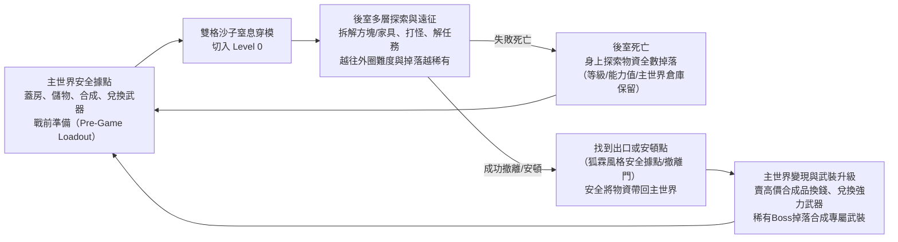

# 後室生存撤離 RPG 總體玩法企劃書（Gameplay & Systems Master Plan）

> **2026-11-25 方向改變**：遊戲改成以恐怖、逃離後室為主（不是為了變強去後室刷資源），能力值與怪物數值也改了。跟這份衝突的地方以 [docs/HORROR_ESCAPE_PLAN.md](HORROR_ESCAPE_PLAN.md) 為準。

> **文件定位**：本企劃書整理 `noclip_backrooms` 模組之完整核心玩法循環、戰前準備系統、樓層解鎖條件、經濟與 NPC 任務、無限地圖距離難度曲線、角色 RPG 能力值／職業規劃，以及純客戶端渲染之理智幻覺系統。  
> **關聯設計文件**：
> - 合成、拆解、工具階梯與五大武器藍圖：[docs/crafting/README.md](crafting/README.md)
> - 60+ 後室樓層索引與命名規範：[docs/levels/README.md](levels/README.md)
> - 協作與套件架構交接書：[docs/PROJECT_PLAN_FOR_CLAUDE.md](PROJECT_PLAN_FOR_CLAUDE.md)

---

## 一、核心玩法循環：主世界據點 × 後室撤離尋寶（Extraction-RPG Loop）

本模組將 Minecraft 的「主世界自由建設」與「後室高壓撤離尋寶（Extraction）」結合，形成長期可遊玩的成長閉環：

### 1. 主世界：永久安全據點
- 玩家在主世界保有完整的 Minecraft 生存與建築自由：可建造基地、倉庫、工作站區、裝備展示牆與商人交易小屋。
- 主世界內理智值（Sanity）自動穩步回復，且主世界倉庫中的物資不受後室死亡懲罰影響。

### 2. 切入後室：雙格沙子穿模入口
- 玩家於主世界透過「頭頂落下兩格沙子造成牆內窒息」（既有 `level0/Noclip.java` 機制）觸發現實錯位，無縫切入 **Level 0**。
- 進入後室前，玩家可先於主世界完成「戰前準備（Pre-Game Loadout）」以決定本次攜帶的裝備、補給與風險承擔。

### 3. 後室探索：高密度收集與環境拆解
- 解決目前後室空間偏空的體感，大幅強化「到處皆可搜刮與拆解」的元素：
  - 既有壁紙、地毯、日光燈、老電腦、貨架、水管、配電櫃、廢棄車輛與異常穿模家具皆可透過對應工具拆解成細緻素材（見 [docs/crafting/01_materials_and_props.md](crafting/01_materials_and_props.md)）。
  - 搭配各工作站合成出高階工具、生存補給、高價值貿易加工品與強大武器。

### 4. 死亡懲罰與撤離安頓機制
- **死亡高風險**：在後室維度中死亡時，玩家身上於本次探索取得的物資將噴光掉落（主世界倉庫、已寄放於安頓點的物資、角色等級與能力值點數不受影響；後續配合戰前準備系統可提供少量「保險格」保留關鍵鑰匙卡）。
- **出口與安頓撤離**：
  - 找到通往主世界的正式出口（如 Level 1 鐵製出口門或其他樓層回程門），即可安全帶著整背包物資返回主世界。
  - 參考《狐霖的後室》的**安頓據點**概念：在特定安全據點（如 Level 1「第一道光」、馬尼拉房間或後續層級安全屋）安頓休息時，除了設定臨時重生點外，也可透過據點物資寄存箱／撤離通道將收集到的素材安全轉運回主世界倉庫。

---

## 二、戰前準備系統（Pre-Game Loadout System）

玩家在主世界據點跳進沙子切入後室前，可透過「戰前整備台／整備選單」進行出征配置：

1. **裝備預設配置（Loadout Presets）**：支援儲存 3～5 套快速換裝方案（例如：初期輕裝拾荒組、中階槍械攻堅組、法師理智控管組），一鍵從據點儲物箱裝填出發。
2. **出征風險檢查清單**：出發前檢視攜帶照明（手電筒／火把）、理智回復物（杏仁水）、拆解工具階級（Tier 1～4）、解鎖憑證（鑰匙卡）與目前理智值。
3. **保險安全格（Secure Case）**：提供 1～4 格隨進度解鎖的綁定槽位，放入其中的樓層鑰匙卡、任務信件或極少數核心 Boss 掉落物在後室死亡時不會噴失。
4. **職業與被動整頓**：進入後室前可在主世界安全切換已解鎖職業（例如切換為「法師」並裝配對應法杖與法術卷軸）。

---

## 三、多樓層條件解鎖系統（Gated Level Progression）

並非所有後室樓層皆可無條件直接進入；除一般探索型出口外，特定高回報／關鍵樓層需滿足解鎖條件（擴充 `core/LevelExits.java` 支援 `ExitCondition`）：

| 解鎖類型 | 機制說明 | 範例場景 |
|---|---|---|
| **擊敗當層 Boss** | 該樓層的進階出口封印於 Boss 死亡後解除，或由 Boss 掉落通行核心 | 擊敗 Level 5 **第五層野獸紳士（Entity 18）** 取得「酒店主鑰匙」解鎖深層入口 |
| **鑰匙卡／特殊憑證** | 出口門禁需手持或消耗特定門禁卡、C.L.I.P.P. 卡或異常鑰匙 | M.E.G. 藍卡、Level 3 變電站檢修卡、Level 4 行政電梯磁卡 |
| **修復設施機關** | 需攜帶拆解素材（銅線、電池、保險絲、合金）修復當層發電機、電梯或管線閥門 | 修復 Level 1 備用發電機、重啟 Level 3 電梯配電盤 |
| **NPC 任務解鎖** | 完成指定 NPC 委託（遞送、救援、調查）後獲得通行密碼或隱藏門座標 | 協助迷路小女孩抵達安全據點、完成據點間加密送信任務 |

---

## 四、經濟系統、商人貿易與 NPC 任務鏈

### 1. 貨幣與高價值合成貿易
- **貨幣單位**：建立跨據點通用的「後室信用點（Backrooms Credits / 實體票券或電子帳戶餘額）」，與既有實體交易物「合金（`alloy`）」並存。
- **加工增值循環**：普通後室拆解素材直接販售價格偏低，但透過工作站加工成高價值成品（如純化杏仁精粹、修復伺服器主機板、封裝實體組織標本、修復古董鐘錶）賣給商人，可獲得高額利潤。

### 2. 主世界武器兌換與稀有合成
- **主世界軍需／黑市商人**：常駐或可召喚於玩家主世界據點，接受「後室貨幣 ＋ 指定後室稀有素材」直接兌換強力現代／異常武器、高階防具與戰術藍圖。
- **稀有掉落合成**：最頂級武器（包含中／西式傳說冷兵器、實驗槍械與**法師專屬法杖**）必須使用外圈精英怪或**多位不同樓層 Boss 的專屬掉落物**，在主世界工作站／異常煉成壇合成，或搭配極高價後室戰利品於主世界兌換。

### 3. NPC 與多樣化任務系統
- **據點委託（送信／運補任務）**：在主世界與後室各據點（M.E.G. 第一道光、商人之家、Base Gamma 等）接取任務，如將重要信件、電池或藥品送到指定座標或跨樓層據點。
- **受困倖存者支線（例：掉進後室的小女孩、迷途流浪者、失聯研究員）**：
  - 在後室深處或特定房間偶遇其他一樣誤入後室的角色（例如抱著玩偶躲在角落的小女孩）。
  - 任務形式包含：提供杏仁水／食物安撫、幫她找回遺失物品、護送她躲開怪物抵達最近據點或出口。
  - 完成報酬：大量 RPG 經驗值、貨幣、稀有裝飾／飾品、特殊樓層通行線索或獨特交易折扣。

---

## 五、無限地圖距離難度與稀有掉落曲線（Radial Difficulty Scaling）

針對後室無限延伸的地形特性，以各樓層降落點／原點 `(0, 0)` 為中心，依水平距離 `R = hypot(x, z)` 劃分動態難度階梯：

| 距離區帶 | 半徑範圍（格） | 怪物強度倍率 | 生成密度與種類 | 掉落物與地圖寶箱稀有度 |
|---|---|---|---|---|
| **Zone 0（近郊帶）** | `0 ～ 250` | `1.0x` | 基礎密度；以常見實體為主（獵犬、微笑者、無面靈） | 基礎拆解素材、少量合金、普通補給箱 |
| **Zone 1（外環帶）** | `250 ～ 750` | 血量 `1.35x` / 攻 `1.2x` | 密度提高；開始出現竊皮者、悲屍、肢叢、死亡飛蛾 | 中階精密零件、進階武器藍圖碎片、較高貨幣掉落 |
| **Zone 2（深淵帶）** | `750 ～ 1600` | 血量 `1.85x` / 攻 `1.5x` | 精英化詞綴實體、成群獵殺；出現無盡之菌、竊骨者、派對客 | 稀有異常核心、高純度素材、軍械寶箱機率大幅提升 |
| **Zone 3+（禁忌外圈）** | `1600+` | 血量 `2.5x+` / 攻 `1.9x+` | 高壓危險實體與野外頭目／巡邏 Boss | 外圈限定傳說合成素材、頂級法杖／神兵兌換憑證 |

> 結合撤離玩法：走得越遠，帶回主世界的物資越珍貴，但距離撤離出口也越遠、理智壓力越高，迫使玩家權衡「見好就收」或「深入搏大獎」。

---

## 六、角色能力值、等級加點與職業系統

### 1. 基礎角色能力值（Phase A 已實作地基）
玩家打開背包即可檢視角色面板，升級獲得自由屬性點後點擊 `+` 即時強化：

| 屬性 | 代號 | 實質效果（每點成長） | 設計定位 |
|---|---|---|---|
| **力量** | `STR` | 近戰攻擊傷害 `+0.5`（後續延伸破甲與重武器需求） | 冷兵器／近戰清怪輸出 |
| **敏捷** | `AGI` | 移動速度 `+2.5%`、攻擊速度 `+4%`（後續延伸閃避／換彈） | 跑酷甩怪、撤離逃生與快攻 |
| **體質** | `VIT` | 最大生命值 `+2.0`（+1 顆心）、護甲韌性 `+0.25` | 承傷容錯、抗外圈高攻怪物 |
| **理智** | `SAN` | 最大理智上限 `+10`、理智流失抗性 `+6%`、回復速率 `+8%` | 延緩精神崩潰；**後續兼作法師魔力池** |

### 2. 等級與配點規則
- 擊殺後室怪物、原版怪物、Boss 或完成任務皆可累積 **RPG 經驗值（與原版附魔經驗獨立，死亡不清空）**。
- 升級公式：`升級所需經驗 = 60 + (目前等級 - 1) × 45`；每升 1 級獲得 **3 點自由屬性點**（新角色初始給予 3 點供開局配點）。

### 3. 後續職業系統與「法師」規劃（Phase D）
預留角色職業槽位（開局為「流浪者」，可於主世界或任務解鎖轉職）：
- **法師（Arcanist / Anomaly Mage）**：
  - **大氣粒子吸收被動**：能從周圍空氣吸收異常粒子，**理智值自然回復速度大幅高於其他職業**（在後室微光／異常區也能持續回氣）。
  - **理智施法機制（高風險回報）**：施放法術（閃電弧、護盾、驅暗光球、空間推斥等）**直接消耗理智值**。若連續施法過度導致理智跌破 30%，法師自己就會立刻陷入幻覺危機！
  - **專屬武器「法杖（Staves）」**：僅法師能完全發揮威力；高階法杖須透過**擊倒數隻不同樓層 Boss 的掉落核心合成**，或在**主世界以稀有後室戰利品兌換**取得。
- **其他後續可擴充職業**：近戰先鋒（強化 `STR/VIT` 與格擋）、拾荒工匠（提高拆解產出與修理效率）、斥候（強化 `AGI`、夜間感知與撤離導航）。

---

## 七、個人介面 UI 改造與純客戶端理智幻覺系統（Phase A 已實作）

### 1. 下方狀態列 HUD 改造
- 保留原版血條與飽食度條，並於下方右側狀態列整合新增專屬 **理智值計量條（Sanity Bar）**（潛水氣泡出現時自動上移避讓，不重疊）。
- 理智值顏色隨精神狀態動態變化：
  - `>= 60%`：冷靜青藍色
  - `30% ～ 59%`：不安紫藍色
  - `< 30%`：**危險暗紅／紫紅色**，狀態條開始微幅抖動並於畫面四周浮現脈動暗角警告。

### 2. 背包角色狀態與加點面板
- 打開原版背包（`InventoryScreen`）時，於左側（若開啟合成書則自動平滑移至右側）展開專屬 **「後室流浪者狀態面板」**。
- 即時顯示：等級、RPG 經驗條、目前理智值、剩餘可配點數、四項能力值（STR / AGI / VIT / SAN）與對應實際數值加成，並內建 4 顆 `+` 按鈕點擊即向伺服器發送加點驗證並即時生效。

### 3. 純客戶端渲染理智幻覺（Client-Side Only Hallucinations）
- **核心原則**：理智低於 **30%** 後，所有幻覺的生成、移動、音效與模型替換**完全只在該低理智玩家的客戶端（Client-side）執行與渲染**；伺服器端完全沒有該幻覺實體，其他隊友的畫面也完全不會出現。
- **兩大恐怖幻覺演出**：
  1. **幻覺怪物追殺**：僅在低理智玩家 A 的本機世界（`ClientLevel`）中於視野邊緣生成後室怪物幻影（微笑者、獵犬、無盡之菌、竊皮者、派對客、悲屍等），伴隨僅 A 聽得見的低語與腳步衝向 A。當 A 驚恐朝幻影揮刀時，幻影會發出扭曲尖嘯化作黑煙消散——而隊友 B 看到的則是 **A 對著空無一物的空氣瘋狂揮刀**。
  2. **隊友變形怪物**：在低理智玩家 A 的客戶端渲染層（`EntityRenderDispatcher`），視野內的其他玩家（隊友 B）會被即時替換渲染為完整的 3D 後室怪物模型（並隱藏隊友 ID 名牌），跟著隊友 B 的腳步與動作逼近；隊友 B 與其他理智正常的玩家完全看不到異狀。

---

## 八、分期實作路線圖

| 階段 | 範圍 | 狀態 |
|---|---|---|
| **Phase A（RPG 能力值、個人 UI 與純客戶端理智幻覺）** | `core/rpg/` 持久化資料與屬性加成、下方 HUD 理智條、背包屬性加點面板、理智低於 30% 純客戶端幻覺怪物＋隊友變形渲染、杏仁水回理智、測試指令 `/backrooms sanity` & `/backrooms stats` | **本次實作完成** |
| **Phase B（撤離循環、戰前準備與距離難度）** | 後室死亡掉落規則 vs. 主世界安全保護、安頓點物資撤離箱、戰前準備介面與保險格、依距離原點半徑動態強化怪物屬性／數量／稀有掉落 | 下一階段 |
| **Phase C（拆解與合成系統 v1）** | 銜接 [docs/crafting/README.md](crafting/README.md)：拆解台、改裝鍛造台、異常穿模家具、Tier 1～4 工具、獨立《後室合成圖鑑》UI 與首批武器 | 緊接 Phase B 或並行 |
| **Phase D（經濟商人、任務鏈、門禁解鎖與職業法師）** | 貨幣與主世界武器兌換商人、高價值加工品收購、送信／受困小女孩 NPC 任務、`LevelExits` 條件解鎖（Boss/鑰匙卡/修發電機）、法師職業與多 Boss 核心法杖 | 後續擴充 |
