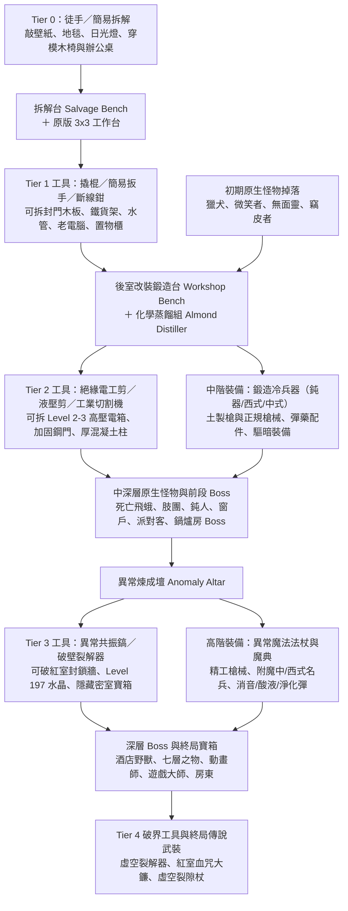

# 後室超大合成與進度系統總覽（Crafting Master Plan）

本系列文件規劃 `noclip_backrooms` 模組的完整生存、拆解、怪物掉落、工具階梯、五大武器體系與獨立合成圖鑑系統。所有規劃均直接銜接目前既有的 Level 0／Level 1 方塊、道具（`flashlight`、`almond_water`、`alloy`、`phosphor_powder`）與怪物（`hound`、微笑者、掠奪者）。

---

## 文件導覽

| 檔案 | 內容涵蓋 |
|---|---|
| [01_materials_and_props.md](01_materials_and_props.md) | 既有方塊拆解掉落表、24 種異常穿模家具（No-Clipped Props）、70+ 種基礎與進階加工素材總表 |
| [02_monsters_bosses_loot.md](02_monsters_bosses_loot.md) | 26 種原生後室實體（統一 `BoxRig` 標準）、10 隻樓層 Boss、專屬掉落物與 5 種樓層寶箱池 |
| [03_tools_and_stations.md](03_tools_and_stations.md) | Tier 0–4 階梯式特殊破壞工具、5 座工作站、求生防具與消耗道具完整細緻合成表 |
| [04_weapons_melee.md](04_weapons_melee.md) | 冷兵器鍛造零件系統 ＋ 中世紀鈍器（12 把）、西式冷兵器（14 把）、中式冷兵器（16 把）共 42 把 |
| [05_weapons_firearms.md](05_weapons_firearms.md) | 槍械精密零件樹 ＋ 熱兵器與實驗槍（18 把）＋ 細緻彈藥鏈 ＋ 戰術改裝配件 |
| [06_weapons_magic_and_chests.md](06_weapons_magic_and_chests.md) | 魔法與異常超自然武器（18 件）＋ 樓層寶箱／Boss 專屬掉落與藍圖對照總表 |

---

## 整體進度科技樹（Tier 0 → Tier 4）

---

## 五大工作站系統

為支撐細緻零件合成而不讓 3×3 格子過於擁擠，工作站分五級：

1. **原版工作台（Crafting Table，3×3）**
   - 處理初期求生用品、基礎原料整合（如現有 `4 合金 → 1 鐵錠`）、Tier 1 基礎工具與土製武器。
2. **後室拆解台（`salvage_bench`）**
   - 1 輸入槽 → 最多 6 輸出槽（帶機率表）。
   - 將敲下來的破損家具、老電腦、破損日光燈、多餘寶箱武器與怪物殘骸細緻拆解成電子／金屬／生物元件。
3. **後室改裝與鍛造台（`workshop_bench`）**
   - 支援 **4×4 精密網格**（或「藍圖槽＋零件組裝槽」雙模式，視實作介面決定）。
   - 負責所有精密冷兵器鍛造、槍械分件組裝、戰術配件安裝、子彈壓裝、Tier 2 工具與防具製作。
4. **杏仁蒸餾與化學組（`almond_distiller`）**
   - 液體槽（杏仁水／機油／強酸）＋ 固體觸媒槽 ＋ 加熱槽（油桶燃料／碳／電池）。
   - 提純杏仁精粹、製作無煙火藥、酸液塗層、磷粉照明劑、醫療與抗精神污染藥劑。
5. **異常煉成壇（`anomaly_altar`）**
   - 中央核心槽 ＋ 外圍 4～8 原料槽（需消耗純化杏仁精粹或異常能量）。
   - 專責 Tier 3／Tier 4 破界工具、全部魔法／異常超自然武器，以及 Boss 核心傳說武器合成。

---

## 雙軌破壞與採集原則

為避免破壞後室建築感與建築黨體驗，採取**雙軌掉落規則**：
- **一般破壞（或持對應 Tier 工具）**：依方塊／穿模家具的拆解表掉落細緻素材（例如敲日光燈掉銅線＋燈管碎片＋螢光粉）。
- **精準採集（Silk Touch）**：掉落方塊本體，方便玩家帶回據點裝潢。
- **工具階級不足**：
  - 未持有對應 Tier 工具（由自訂方塊標籤 `noclip_backrooms:requires_tier_1` ～ `requires_tier_4` 控制）時，方塊挖掘速度極慢且**不掉落素材**，並在 ActionBar 提示所需工具類型（例如「需要撬棍或更高階工具拆解」）。
- **絕對不可破壞例外**：跨樓層出口門、EXIT 門、據點置物櫃與世界基岩外殼維持不可破壞。

---

## 遊戲內「獨立合成表」系統規格（《後室合成圖鑑》）

使用者要求合成表需獨立做出來，採用**「資料驅動＋內建獨立 UI＋相容 JEI/REI」**三合一架構：

1. **獨立資料來源（Single Source of Truth）**
   - 所有標準工作台配方照寫標準 Minecraft `data/noclip_backrooms/recipe/*.json`（確保玩家若安裝 JEI / REI / EMI 也能自動讀取）。
   - 進階工作站（拆解台、改裝鍛造台、化學組、異常煉成壇）皆實作為標準 Minecraft `RecipeType` ＋ `RecipeSerializer`，同樣以 JSON 存放在 `data/noclip_backrooms/recipe/`。
   - 額外補一份來源索引（自動從 LootTable / Recipe 掃描生成，不必人工維護兩份）：記錄每個素材來自「哪個方塊（需哪階工具）」、「哪隻怪／Boss」或「哪種樓層寶箱」。
2. **遊戲內獨立查詢 UI：《後室合成圖鑑（`backrooms_compendium`）》**
   - **開啟方式**：隨身書本道具（初次掉進 Level 0 或在據點／馬尼拉房間拾取，也能徒手用壁紙碎紙合成）**或按獨立快捷鍵（預設 `B`）直接開啟**。
   - **左側分類分頁**：
     1. 基礎與拆解素材
     2. 工具與工作站（依 Tier 0–4 排列）
     3. 中世紀鈍器
     4. 西式冷兵器
     5. 中式冷兵器
     6. 熱兵器、彈藥與配件
     7. 魔法與異常武器
     8. 防具、藥劑與求生道具
     9. 怪物圖鑑與掉落（含 Boss 與寶箱）
   - **右側詳情頁功能**：
     - 顯示完整合成格（自動依工作站類型切換 3×3 / 4×4 / 拆解 / 蒸餾 / 煉成版面）。
     - **點擊任一原料可直接跳轉**到該原料的下一層合成表或取得來源頁（支援返回上一頁歷史棧）。
     - 顯示「此素材可用於合成哪些成品（反查用途）」。
     - 支援中文／英文關鍵字搜尋與依樓層篩選（例如只看「Level 0–1 目前做得出的東西」）。

---

## 建議分期實作路線

| 階段 | 範圍 | 目標 |
|---|---|---|
| **Phase 1（系統骨架）** | 拆解台、改裝台、Tier 1 工具（撬棍/扳手）、《合成圖鑑》UI 框架、Level 0/1 穿模家具 6 種、五大類各 2 把代表武器 | 在既有 Level 0 & 1 完整跑通「敲家具 → 拆素材 → 查圖鑑 → 做工具與武器 → 打獵犬」閉環 |
| **Phase 2（原生怪軍團）** | 第一批 8 種原生怪物（Blender `BoxRig` 統一風格）＋ 專屬掉落 ＋ 蒸餾組 ＋ Tier 2 工具與槍械彈藥鏈 | 補齊 Level 0–5 生態與完整槍械／冷兵器鍛造樹 |
| **Phase 3（異常與 Boss）** | 異常煉成壇 ＋ Tier 3 工具 ＋ 魔法武器全系 ＋ 前 5 隻樓層 Boss 與軍械／異常寶箱 | 銜接 Level 2–5、Level 37、Level 94、Level 188 等新樓層 |
| **Phase 4（深層終局）** | 第二批怪物、深層 Boss、Tier 4 破界工具與全部傳說武裝 | 貫通全 60 層規劃進度 |

---

## 企劃書對齊紀錄（2026-11-25 對齊 `docs/企劃書/backrooms_mod_design_spec.md` 與 `docs/levels/MATERIALS.md`）

為與最新版最高指導企劃書及各樓層拆解清單保持 100% 同步，系統已完成以下對齊與實裝（全數附帶 3D 模型、64×64 多材質貼圖、JEI 索引與中英文翻譯）：

- **新增第 5 座頂級工作站與 6 座主世界／中繼站設施**：`spiderweb_crafting_table`（超大型蜘蛛網合成台，融合後室核心＋科技積木＋原版物資，支援最高 9 格原料與獨立 JEI 分類）、`scrap_recycler`、`anomaly_distillery_barrel`、`anomaly_research_terminal`、`crystal_replicator`、`anomaly_archive_board`、`relay_dropoff_box`。
- **補齊 20 種 Level 0 與 `MATERIALS.md` 可破壞 3D 家具與變體方塊**：桌上型電腦（完好／損壞／穿模）、手機（完好／螢幕裂／穿模）、完好辦公椅、發霉雙人沙發（完好／穿模）、辦公室玻璃隔間（完好／破損）、倒扣折疊椅雜物堆、窗簾布堆、落地全身鏡、塑膠假盆栽、老舊電風扇、泛黃微波爐、落地立燈、生鏽壁掛舊急救箱、紙箱雜物山，均已接入拆解台配方。
- **補齊 73 種企劃書與樓層專屬物品**：
  - Level 0 辦公文具、家電零件與陽春醫療／糧食（破布、斷裂桌腳、一盒螺絲與釘子、絕緣膠帶、強力膠、訂書機、原子筆、橡皮筋球、雜誌、破碎鏡片、機殼風扇、靜電顯像管、閃爍日光燈管、鍵盤、室內電話、空塑膠瓶、無菌紗布、外用酒精、老舊 OK 繃、過期止痛藥、過期罐頭、壓縮餅乾、乾燥泥土與枯萎草藥、土製鎮靜飲品）。
  - 貿易品、盲盒、撤離與深層獎勵（雜訊錄音帶、遺失舊幣、鏽死辦公保險箱、加密硬碟、切出裂片、火鹽、笑魘發光眼珠、生鏽樓梯間鑰匙、樓層通行鑰匙卡、修復的復古終端機、陳年精釀杏仁露、單向歸鄉錨釘、禁忌知識卷軸×3）。
  - 《異星工廠》三色電路（綠／紅／藍板）、三色研究瓶（黃／灰／紫瓶）、三種插件晶片（速度／產能／節能），與《非生物因素》科技積木（電源磚、計算磚、控制器）、精密拆解螺絲起子、密碼門駭客器 Tier 1–4。
  - 早期實戰裝備（粗糙／消毒繃帶、土製燃燒瓶、戰術轉角鏡、辦公室十字弓＋原子筆金屬弩箭、靜電脈衝法杖、3D 穿戴雜誌膠帶護甲與消音地毯潛行靴）及 `MATERIALS.md` 汽車輪胎、橡膠輸送帶與六階玻璃系列。
- **統一物品標籤（`data/noclip_backrooms/tags/item/`）**：建立 `electronics`、`scrap_metal`、`office_junk`、`cloth`、`wood_scrap`、`glass_tier`、`circuits`、`science_packs`、`geodes` 共 9 組標籤。
