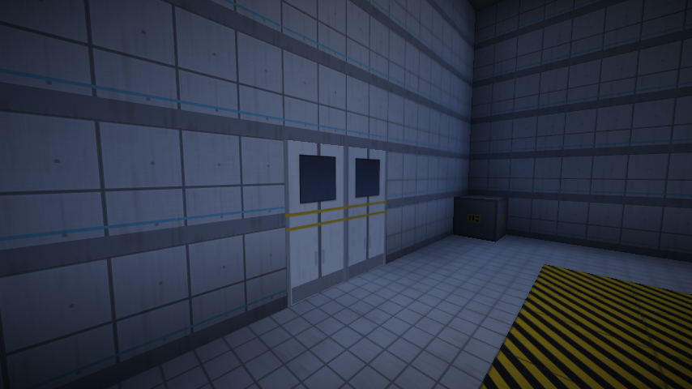
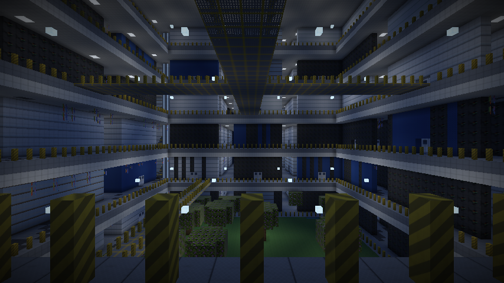
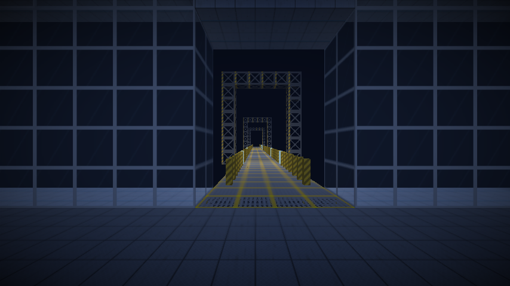
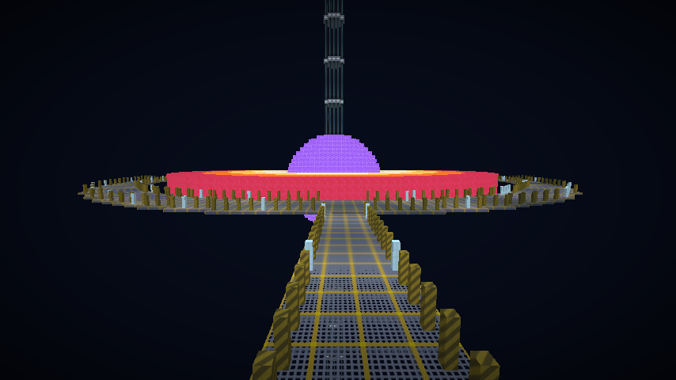
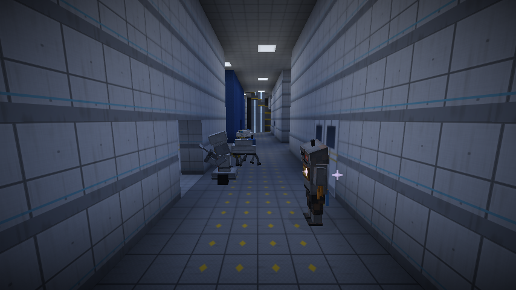
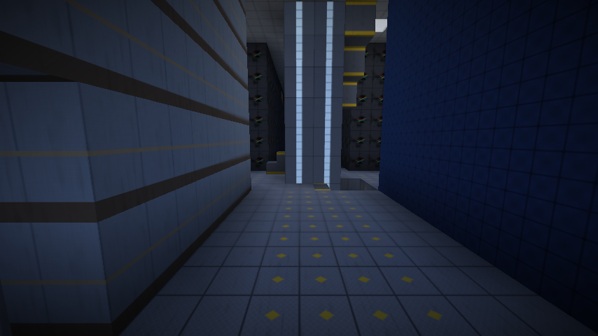

# Level 0.1：天頂站（Zenith Station）

- **分類**：Level 0 的子樓層（第一個做出來的子樓層，共用做法見根目錄 `README.md` 的「子樓層」）
- **目前狀態**：已開放
- **資料夾與 Java 套件**：`dev.noclip.backrooms.level0p1`
- **維度 ID**：`noclip_backrooms:level_0.1`
- **出口登記鍵（`LevelExits`）**：`"0.1"`（父層 `"0"`）
- **原文**：[Backrooms 中文維基 Level 0.1](https://backrooms-wiki-cn.wikidot.com/level-0-1)（作者 CutTheBirch，譯者 Ambersight，生存難度 0）

## 原文怎麼說

一座被 Level 0 整個吞進去的巨大太空站：鋼鐵與玻璃的未來風，主體嚴重損壞。形狀推測是極大的球形殼體，殼厚到「幾乎能與數十條城市街區的寬度相當」，中間有一個巨大的空心區域。殼裡有大量臥室、廚房、健身室、水培溫室，用自動推拉門相連；機器人到處晃，少數還在清潔、烹飪。多數艙室燈亮、室溫，受損區域全黑，偶爾冷或熱到接近致死。天花板持續嗡鳴，有警報和自動廣播（「請保持冷靜」）。原文沒有任何怪物，也沒有據點；M.E.G. 勸人別為了材料進去，B.N.T.G. 有可靠的進入方法。入口幾乎不可能偶然遇到；出口回 Level 0，或「隨機切出」到 Level 1（偶爾回 Level 0）。

背景故事：科學家 Rhea Valpri 在天頂站做愛因斯坦–羅森橋（蟲洞）實驗，失敗後整座站被蟲洞吞進去，她最後獨自在黃色長廊裡哭。

## 遊戲裡怎麼做

### 形狀：真的做成一顆球

球心在世界座標 (0, 0, 0)，維度高度 1024（`min_y = -512`），是目前最高、最大的一層。

| 部分 | 半徑 | 內容 |
|---|---|---|
| 外殼 | 477–480 | 外殼板與肋條，不可破壞，什麼都出不去 |
| 殼體 | 189–477 | 約 290 格厚、每 8 格一層甲板（共 120 層上下），模組格子：每 16×16 一格，兩側是 4 格寬走廊，其餘是 10×10 的房間 |
| 隔艙壁 | 188–189 | 一格厚，有寬拱門 |
| 環廊 | 178–188 | 10 格寬、沿內殼彎曲的長街，內側整排窗 |
| 內殼 | 176–178 | 兩格厚，幾乎都是觀景玻璃 |
| 中央空洞 | 0–176 | 奇點、電漿圓盤、步道、大樑環、底部冷卻水湖 |

- **房間**：臥室、廚房、健身室、水培溫室、控制室、機房、儲藏室、空房、毀損房、氣閘室。每個房間中間留十字通道，四個 4×4 象限擺家具，所以門一定走得進去。
- **自動門**：靠近 3 格內自動滑開，離開後自己關上（`ZenithDoors`）。
- **樓梯**：每 48×48 的角落有一座螺旋梯，繞著發亮的中柱，每圈上一層甲板，從最底到最頂都接得上（單元測試走過）。
- **中庭（水培大廳）**：約十分之一的 48×48×48 區塊是挖空的大廳，有苔蘚地、小池塘、開花杜鵑樹、天橋和懸浮光球，四周有欄杆走道和各層門。
- **損壞區**：48×48 格、3 層高一塊，燈全死、牆破、電纜垂下；其中一部分冷到會結霜（1 區），一部分熱到餓得快（2 區），待滿 30 秒開始減速（`ZenithClimate`）。
- **中央空洞**：四條「輻條」從赤道甲板的走廊筆直穿過環廊、內殼的門洞，伸到奇點外圈的步道；中心是白熱的奇點與四層顏色的電漿圓盤，另有四個大樑環、一根從奇點貫穿到頂的繫纜、底部深 18 格的冷卻水湖（掉下去不會摔死）。
- **氣候與聲音**：嗡鳴、遠處警報、金屬嘎吱聲，以及不定時的站內廣播（聊天欄文字，內容來自原文的「請保持冷靜」和故事）。

### 出入口

| | 怎麼走 |
|---|---|
| **進來（找）** | Level 0 每個 1 公里見方的區塊，有一半會在一面牆裡藏一扇白色艙門（`station_hatch`），區塊載入時放進去，不影響能走的路（`ZenithEntrance`） |
| **進來（捷徑）** | B.N.T.G. 信標（`bntg_beacon`）：在 Level 0 右鍵使用，直接進站、信標用掉。合成：末影珍珠＋2 合金＋紅石（粉） |
| **出去** | 氣閘室中間的黃色門框（`yellow_doorway`），右鍵回 Level 0；氣閘室都在靠近外殼的地方 |
| **隨機切出** | 毀損房裡偶爾有「雜訊裂縫」（`static_tear`），右鍵：85% 掉進 Level 1、15% 回 Level 0 |

進站時落在最靠近玩家座標方向的氣閘室。

### 機器人

原文說房間裡有機器人（七足清洗機器人等），都是中立的環境角色，不攻擊。三種都用 Blender 建模（`tools/make_robots.py` 產生規格與貼圖，`tools/blender_robots.py` 在 Blender 5.3 的 bpy 組出 `art/robots/robots.blend` 與預覽圖），格式跟獵犬、居民一樣（BoxRig）：

| 機器人 | 長相與動作 | 出現在 |
|---|---|---|
| 七足清洗機器人（`robot_cleaner`） | 低矮圓頂、保險桿有警示條、七條小腳、前面一支滾刷（一直轉）、背後水箱；走路七條腿輪流動 | 走廊、一般房間 |
| 廚房機器人（`robot_chef`） | 輪子底盤、廚師帽、圍裙、琥珀色雙眼；站著時右手攪拌 | 廚房 |
| 壞掉的服務機器人（`robot_servant`） | 髒污生鏽、一隻眼壞掉一隻紅眼、左臂被扯斷露出電線、背後垂電纜；站著歪頭，偶爾抽搐，會冒火花 | 毀損房、冷／熱／暗的損壞區 |

牠們會閒逛、看你一眼，不會攻擊也不會鎖定目標；遠離玩家就消失。`ZenithRobots` 每 4 秒檢查一次，玩家附近少於 5 隻就在看不到的地方生一隻（可用 `/summon noclip_backrooms:robot_cleaner` 等自己叫出來）。

## 還沒做 / 之後

- 站內材料的合成（交給 Antigravity 的合成系統；目前只有方塊本身）。
- 視聽幻覺（跟 Level 0 的一樣）、導航失效。

## 檔案

- `ZenithLayout`：整座站的形狀，純函式、可單元測試（`ZenithLayoutTest`：上樓、走廊走到中央、降落點、氣閘門、外殼封閉）。
- `ZenithChunkGenerator`、`ZenithBlocks`：生成與方塊。
- `ZenithDoors`、`ZenithClimate`、`ZenithAmbience`、`ZenithTravel`、`ZenithEntrance`、`ZenithItems`、`ZenithSounds`。
- 工具：`tools/make_level0p1.py`（貼圖、模型、blockstates、物品、掉落物表、語言、音效與挖掘標籤），預覽 `docs/levels/level0p1/textures.png`。
- 遊戲實測：`src/gametest/.../level0p1/Level0p1ClientTest`。

## 實機畫面

用 `Level0p1ClientTest` 在真的遊戲客戶端拍的（`screens/`）：氣閘室、廚房、螺旋梯、水培大廳、天橋、通往中央的門洞、奇點與電漿圓盤、機器人；`preview_*.png` 是 Blender 渲染的機器人。

| | |
|---|---|
|  |  |
|  |  |
|  |  |
