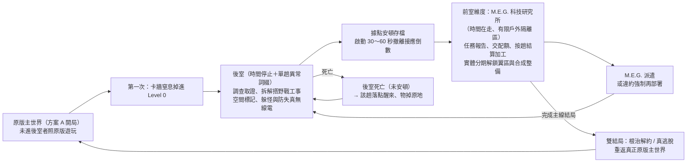

# 遊戲玩法

> 這一章說明這個模組怎麼玩：故事背景、一輪一輪的循環、時間與配額、在後室裡的層數與難度、死亡、安頓與撤離、主世界的前哨、經濟與任務。標示說明見 [企劃書總目錄](../README.md)。
> 2026-11-25 起遊戲方向改成**恐怖、逃離後室**；舊企劃裡「主世界是絕對安全的大本營」「為了變強去後室刷資源」的部分都已照新方向改寫。

## 一句話

**你是不小心掉進後室的 M.E.G. 調查員。** 每一趟的目標是完成現場調查、在接應倒數中活著撤離；但撤離後你並不是回到原本的家，而是被檢疫隔離在跑不出去的「前室」科技研究所裡——身體和雇主都不會讓你待太久。後室裡要命，前室裡要時間。

## 故事背景

### M.E.G. 與你

後室（The Backrooms）是現實的背面。從現實的縫隙「穿」出去（noclip）的人，會掉進一層又一層無盡、空曠、嗡嗡作響的空間。後室的 wiki 裡，**M.E.G.**（Major Explorer Group，主要探險者團體）是在後室裡活動最久的組織之一：他們在各層建據點、畫地圖、記錄實體。

在這個模組裡，你在原版主世界過著原本的生活；某次意外卡進牆裡（窒息切出），醒來時已經躺在潮濕的黃色地毯上，頭頂的日光燈嗡嗡作響——這是 Level 0。當你第一次透過據點或逃生出口撤離出來時，M.E.G. 攔截並接管了你：他們以「你已沾染悲屍化風險」為由，將你收容進一座與世隔絕的科技機構——**前室（The Frontrooms）M.E.G. 檢疫研究所**，強制把你編為外勤調查員。

### 後室沒有時間

後室跟原本的世界是隔開的，裡面沒有時間的概念，不分白天黑夜，也沒有日期。你在裡面待多久都一樣。

但在前室（與地面上）的時間一直在走。從後室出來的人，身上都帶著後室的「痕跡」。

### 悲屍化（Wretch Cycle）

後室 wiki 裡，待在後室太久的人會慢慢失去理智、脫水、變形，最後變成**悲屍**（Wretch）。在這個模組裡，悲屍化反過來發生在後室之外：

- 你的身體已經沾上後室，現實世界開始排斥你。
- 出來的頭兩天一切正常；之後普通食物越來越填不飽、理智一點一點往下掉、晚上開始看到不該存在的東西。
- 能壓住它的藥，原料只在後室裡；真正能根治的配方，藏在更深、更危險的樓層。

### M.E.G. 不是慈善機構

M.E.G. 把你從後室的據點接回前室研究所，但這不是免費的。你是組織的資產，每個週期都要上繳「調查配額」：現場取證照片、空間測繪資料、怪物樣本、失蹤小隊的檔案、從後室帶出來的物資。交得出來，研究所就會逐步開放醫療、軍械、研發與深層傳送權限；交不出來，研究所各翼區會對你關門，並在隔天日出把你「強制再部署」回後室，丟到哪一層隨機。

### 主線與雙結局：失蹤的小隊與前室真相【定】

你不是第一個掉進去的調查員。在你之前，有一整支 M.E.G. 小隊在後室失蹤了。每次任務，你都可能透過無線電、補給箱或深層房間找到他們留下的 5 階段檔案線索。隨著檔案拼湊完整，玩家會面臨兩條明確結局：

1. **結局 A：根治解約**：一路解鎖研究所權限與深層派遣，在深層集齊稀有原料並於 9×9 終極蜘蛛網合成「悲屍化根治藥」，完成最終履約協議，正式解除 M.E.G. 合約並獲准重返真正的原版主世界。
2. **結局 B：違抗與真逃脫（The True Ending）**：透過失蹤小隊殘留線索與無線電異狀，用高階駭客器／鑰匙卡撬開研究所地下 B2 的封鎖檔案室，發現「跑不出去的前室」其實是 M.E.G. 封鎖真正出口、把調查員當異常消耗品的隔離收容假象；玩家繞開研究所管制，從特定深層／隱秘層（如 Level 3999／The Hub）強行逃回真正的原版主世界。

### 後室裡的其他人

後室裡不是只有 M.E.G.。停車場（Level 1）有 M.E.G. 的據點「第一道光」，也有殖民者的據點「眨眼」、商人之家、診所、餐館；Level 2 有 B.N.T.G. 的辦公區；Level 3 有大型 Gamma 基地與其他勢力據點。這些組織的據點都可以讓你安頓與發起撤離接應【定】。

## 核心循環

## 流程與前室總部定案（2026-11-26）【已做大部分】

使用者和 Claude、Gemini（Antigravity）討論後定下的完整架構。底下各節若有舊寫法跟這裡衝突，一律以本節為準。

### 已經做好的（2026-11-26，Claude）

- **前室維度** `noclip_backrooms:frontrooms`：
  - 研究所在正中央，外面是原版自然地形（起伏、樹林、水池、牛羊雞豬，沒有怪物、沒有村莊）；
  - 半徑 100 格有一圈檢疫圍牆（高到 y=100、黃黑警示帶、頂上高壓電網和探照燈、內側警告牌），牆外什麼都沒有；跑出去會被帶回研究所大廳。
  - 時間跟著主世界的時鐘（有白天黑夜，可以睡覺）。
- **研究所**（平面圖在 `frontrooms/InstituteLayout`，64×48 格三層）：
  - 1F：檢疫接待大廳（落點在這裡，正對指揮官的桌子）、收購窗口、補給窗口、個人置物櫃室、西側基礎工作區（黃黑邊地板，可以放東西、拆自己放的東西）、北邊檢疫走廊與三間隔離室、南邊大門與前廣場；
  - 醫療隔離翼（交滿 1 期）：醫官、病床、蒸餾設備；
  - 軍械庫與加工車間（交滿 3 期）：軍需官、武器櫃、車間（工作區，有垃圾回收機、蜘蛛網合成台等）；
  - B1 深層異常傳送廳（交滿 5 期，從 1F 北邊樓梯下去）：三座傳送台（站上去就能申請派遣，不用找指揮官）、研究終端、晶體複製機；
  - B2 機密檔案室：B1 角落的加密艙口，只有 3 階以上的密碼門駭客器打得開（打開後所有人都能下去）；裡面六份機密檔案講「前室的真相」（結局 B 的線索，結局本身還沒做）。
  - 防爆氣密門上面有燈，鎖著是紅的、開了是綠的；交滿配額時全伺服器會收到「某翼區已開放」。
  - 建築本體打不壞（玩家敲不掉、在上面也放不了方塊），只有工作區可以蓋。
- **人員**：指揮官、收購商、補給商、醫官、軍需官各一位，固定在位置上；不見了會自己補回來。
  - 醫官：賣繃帶、杏仁水、抑制藥等；右鍵時會出現「[治療：40 點]」（補滿血和理智、清掉負面效果，`/meg treat`）。
  - 補給商：多了原版基礎材料（煤、鐵、銅、紅石、玻璃、線、種子、樹苗），之後還會賣無線電、粉筆等。
- **所有回家的路都送到研究所**：撤離、Level 0 綠色 EXIT 門、停車場出口門、歸鄉錨釘；舊存檔裡已經在主世界、進過後室的人，登入時會被 M.E.G. 帶進前室。
- **撤離接應倒數**（取代點一下就回家）：在據點點「[呼叫接應]」、按 EXIT 門、用歸鄉錨釘，就開始倒數。
  - 30 秒起跳，這一趟每多一層多 6 秒，最多 60 秒；畫面上方有倒數條。
  - 要待在原地附近（6～12 格內），離開、換層、死掉就取消。
  - 每 2 秒把 40 格內的怪物都引過來；倒數到三分之一和三分之二時，黑暗裡會再冒出獵犬（越深越多）。
- **死亡**照下面的表做好了；主世界或前室死掉時身上的東西收進置物櫃（放不下的先當「遺物」，下次打開置物櫃時自動放進去）。
- **多人同一片後室**：從外面掉進同一層的人落在同一片；全隊離開後室超過 30 秒，下次掉進去才是新的一片。
- **沒進過後室的人**：照原版（血量 20、沒有倒數與配額畫面、不算進配額人數、主世界死掉照原版）。
- **任務報告畫面**：被送回研究所後跳出，列出這一趟走了幾層、經過哪些 Level、帶回的東西照收購價值多少點、配額還差多少、剩幾天、欠款、研究所權限；關掉後出現黃色「任務開始第 N 天」。
- **研究所升級**：照交滿的期數開門（見上），指揮官會說現在幾期、下一個開放什麼；Level 1 以後的樓層要交滿 5 期才能派遣。
- **M.E.G. 無線電**：第一次回到研究所時發一台。帶在身上進後室，每 3～6 分鐘收到一則斷斷續續的廣播：失蹤的第七搜索隊的通訊、這一期要交什麼、剩幾天或欠多少。
  - **失真**：這一趟第 4 層以後、理智低於三成、或附近 32 格有竊皮者時，有四成機率是假的：用隊友的名字喊你過去、報假的撤離點。
- **個人置物櫃**：研究所的置物櫃（54 格），每個人打開都是自己的，死了也不會掉。
- **舊的石造公會**：新世界不再生成；舊存檔的在載入時整棟拆掉（地板變回草地、門口小路變回草地、箱子裡的東西掉在原地、商人離開）。

### 還沒做的

- 研究所加工設施的「按趟結算」、B1 的異常預告廣播、結局 A／B 本身（見「後室進階玩法」和「主線與雙結局」）。

### 整條流程（方案 A 開局）

1. **原版主世界開局**：開新世界後先照原版 Minecraft 遊玩，沒有倒數與配額。在主世界被沙子或方塊卡在牆裡窒息，掉進 Level 0。
2. **後室探索（時間停止）**：每趟帶隨機樓層異常現象，進行現場取證、搜刮拆解、搭野戰工事、找據點安頓。
3. **撤離送往獨立維度「前室」**：啟動撤離接應倒數並撐過後，不會回到原本主世界，而是**被送到獨立維度「前室（The Frontrooms）」的 M.E.G. 科技研究所**（檢疫隔離）。
4. **任務報告與週期開始**：回到研究所時跳出**任務報告畫面**，同時結算「按趟加工」成果；第一次回來時開始第 1 期的 5 天倒數與配額。
5. **前室與後室循環**：在有限的前室科技研究所與戶外隔離區整備、交配額、解鎖新翼區、再由 M.E.G. 派遣回後室。違約隔天日出強制再部署；在前室或原版主世界死掉（進過後室者）會直接掉回新 Level 0。
6. **重返原版主世界**：只有完成結局 A（根治解約）或結局 B（揭露真相、從深層真逃脫），才能真正離開被封鎖的前室回到原本的主世界。

### 獨立維度：前室（The Frontrooms）與 M.E.G. 科技研究所

- **維度定位**：新增獨立維度 `noclip_backrooms:frontrooms`（類似《狐霖的後室》跑不出去的前室），取代原本主世界村莊旁的石造公會。
- **原主世界村莊旁石造公會（`guild`）：直接停用／取代**。新世界不再生成；**舊存檔裡已經生成的整個拆掉**【定】（2026-11-26，連同門口小路與商人，地面補回草地）。原本的 4 位 NPC（收購商、補給商、軍需官、前哨指揮官）、分期開放的醫官、商店、配額與委託，全數遷入前室科技研究所；不再於原版主世界村莊旁生成石造公會。
- **所有回家的路都送到前室研究所**：據點撤離接應、Level 0 的綠色 EXIT 門、停車場的出口門、單向歸鄉錨釘，一律送到前室研究所檢疫接收室。背景設定：所有已知逃生出口皆被 M.E.G. 攔截管制。
- **大型科技感研究所建築（保護區）**：
  - 採用現代／科技研究機構風格（冷白與緊急燈具、混凝土與複合裝甲板、防爆氣密門、門禁讀卡機、觀察窗、檢疫走廊、實驗室與收容槽、深層傳送門廳），格局寬敞分層。
  - **建築本體不可破壞**：防止玩家敲拆科技牆壁／燈具套利或挖穿未解鎖的氣密門；室內規劃**專屬玩家工作區**，允許放置箱子與工作站。
  - **實體分期開門解鎖**（依交滿的配額期數，原本亮紅燈鎖閉的氣密門轉為綠燈開放）：
    - **第 0 期（初始）**：1F 檢疫接待大廳、收購窗口、基礎補給窗口、個人置物櫃室、基礎工作區、大門通往戶外隔離區。
    - **第 1 期達標**：解鎖 **醫療隔離翼**（醫官進駐：治療、賣高階醫療品；開放按趟結算蒸餾研究室）。
    - **第 3 期達標**：解鎖 **軍械庫與加工研發車間**（軍需官進駐＋高階武器測試室；開放按趟結算垃圾回收機、大型工作站區）。
    - **第 5 期達標**：B1 電梯開通，解鎖 **深層異常傳送廳與研究終端**（開放付費派遣至 Level 2、Level 3 與之後深層；開放研究瓶解鎖與異常晶體複製機；高階廣播可提前預告當趟樓層異常現象）。
    - **隱藏區（B2 機密檔案室）**：不靠期數開放，需持高階密碼門駭客器或失蹤小隊鑰匙卡暗中撬開，內藏「前室隔離真相」與結局 B 關鍵線索。
    - 指揮官會說明研究所目前權限等級與下一階段解鎖區域。
- **研究所大門外：有限戶外隔離區（可自由建造）**：
  - 研究所外圍生成一小片外觀近似原版主世界的自然地形（草地、樹林、小水池與可耕地，**半徑約 80～120 格，沒有村莊、沒有其他人煙**）。
  - 邊界由高聳混凝土檢疫圍牆、高壓電網、探照燈、警示牌與檢疫邊界濃霧／空氣牆封鎖，無法走出去。
  - **此戶外區開放玩家自由建造**：玩家可在此蓋小屋、整理個人倉庫、種樹種田、擺放 7×7／9×9 蜘蛛網合成台與展示收藏，保留 Minecraft 沙盒建造樂趣。

### 原版材料來源配套（因應前室有限範圍）

因前室範圍有限且沒有村莊、地獄與終界，確保原版 3×3 與 7×7／9×9 蜘蛛網外環材料不中斷，採三軌供應：
1. **前室戶外隔離區**：提供可再生的基礎木頭、農作物與動物／農地建造空間。
2. **研究所補給站兌換**：用帳戶點數或後室基礎廢料穩定兌換基礎原版材料（煤炭、鐵、銅、玻璃、紅石等）。
3. **按趟結算回收機＋深層主題樓層**：研究所垃圾回收機把後室拆回的家具與電器穩定轉為鐵錠、銅線、紅石與電池；中後期的礦坑層與異界聯動樓層產出稀有原版核心（黑曜石、終界珍珠、紫水晶、下界素材等）。

### 死亡

| 情況 | 在哪裡醒來 | 東西 |
| --- | --- | --- |
| 在後室死掉、有安頓 | 安頓的地方（據點） | 掉在原地 |
| 在後室死掉、沒安頓 | 這一趟進後室時的落點，層數回到第 1 層 | 掉在原地 |
| 在前室或原版主世界死掉（進過後室的人） | 掉回後室：一片新的 Level 0 | M.E.G. 收進前室研究所的個人置物櫃（遺物），下次回來領 |
| 在原版主世界死掉（沒進過後室的人） | 照原版 | 照原版 |

- **多人時同一片後室**：有人從前室或主世界掉進去（死掉、派遣、被丟回去、沙子、委託），就開一片新的落點區；之後其他人掉進同一層，就掉進同一片，醒在附近。隊伍裡沒有人在後室了，下次掉進去就是全新的一片。
- 跨層不受影響：Level 0 → Level 2 → 再回到 Level 0，這個 Level 0 是全新的一片（跟層數規則一樣，越深越難）。

### 沒進過後室的人

- 照原版主世界玩：沒有倒數、死掉照原版回家、不會被送進前室或強制再部署。
- 配額人數、在家算時間、強制再部署，都只算進過後室的人。
- 血量砍半（生命上限 10）**只對進過後室的人**【定】（2026-11-26）：沒進過後室的人照原版 20 點，第一次掉進後室後才變成 10。

### 不加回來的

- 「暗處、地底、理智低、身上帶後室物資、在暗房睡覺會慢慢被拉進後室」那一套：**不加**。
- 「主世界地面滲透成黃地毯」與「戶外發光裂縫」：**已移除**。

### 研究所核心新功能（都要做）

1. **任務報告畫面**：撤離回到前室研究所時跳出來，像《致命公司》結算：這一趟走了幾層、去了哪些 Level、拍到／測繪了哪些取證資料、帶回物資收購估值、按趟加工成品通知、配額還差多少、剩幾天、欠款。關掉之後畫面中央出現黃色的「任務開始第 N 天」。
2. **研究所實體分期解鎖**：見上方「獨立維度：前室」分期列表（醫療翼、軍械庫與加工車間、B1 深層傳送廳、隱藏 B2 機密檔案室）。
3. **按趟結算的工業加工與研究**：研究所內的垃圾回收機、異常蒸餾桶、異常研究終端、異常晶體複製機**不吃前室 5 天倒數的掛機時間**；出門前把原料投進去，下次活著撤離回研究所時，**依本趟探索過的層數直接結算產出與品質**，徹底解決「5 天期限」與「工業加工系統」的衝突。
4. **M.E.G. 無線電**：第一次回到研究所時發一台（補給商也賣）。帶在身上進後室，接收斷斷續續的廣播：失蹤小隊 5 階段線索、這期必交與取證目標、剩餘天數；深層或附近有竊皮者時會出現「失真偽造訊息」（見下方創新玩法）。
5. **個人置物櫃**：前室研究所裡的專屬置物櫃（新方塊），每個人打開看到自己的東西，死了也不會掉；在前室／主世界死亡時的遺物也收在這裡。

## 後室進階玩法與創新機制（2026-11-26）【定】

> 分工（2026-11-26 使用者決定）：這一章的新玩法、前室維度與研究所，**連研究所的按趟加工結算、武器護甲的數值平衡，全部由 Claude 做**；新道具先用簡單的圖示，之後 Gemini 可以換成 3D 模型。

為了讓後室本身不只是「走路、開箱、躲怪、點床瞬移」，同時發揮 Minecraft 方塊沙盒優勢與 M.E.G. 調查員主題，新增以下 6 項核心玩法：

### 1. 撤離接應倒數（取代點按鈕瞬移）
- **據點分職**：後室各組織據點的行軍床負責**安頓（存檔重生點）與補給交易**，不再點一下就免費瞬移回家。
- **30～60 秒接應防守**：要撤離回前室研究所，必須在據點撤離電台、出口門充能點或使用「單向歸鄉錨釘」啟動接應程序，進入 **30～60 秒倒數**（依當前層數拉長）。
- 倒數期間發射的訊號與震動會持續吸引周圍實體靠近，玩家與隊友必須運用身上裝備、照明彈與臨時封門工事撐過倒數，接應完成才傳回前室研究所。

### 2. 高風險「現場取證」（拍立得相機＋空間測繪信標）
讓 M.E.G. 配額與必交項目真正貼合「異常調查員」身分，不再只靠撿零件賣錢：
- **M.E.G. 拍立得／錄影機**：每期配額與指定訂單可抽中拍照目標（例如：距離 8 格內拍到微笑者發光笑臉、拍下 Level 1 停電瞬間、拍攝紅室異常祭壇或特定實體）。**按下快門的閃光會激怒微笑者與趨光實體、暴露自身位置**，高風險照片可換取高額配額點數與必交進度。
- **空間測繪信標**：需攜帶至離當層落點 **300 格以上** 的深處架設並啟動掃描 **20 秒**；掃描期間信標會發出高頻嗶聲與閃光吸引怪物。掃描完成收回的「樓層拓撲磁帶」帶回前室可抵大量配額，並**永久折抵該樓層的 M.E.G. 派遣費**。

### 3. 野戰臨時工事（現場拆解即用）
發揮 Minecraft 動手改造空間的優勢，讓玩家在後室敲家具拆出的木板、膠帶、鐵絲、電線**當場就有戰術價值**，而不必全部背回前室：
- **緊急封門木板**：持釘子＋木板快速釘死走廊門框或窄道，強制獵犬／悲屍等實體花數秒撞破，爭取撤離倒數、吃藥或包紮的喘息時間。
- **鐵絲＋空罐絆線警報器**：在走廊轉角或身後架設，實體經過觸發清脆叮噹聲與方位提示，提前防範偷襲。
- **便攜應急燈與電箱切電**：在暗區插設電池應急燈短暫穩住理智；或主動拉閘切斷某條走道照明以避開趨光型怪物（如死亡飛蛾）。
- 所有野戰工事皆為「撐過當下就得繼續往前／撤離」的臨時手段，不會演變成在後室永久築堡定居。

### 4. 會背叛玩家的「空間標記系統」
- 後室裡一般指南針與地圖不可靠；玩家主要仰賴**粉筆塗鴉**（可在牆面／地板畫箭頭、X、出口符號）、**化學螢光棒**與**導引紅線**辨識歸途。
- **空間侵蝕（Noclip Drift）**：當玩家理智低於門檻，或離開標記區超過一定距離後，空間會悄然錯亂——少數粉筆箭頭方向會被偷偷改向、螢光棒熄滅或位移；深處還會出現**失蹤小隊遺留的錯誤／過時標記**，真假難辨。

### 5. 「失真無線電」＋竊皮者心理戰
- 結合 **M.E.G. 無線電** 與既有的「低理智隊友幻覺」：
  - 深入高層數區域、理智偏低或附近潛伏竊皮者時，無線電會夾雜雜訊，偶爾出現**偽造的隊友求救訊息或假方向提示**（例如假冒隊友播報「找到撤離點，往北側走廊來」），實則引導至埋伏點或死巷。
  - 多人探索時形成雙重猜忌：眼前的隊友可能是低理智幻覺或竊皮者，無線電裡傳來的訊息也未必可信。

### 6. 每趟隨機「樓層異常現象（單趟詞綴）」
- 既然全隊離開後下次進後室會開一片全新落點區，每次開新片區時自動抽取 **1 條當趟異常現象**，打破背板疲乏（研究所升至第 5 期後，出門前可由指揮官廣播提前預告）：
  - **靜電過載**：燈具更頻繁閃爍／爆裂、手電筒耗電加快，但所有電器拆解產出雙倍電路板與電池。
  - **絕對沉寂**：腳步、開門與拆解聲傳播距離加倍（極易引來肢叢與周圍實體），但現場取證與寶箱高階樣本機率提升。
  - **紅霧滲透**：理智流失加快，該片區域紅室與異常密室出現率提高。
  - **偽裝活躍**：部分補給箱與人影實為竊皮者或異常陷阱，須靠近檢驗或用工具識破。

### 7. 裝備與武器在恐怖玩法下的定位原則
為解開「恐怖無力感」與「5×5／7×7／9×9 龐大合成樹」的矛盾，明確切分裝備用途（細節同步見 [玩家能力值](../2-player/README.md) 與 [合成](../3-crafting/README.md)）：
- **日常求生與中高階裝備＝反制規則與控場工具**：不靠堆數值秒殺一般怪物，而是提供對抗怪物機制的手段（例如強光／閃光壓制微笑者、發聲誘餌引開肢叢、感測器識破竊皮者、高階工具切開紅室與捷徑、減緩深層理智耗損的護具）。
- **高火力與 Tier 3–4（7×7／9×9 蜘蛛網）裝備的專屬舞台**：專供**樓層 Boss 戰、深層極端區域環境抗性、以及 30～60 秒撤離接應防守戰**。

## 時間：後室裡沒有時間【已做】

- **人在後室時，倒數暫停**，可以慢慢探索，沒有時間壓力，只有危險。
- **人在前室（及尚未遷移前的原版主世界）時，倒數才開始扣**。前室相對安全，但時間一直在燒；待越久，排斥越重、配額期限越近。
- 倒數以「天」計算，一天＝24000 tick（約 20 分鐘）。**每到新的一天，畫面中央會用黃色大字顯示「任務開始第 N 天」**，下面一行是配額進度和剩幾天（最後一天寫「最後一天！」，欠款時寫欠多少）；從後室撤離回來時也會顯示一次。
- 前室左上角一直顯示：第幾天、配額幾點、必交項目交了幾個、欠款。後室裡不顯示（沒有時間）。
- 睡覺跳過黑夜也算過了那段時間（時鐘跳多少就算多少），不然睡覺會變成躲時間的漏洞。就算伺服器關掉日夜循環，在家的每一刻也照樣算。
- 多人時，只要有任何一位進過後室的隊員待在後室之外，隊伍的倒數就在扣（有人拖延，就是在燒大家的時間）；離線的人不算。
- **什麼時候開始**：有人第一次活著從後室撤離到前室的那一刻，第一期開始。在那之前（例如剛開新世界在原版主世界探索），什麼都不會發生。

## 週期：悲屍化倒數＋M.E.G. 配額【已做】（2026-11-26）

上一版靠排斥症狀和發光裂縫逼人回去，但藥可以囤、症狀忍得過去、裂縫只是「可以進去」。改成兩股力量綁在一起：

- **身體**（Gemini 提的《深海迷航》＋後室 wiki 悲屍化）：你帶著倒數計時逃出來，不回去拿藥，在主世界也會爛掉。
- **雇主**（《致命公司》）：M.E.G. 要你每個週期交調查配額。

兩股力量共用**同一個倒數**，玩家只要看一個數字。

### 一個週期（只算在主世界的時間）

- 長度 **5 天**（約 100 分鐘）。
- 第 1～2 天：身體正常。
- 第 3～5 天：悲屍化排斥發作，到期限時最重。症狀照 Gemini 做的四個階段：
  - 理智停止恢復、開始往下掉；
  - 偶爾飢餓，接著虛弱；
  - 晚上有幻覺；
  - 最重時生命上限少一顆心、偶爾眼前一黑。

  進後室就停（時間也停）。
- **交滿配額的那一刻，這個週期就算完成**：
  - M.E.G. 給治療（排斥的症狀清掉、時鐘回到第 1 天）；
  - 在主世界的人各拿一份補給包（杏仁水 2、繃帶 2、麵包 4）；
  - 新的週期從第 1 天開始。

  帶著夠的東西回到地面、馬上交，就有完整的 5 天可以休息、合成、交易，然後再進去。
- 換句話說：每交一次配額，最多只能在家待 5 天。

### 配額：多人一起交

- 整個伺服器是同一隊，一起交。
- **點數**：
  - 第一期 100 點，每交滿一期漲 30%（130、169……）；
  - 人數加成：1 人 ×1，每多 1 人 +60%（2 人 ×1.6、3 人 ×2.2、4 人 ×2.8）；
  - 人數用「這一期上線過的人數」，期中有人加入，配額會跟著往上調。
- **必交項目**：每期指定 1 種（第 3 期起 2 種），每種要交的數量是「人數除以 2 再無條件進位」（1～2 人 1 個、3～4 人 2 個）。從這些裡面抽：
  - 開放樓層怪物的樣本：獵犬獠牙、濕黑長毛、微笑殘光、暗影微粒、糾纏骨節、灰暗殘渣、枯萎心臟、黑絲菌束、強酸囊、蛾翼鱗粉、無面皮膜、偽裝厚皮；
  - 殘破藍圖頁；
  - **M.E.G. 失蹤小隊報告**（新的主線道具：停車場的補給箱、有眼睛的箱子、Level 2 的儲物箱、Level 3 的 M.E.G. 補給箱，大約每 10 個箱子有 1 份）；
  - **現場取證成果【定】**：高風險拍立得實體／異常照片、離落點 ≥300 格掃描出的樓層拓撲磁帶（同時永久折抵該層派遣費）。
- **怎麼交**：**賣給前哨的收購商就是交**。
  - 賣出的價值先還欠款，再算進配額，**剩下的才付到帳戶**；
  - 必交項目賣出時自動算進去；
  - 收購商收的東西和價格見 `data/noclip_backrooms/shops/buyer.json`（這次補上了上面那些怪物樣本和小隊報告）。
- 原本的三份委託變成 **M.E.G. 指定訂單**：完成時報酬的點數算進配額（放不下的付到帳戶），另外再給報酬的一半當帳戶獎勵。

### 違約（到期交不出來）

- 前哨除了收購商以外都對隊伍關閉：補給商、軍需官不賣，指揮官不接委託。
- 排斥停在最重的那一段，直到欠款還清。
- **強制再部署**：隔天早上（主世界下一次日出），M.E.G. 把當時在主世界的隊員丟進目前開放樓層中隨機的一層，不給補給。違約時人在後室裡的隊員不會被丟，但出來時一樣被前哨拒於門外，直到還清。
- 新的一期照常開始，但配額不漲（只有交滿的期數才會讓配額成長）。
- 這是唯一會把人丟進去的情況。它是期限公布了好幾天、自己沒做到的結果，不是隨機發生的。

### 欠款：複利 20%

- 期限到時還沒交的部分（欠款＋這期沒交滿的點數＋沒交的必交項目，每個算 30 點）**全部再加 20%**，變成新的欠款。之後每過一個期限還沒還清，就再加 20%（例如欠 100 點：下一期 120、再下一期 144）。
- 欠款要先還清，這一期的配額才算得上去。
- 可以用帳戶點數還，但要付兩倍（1 點欠款＝2 點帳戶），當作最後的退路：在指揮官旁邊點「[用帳戶點數還]」或打 `/meg quota paydebt`。

### 藥

- 三種抑制藥（初階穩定劑、高純度血清、現實穩定核心）和杏仁藥水**只能暫時壓住症狀**，不能延長期限、不能代替配額。原料一樣只在後室裡。
- **根治的解藥配方**藏在後面幾個危險樓層，是長期目標之一【未來】。就算根治了身體，M.E.G. 的配額還是要交：身體自由了，合約還沒有。

### 拿掉的東西

- **發光裂縫**、**主世界地面變成後室地毯**：都拿掉了。舊存檔裡已經滲成地毯的地面和已經開的裂縫，伺服器開啟時會自動恢復原狀、關掉。

### 為什麼這樣設計（Claude 的看法）

- 時間只在主世界扣：後室裡要命、主世界要時間，兩邊的壓力互補。玩家會自己想快點回去，不需要隨機把人丟進去。
- 有「必須回去」的理由：配額。拖延的下場一定比去更慘：排斥加重、前哨關閉、最後被隨機丟進去。
- 藥囤再多也只能撐症狀，不能交差，囤藥這條路就斷了。
- 多人一起交，大家互相催：有人在家拖，就是在燒全隊的時間，有《致命公司》的味道。
- 要注意越輸越慘的死亡螺旋：違約 → 隨機丟 → 死掉、東西沒了 → 又違約，加上複利，欠款會越滾越大。所以違約後配額不漲，並且可以用帳戶點數還。

## 怎麼進去

- **第一次：意外**【已做】：在主世界被沙子或方塊卡在牆裡窒息，會穿進 Level 0（朋友做的入口）。
- **M.E.G. 派遣**【已做】：右鍵研究所的前哨指揮官（或站在 B1 的傳送台上右鍵），聊天欄會列出可以申請的派遣，點一下就送進去（也可以打 `/meg deploy <樓層>`）。Level 1 以後的樓層要交滿 5 期才能派遣。
  - Level 0 免費；
  - 隊伍去過的樓層要付點數：Level 0.1 是 80 點、Level 1 是 50 點、Level 2 是 120 點、Level 3 是 250 點，之後的樓層先訂 400 點。
- **強制再部署**【已做】：違約時，見上面。
- **指定訂單**【已做】：右鍵前哨指揮官接委託，接了就被送進 Level 0。

## 在後室裡：層數與難度

### Level 和「第幾層」不一樣【已做】

層數算法跟《狐霖的後室 RPG》一樣：

- **Level** 是你在哪一個後室（Level 0、Level 1、Level 2……）。
- **第幾層**是這一趟你走過幾次出口。每穿過一次出口加一層，走回去也算。例如 Level 0（第 1 層）→ Level 1（第 2 層）→ Level 2（第 3 層）→ 回到 Level 0（第 4 層）。另外也記「去過幾個不同的 Level」。
- **回到去過的 Level，是一片全新的 Level**：落點在那一層很遠、沒人去過的地方，沒走過的地形、沒被拿過的物資。落點由「你從哪個出口出來」決定，同一個出口過去的隊友會在一起。
- **畫面**：
  - 到達時螢幕中間顯示大字「Level 0」和名稱；
  - 後室裡左上角一直顯示「第 3 層」；
  - 打開背包時上方顯示「Level 0 · 大廳」。
- **一趟什麼時候結束**：
  - 活著回到研究所（或主世界），這一趟就結束、層數歸零；
  - 在後室據點安頓過，死掉在那裡醒來，層數接著算；
  - 死掉又沒安頓過，在這一趟掉進來的地方醒來，層數回到第 1 層；
  - 每個玩家會記住自己走過的最高層數。

### 雙軸難度（原企劃書）【未來】

1. **垂直難度（層數）**：層數越高，怪物越多、血越厚、打越痛；寶箱與家具掉的東西越多、品質越好、稀有材料越容易出現。
2. **水平難度（離降落點多遠）**：每一層幾乎無限大。**從你這次進入這一層的降落點算**，不是從世界原點 (0, 0) 算（多人和重進時才不會亂）。離降落點越遠，遇怪率、怪物強度、寶箱品質、特殊房間（例如紅室）越高。
   - Gemini 舊企劃提的分帶，可以當起點：0～250 格 ×1；250～750 格血 ×1.35、攻擊 ×1.2；750～1600 格血 ×1.85、攻擊 ×1.5；1600 格以上血 ×2.5、攻擊 ×1.9。
3. **防刷規則**：
   - 層數只放大掉落的數量、品質和該層的深層大獎，不會讓低樓層掉出別的主題樓層才有的材料。例如 Level 0 走到第 50 層，也開不出魔法森林的核心。
   - 短時間內在同兩個 Level 之間來回，不再加層數，還會讓怪物變強、掉落變差。

> 走越遠、越深，帶回去的東西越值錢，但離出口和據點也越遠、理智壓力越大。玩家要自己決定「見好就收」還是「深入搏大獎」。

### 出口

- 每一層有自己的出口；樓層編號越低（越深），出口越難找【已做】。
- Level 0 的綠色 EXIT 門會直接送你回重生點（沒安頓過就是回家）。2026-11-26 起改成很稀有，大約每 8 區（560×560 格）才有一扇【已做】。平常要回家，得往下找據點。
- **條件解鎖的樓層**（原企劃書＋Gemini 舊企劃）【未來】：特定高回報樓層要滿足條件才進得去：
  - 打倒當層 Boss；
  - 鑰匙卡或憑證（M.E.G. 藍卡、C.L.I.P.P. 卡等）；
  - 多階密碼門駭客器 1～4 階；
  - 修好當層的發電機或電梯；
  - 完成 NPC 任務。

## 死亡

- **在後室死掉**【已做】：
  - 安頓過：在據點醒來；
  - 沒安頓過：在這一趟掉進來的地方醒來（層數回到第 1 層）。
  - 不管哪一種，身上的東西都掉在原地，要冒險回去拿。
- **在研究所或主世界死掉（進過後室的人）**【已做】：掉回 Level 0（隊伍的那一片），身上的東西收進研究所的個人置物櫃。
- **永遠不會掉的**：帳戶裡的點數、等級與能力值。
- **保險箱**（原企劃書）【未來】：隨身 1～2 格保護格，死亡時格子裡的東西保住；在主世界花大錢可擴充到 6 格。適合放鑰匙卡、任務信件。

## 安頓與撤離

- **安頓**【已做】：在據點的行軍床或睡袋上躺一下，之後死掉會在這裡醒來。
- **撤離接應倒數**【已做】（2026-11-26）：安頓後點「[呼叫接應]」（或 `/meg extract`），撐過倒數就送到研究所；細節見「流程與前室總部定案」。原本的定案：據點改為負責安頓存檔與補給；撤離需在撤離電台、逃生門充能點或使用「單向歸鄉錨釘」啟動 **30～60 秒接應倒數**（越深越久），期間訊號吸引附近實體靠近，撐過倒數即送往**前室 M.E.G. 科技研究所**（見「後室進階玩法與創新機制」）。
- **不是只有 M.E.G.**【定】：其他組織的據點也能安頓與發起撤離接應。
- **中繼站**（原企劃書）【未來】：特定安全樓層（例如 Level 4、Level 11）有流浪商人、黑市、任務板、簡易修理台。另外還有：
  - **單向寄物箱**：花錢把背包裡的東西寄回前室研究所個人置物櫃，人可以不回去、繼續往深處走；
  - **付費服務**：單趟裝備保險（死了自動寄回）、付費捷徑（請嚮導送你到解鎖過的深層）。
- **緊急撤離道具**（原企劃書）【已做】：「單向歸鄉錨釘」用蜘蛛網合成台做，使用時同樣走接應倒數並引來附近怪物；成功即帶著全身物品送往**前室研究所**。
- 待討論：
  - 哪些樓層有據點（照 wiki 和狐霖的後室 RPG 查）。

## 前室科技研究所（取代原主世界村莊前哨）【定】

- **原主世界村莊旁石造公會（`guild`）**：已定案**直接停用／取代**；既有 NPC、商店 JSON、永久帳戶與配額邏輯全部遷入獨立維度「前室（`frontrooms`）」的大型科技感 M.E.G. 研究所（舊公會技術細節與貨單格式暫留於 [outpost.md](outpost.md) 作遷移參考）。
- **前室不再是「無限自由且沒有壓力的原版主世界」**：研究所本體為保護區不可破壞，大門外半徑 80～120 格隔離圍牆內開放自由建造、種樹與農作；時間照常在走（見「時間」與「週期」）。
- **研究所核心人員**（隨配額期數分區進駐，見「流程與前室總部定案」）：
  - 收購商（1F 初始開放）：收後室帶回的物資、樣本、現場取證照片與拓撲磁帶，也是交配額的窗口（違約時唯一還開著的）；
  - 補給商（1F 初始開放）：賣藥品、食物、照明、粉筆／螢光棒、無線電，並提供點數／廢料兌換原版基礎材料；
  - 醫官（第 1 期醫療隔離翼解鎖）：提供治療與高階醫療用品；
  - 軍需官（第 3 期軍械庫解鎖）：賣武器、彈藥、護甲與高階反制裝備；
  - 前哨指揮官（1F 接待大廳）：說明研究所權限等級與配額、申請派遣、還欠款、發 M.E.G. 指定訂單、第 5 期起提前廣播當趟樓層異常現象。
- **研究所加工設施（改為按趟結算）**【定／部分方塊已有】：
  - 垃圾回收機：把後室拆解家具、破布、塑膠、鏡片穩定轉成鐵錠、銅線、紅石、鋼錠與電池；
  - 異常蒸餾桶：把杏仁水、草藥釀成高價的陳年杏仁露；
  - 異常研究終端：用研究瓶解鎖蜘蛛網的高階配方；
  - 異常晶體複製機：後期複製稀有晶核；
  - 異常檔案修復板：繳交各層指定物資組合，永久解鎖便利功能。

  以上設施皆改為**出門前投料、活著撤離回前室時依本趟走過的層數結算產出**，不與 5 天倒數衝突；詳細見 [合成](../3-crafting/README.md)。

## 經濟與任務

- **永久帳戶**【已做】：撿到的硬幣（10 點）、錄音帶（40 點）右鍵存入；死掉、進出後室都不會掉。背包下方顯示餘額。
- **賺錢**（原企劃書）：
  - 收集廢料與稀有物資，透過研究所按趟結算加工成高價商品（加工後售價是原料的 3～5 倍）賣給商人；
  - 進行現場拍照取證、空間測繪與完成指定訂單。
- **好裝備的門檻**【已做一部分】：頂級武器要「大量點數＋該層稀有素材」雙門檻，前期刷錢不能直接買到後期。軍需官的好槍已經要錢加材料。
- **越深的中繼站商人賣越好的東西**【未來】：現代槍械、高階彈藥、能力值卷軸、高階藍圖。
- **任務**【未來】：
  - 種類：現場高風險取證拍照、深層空間測繪、討伐某層的怪物或 Boss、收集或合成指定物品交付、跨多層連續送信（不回前室的前提下連續穿過幾個指定 Level）。
  - 受困倖存者支線（Gemini 舊企劃）：在後室深處遇到一樣掉進來的人，例如抱著玩偶躲在角落的小女孩。給她杏仁水和食物、幫她找回東西、護送她到據點。報酬是經驗、點數、稀有飾品或樓層線索。
  - **防死局（必做）**：隨機派發任務時，只能派玩家進得去的樓層（看他已解鎖的鑰匙卡、駭客器等級）。

## 待討論（整理）

- 週期長度、配額、漲幅、派遣價格與撤離倒數秒數都是先訂的數字，玩過再調。
- 要不要分隊（現在整個伺服器是一隊）。
- 哪些樓層有據點（照 wiki 和狐霖的後室 RPG 查）。
- 怪物的特殊效果（見 [怪物](../4-monsters/README.md)）。
- 武器與護甲具體數值依「反制規則／控場優先、高火力留給 Boss 與撤離」原則重新平衡（見 [玩家能力值](../2-player/README.md)）。

## 程式位置

| 東西 | 位置 |
| --- | --- |
| 層數、Level 名稱、到達標題 | `src/main/java/dev/noclip/backrooms/core/floors/`、客戶端 `core/floors/FloorsClient` |
| 出口、落點「全新的一片」、直接掉進某層 | `core/LevelExits.java`（`anchor`、`fallInto`） |
| 死亡、安頓、撤離 | `core/trip/Trips.java`、接應倒數 `Extraction`、隊伍落點 `Expedition`、任務報告 `Report`（客戶端 `MissionReportScreen`） |
| 前室與研究所、回家 | `frontrooms/`（`Frontrooms`、`FrontroomsTerrain`、`FrontroomsChunkGenerator`、`InstituteLayout`、`Institute`、方塊）、`core/Home.java`；舊公會拆除 `core/guild/GuildRemoval.java` |
| 置物櫃、無線電、醫官治療 | `core/locker/Lockers.java`、`core/radio/Radio.java`、`core/trade/Treatment.java` |
| 悲屍化排斥（跟著週期的天數走）、藥、預兆 | `core/trip/Pull.java`、`PullState.java`、`SeepageData.java`、`props/BackroomsRiftBlock.java`、客戶端 `core/trip/PullClient.java` |
| 週期、配額、欠款、違約、派遣、「任務開始第 N 天」 | `core/quota/`（`Quota`、`QuotaMath`、`QuotaData`、`QuotaStatusPayload`）、客戶端 `core/quota/QuotaClient`（左上角） |
| 委託（M.E.G. 指定訂單） | `core/guild/Contracts.java` |
| 前哨建築、商人、帳戶 | `core/guild/`、`core/trade/`、`core/economy/`（見 [outpost.md](outpost.md)） |
| Level 0 綠色 EXIT 門的稀有度 | `level0/Exits.java`（`RARITY`） |
| 實機測試 | `horror/HorrorClientTest.java`（`-Plevels=horror`：含週期、配額、違約、再部署、還債）、`floors/FloorsClientTest.java`（`-Plevels=floors`）、`guild/GuildClientTest.java`（`-Plevels=guild`）；單元測試 `core/quota/QuotaMathTest` |
