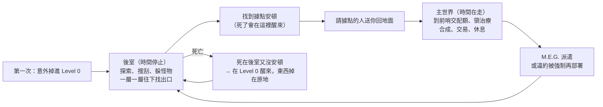

# 遊戲玩法

> 這一章說明這個模組怎麼玩：故事背景、一輪一輪的循環、時間與配額、在後室裡的層數與難度、死亡、安頓與撤離、主世界的前哨、經濟與任務。標示說明見 [企劃書總目錄](../README.md)。
> 2026-11-25 起遊戲方向改成**恐怖、逃離後室**；舊企劃裡「主世界是絕對安全的大本營」「為了變強去後室刷資源」的部分都已照新方向改寫。

## 一句話

**你是不小心掉進後室的 M.E.G. 調查員。** 每一趟的目標是活著逃出去；但回到地面以後，身體和雇主都不會讓你在家待太久。後室裡要命，主世界要時間。

## 故事背景

### M.E.G. 與你

後室（The Backrooms）是現實的背面。從現實的縫隙「穿」出去（noclip）的人，會掉進一層又一層無盡、空曠、嗡嗡作響的空間。後室的 wiki 裡，**M.E.G.**（Major Explorer Group，主要探險者團體）是在後室裡活動最久的組織之一：他們在各層建據點、畫地圖、記錄實體。

在這個模組裡，M.E.G. 在地面上也有前哨站，專門調查「有人憑空消失」的事件。**你是他們的地面調查員。** 某次出勤，你在一個不該有牆的地方卡進了牆裡，醒來時已經躺在潮濕的黃色地毯上，頭頂的日光燈嗡嗡作響。這是 Level 0。

### 後室沒有時間

後室跟原本的世界是隔開的，裡面沒有時間的概念，不分白天黑夜，也沒有日期。你在裡面待多久都一樣。

但地面上的時間一直在走。從後室出來的人，身上都帶著後室的「痕跡」。

### 悲屍化（Wretch Cycle）

後室 wiki 裡，待在後室太久的人會慢慢失去理智、脫水、變形，最後變成**悲屍**（Wretch）。在這個模組裡，悲屍化反過來發生在地面上：

- 你的身體已經沾上後室，現實世界開始排斥你。
- 出來的頭兩天一切正常；之後普通食物越來越填不飽、理智一點一點往下掉、晚上開始看到不該存在的東西。
- 能壓住它的藥，原料只在後室裡；真正能根治的配方，藏在更深、更危險的樓層。

### M.E.G. 不是慈善機構

M.E.G. 把你從後室的據點接回地面，但這不是免費的。你是公司的資產，每個週期都要上繳「調查配額」：筆記、異常樣本、失蹤小隊的資料、從後室帶出來的物資。交得出來，就有治療、補給和庇護；交不出來，前哨會對你關門，然後把你「強制再部署」回後室，丟到哪一層隨機。

### 主線：失蹤的小隊【未來】

你不是第一個掉進去的調查員。在你之前，有一整支 M.E.G. 小隊在後室失蹤了。每次任務，你都可能找到他們留下的東西：筆記、錄音、裝備。長期目標：

1. 找到失蹤的小隊，或弄清楚他們發生了什麼事；
2. 找到根治悲屍化的方法；
3. 要不要有「跟 M.E.G. 解約」的結局，待討論。

### 後室裡的其他人

後室裡不是只有 M.E.G.。停車場（Level 1）有 M.E.G. 的據點「第一道光」，也有殖民者的據點「眨眼」、商人之家、診所、餐館；Level 2 有 B.N.T.G. 的辦公區。這些組織的據點都可以讓你安頓、送你回地面【定】。

## 核心循環

## 流程定案（2026-11-26）【定】

使用者和 Claude 討論後定下的整條流程。底下「死亡」「安頓與撤離」「主世界」各節裡跟這裡衝突的，以這裡為準；做完後再把各節改成【已做】。

### 整條流程

1. 主世界照原版玩，沒有倒數。被沙子卡在牆裡窒息，掉進 Level 0。
2. 在後室探索（時間停止），找據點安頓。
3. 安頓後請據點的人送你回地面：**直接送到 M.E.G. 研究所**（地面前哨），不是家裡。
4. 回到研究所，跳出**任務報告畫面**，M.E.G. 開始派任務：倒數與配額從這時開始（第一次回來時開始）。
5. 不願意回去：違約後被強制丟回去。主世界死掉也會掉回後室。回到主世界變得很困難，這是刻意的。

### 研究所（總部）

- 整個隊伍有一間總部：**離世界出生點最近的那一間前哨**，第一次找到就記下來。
- 還沒生成也沒關係：用找結構的方式（跟 /locate 一樣，連還沒生成的區塊也找得到）找到最近的前哨，送過去時才生成。所以一定會被送到研究所，不會回到出生點。
- **所有回家的路都送到研究所**：撤離、Level 0 的綠色 EXIT 門、停車場的出口門、Gemini 的歸鄉錨釘。背景設定：這類逃生出口也被組織管制，逃出去也會被帶到研究所。

### 死亡

| 情況 | 在哪裡醒來 | 東西 |
| --- | --- | --- |
| 在後室死掉、有安頓 | 安頓的地方（據點） | 掉在原地 |
| 在後室死掉、沒安頓 | 這一趟進後室時的落點，層數回到第 1 層 | 掉在原地 |
| 在主世界死掉（進過後室的人） | 掉回後室：一片新的 Level 0 | M.E.G. 收進研究所的置物櫃（遺物），下次回來領 |
| 在主世界死掉（沒進過後室的人） | 照原版 | 照原版 |

- **多人時同一片後室**：有人從主世界掉進去（死掉、派遣、被丟回去、沙子、委託），就開一片新的落點區；之後其他人掉進同一層，就掉進同一片，醒在附近。隊伍裡沒有人在後室了，下次掉進去就是全新的一片。
- 跨層不受影響：Level 0 → Level 2 → 再回到 Level 0，這個 Level 0 是全新的一片（跟層數規則一樣，越深越難）。

### 沒進過後室的人

- 照原版玩：沒有倒數、主世界死掉照原版回家、不會被丟進去。
- 配額人數、在家算時間、強制再部署，都只算進過後室的人。
- 注意：血量砍半（主世界也是 10）目前對所有人都有效，要不要改成只對進過後室的人，還沒決定。

### 不加回來的

- 「暗處、地底、理智低、身上帶後室物資、在暗房睡覺會慢慢被拉進後室」那一套：**先不加**。

### 新功能（都要做）

1. **任務報告畫面**：回到研究所時跳出來，像《致命公司》每天結束的結算：這一趟走了幾層、去了哪些 Level、帶回什麼、照收購價值多少點、配額還差多少、還剩幾天、欠款。關掉之後畫面中央出現黃色的「任務開始第 N 天」。
2. **研究所跟著配額升級**（看交滿幾期）：
   - 第 1 期：醫療室開放（醫官：治療、賣醫療用品）；
   - 第 3 期：軍械庫開放（軍需官的高階武器）；
   - 第 5 期：開放付費派遣到更深的樓層（Level 2 以後；Level 0、0.1、1 一開始就能派遣）。
   
   指揮官會說研究所現在幾級、下一個開放什麼。
3. **M.E.G. 無線電**：第一次回到研究所時發一台（補給商也賣）。帶在身上進後室，偶爾收到斷斷續續的廣播：失蹤小隊的線索、這一期的必交項目、還剩幾天。
4. **個人置物櫃**：研究所裡的置物櫃（新方塊），每個人打開看到自己的東西，死了也不會掉。主世界死掉的遺物也放這裡。舊世界已經生成的研究所沒有置物櫃的，在指揮官旁邊也能打開。

## 時間：後室裡沒有時間【已做】

- **人在後室時，倒數暫停**，可以慢慢探索，沒有時間壓力，只有危險。
- **人在主世界時，倒數才開始扣**。主世界安全，但時間一直在燒；待越久，排斥越重、配額期限越近。
- 倒數以「天」計算，一天＝主世界的 24000 tick（約 20 分鐘）。**每到新的一天，畫面中央會用黃色大字顯示「任務開始第 N 天」**，下面一行是配額進度和剩幾天（最後一天寫「最後一天！」，欠款時寫欠多少）；從後室回到主世界時也會顯示一次。
- 主世界左上角一直顯示：第幾天、配額幾點、必交項目交了幾個、欠款。後室裡不顯示（沒有時間）。
- 在家睡覺跳過黑夜也算過了那段時間（時鐘跳多少就算多少），不然睡覺會變成躲時間的漏洞。就算伺服器關掉日夜循環，在家的每一刻也照樣算。
- 多人時，只要有任何一位隊員在主世界，隊伍的倒數就在扣（有人待在家，就是在燒大家的時間）；離線的人不算。
- **什麼時候開始**：有人第一次活著從後室走出來的那一刻，第一期開始。在那之前（例如剛開新世界），什麼都不會發生。

## 週期：悲屍化倒數＋M.E.G. 配額【已做】（2026-11-26）

上一版靠排斥症狀和發光裂縫逼人回去，但藥可以囤、症狀忍得過去、裂縫只是「可以進去」。改成兩股力量綁在一起：

- **身體**（Gemini 提的《深海迷航》＋後室 wiki 悲屍化）：你帶著倒數計時逃出來，不回去拿藥，在主世界也會爛掉。
- **雇主**（《致命公司》）：M.E.G. 要你每個週期交調查配額。

兩股力量共用**同一個倒數**，玩家只要看一個數字。

### 一個週期（只算在主世界的時間）

- 長度 **5 天**（約 100 分鐘）。
- 第 1～2 天：身體正常。
- 第 3～5 天：悲屍化排斥發作，到期限時最重。症狀照 Gemini 做的四個階段：
  - 理智停止恢復、開始往下掉；
  - 偶爾飢餓，接著虛弱；
  - 晚上有幻覺；
  - 最重時生命上限少一顆心、偶爾眼前一黑。

  進後室就停（時間也停）。
- **交滿配額的那一刻，這個週期就算完成**：
  - M.E.G. 給治療（排斥的症狀清掉、時鐘回到第 1 天）；
  - 在主世界的人各拿一份補給包（杏仁水 2、繃帶 2、麵包 4）；
  - 新的週期從第 1 天開始。

  帶著夠的東西回到地面、馬上交，就有完整的 5 天可以休息、合成、交易，然後再進去。
- 換句話說：每交一次配額，最多只能在家待 5 天。

### 配額：多人一起交

- 整個伺服器是同一隊，一起交。
- **點數**：
  - 第一期 100 點，每交滿一期漲 30%（130、169……）；
  - 人數加成：1 人 ×1，每多 1 人 +60%（2 人 ×1.6、3 人 ×2.2、4 人 ×2.8）；
  - 人數用「這一期上線過的人數」，期中有人加入，配額會跟著往上調。
- **必交項目**：每期指定 1 種（第 3 期起 2 種），每種要交的數量是「人數除以 2 再無條件進位」（1～2 人 1 個、3～4 人 2 個）。從這些裡面抽：
  - 開放樓層怪物的樣本：獵犬獠牙、濕黑長毛、微笑殘光、暗影微粒、糾纏骨節、灰暗殘渣、枯萎心臟、黑絲菌束、強酸囊、蛾翼鱗粉、無面皮膜、偽裝厚皮；
  - 殘破藍圖頁；
  - **M.E.G. 失蹤小隊報告**（新的主線道具：停車場的補給箱、有眼睛的箱子、Level 2 的儲物箱、Level 3 的 M.E.G. 補給箱，大約每 10 個箱子有 1 份）。
- **怎麼交**：**賣給前哨的收購商就是交**。
  - 賣出的價值先還欠款，再算進配額，**剩下的才付到帳戶**；
  - 必交項目賣出時自動算進去；
  - 收購商收的東西和價格見 `data/noclip_backrooms/shops/buyer.json`（這次補上了上面那些怪物樣本和小隊報告）。
- 原本的三份委託變成 **M.E.G. 指定訂單**：完成時報酬的點數算進配額（放不下的付到帳戶），另外再給報酬的一半當帳戶獎勵。

### 違約（到期交不出來）

- 前哨除了收購商以外都對隊伍關閉：補給商、軍需官不賣，指揮官不接委託。
- 排斥停在最重的那一段，直到欠款還清。
- **強制再部署**：隔天早上（主世界下一次日出），M.E.G. 把當時在主世界的隊員丟進目前開放樓層中隨機的一層，不給補給。違約時人在後室裡的隊員不會被丟，但出來時一樣被前哨拒於門外，直到還清。
- 新的一期照常開始，但配額不漲（只有交滿的期數才會讓配額成長）。
- 這是唯一會把人丟進去的情況。它是期限公布了好幾天、自己沒做到的結果，不是隨機發生的。

### 欠款：複利 20%

- 期限到時還沒交的部分（欠款＋這期沒交滿的點數＋沒交的必交項目，每個算 30 點）**全部再加 20%**，變成新的欠款。之後每過一個期限還沒還清，就再加 20%（例如欠 100 點：下一期 120、再下一期 144）。
- 欠款要先還清，這一期的配額才算得上去。
- 可以用帳戶點數還，但要付兩倍（1 點欠款＝2 點帳戶），當作最後的退路：在指揮官旁邊點「[用帳戶點數還]」或打 `/meg quota paydebt`。

### 藥

- 三種抑制藥（初階穩定劑、高純度血清、現實穩定核心）和杏仁藥水**只能暫時壓住症狀**，不能延長期限、不能代替配額。原料一樣只在後室裡。
- **根治的解藥配方**藏在後面幾個危險樓層，是長期目標之一【未來】。就算根治了身體，M.E.G. 的配額還是要交：身體自由了，合約還沒有。

### 拿掉的東西

- **發光裂縫**、**主世界地面變成後室地毯**：都拿掉了。舊存檔裡已經滲成地毯的地面和已經開的裂縫，伺服器開啟時會自動恢復原狀、關掉。

### 為什麼這樣設計（Claude 的看法）

- 時間只在主世界扣：後室裡要命、主世界要時間，兩邊的壓力互補。玩家會自己想快點回去，不需要隨機把人丟進去。
- 有「必須回去」的理由：配額。拖延的下場一定比去更慘：排斥加重、前哨關閉、最後被隨機丟進去。
- 藥囤再多也只能撐症狀，不能交差，囤藥這條路就斷了。
- 多人一起交，大家互相催：有人在家拖，就是在燒全隊的時間，有《致命公司》的味道。
- 要注意越輸越慘的死亡螺旋：違約 → 隨機丟 → 死掉、東西沒了 → 又違約，加上複利，欠款會越滾越大。所以違約後配額不漲，並且可以用帳戶點數還。

## 怎麼進去

- **第一次：意外**【已做】：在主世界被沙子或方塊卡在牆裡窒息，會穿進 Level 0（朋友做的入口）。
- **M.E.G. 派遣**【已做】：右鍵前哨指揮官，聊天欄會列出可以申請的派遣，點一下就送進去（也可以打 `/meg deploy <樓層>`，要在指揮官旁邊）。
  - Level 0 免費；
  - 隊伍去過的樓層要付點數：Level 0.1 是 80 點、Level 1 是 50 點、Level 2 是 120 點、Level 3 是 250 點，之後的樓層先訂 400 點。
- **強制再部署**【已做】：違約時，見上面。
- **指定訂單**【已做】：右鍵前哨指揮官接委託，接了就被送進 Level 0。

## 在後室裡：層數與難度

### Level 和「第幾層」不一樣【已做】

層數算法跟《狐霖的後室 RPG》一樣：

- **Level** 是你在哪一個後室（Level 0、Level 1、Level 2……）。
- **第幾層**是這一趟你走過幾次出口。每穿過一次出口加一層，走回去也算。例如 Level 0（第 1 層）→ Level 1（第 2 層）→ Level 2（第 3 層）→ 回到 Level 0（第 4 層）。另外也記「去過幾個不同的 Level」。
- **回到去過的 Level，是一片全新的 Level**：落點在那一層很遠、沒人去過的地方，沒走過的地形、沒被拿過的物資。落點由「你從哪個出口出來」決定，同一個出口過去的隊友會在一起。
- **畫面**：
  - 到達時螢幕中間顯示大字「Level 0」和名稱；
  - 後室裡左上角一直顯示「第 3 層」；
  - 打開背包時上方顯示「Level 0 · 大廳」。
- **一趟什麼時候結束**：
  - 活著回到主世界，這一趟就結束、層數歸零；
  - 在後室據點安頓過，死掉在那裡醒來，層數接著算；
  - 死掉又沒安頓過，在 Level 0 醒來，算新的一趟；
  - 每個玩家會記住自己走過的最高層數。

### 雙軸難度（原企劃書）【未來】

1. **垂直難度（層數）**：層數越高，怪物越多、血越厚、打越痛；寶箱與家具掉的東西越多、品質越好、稀有材料越容易出現。
2. **水平難度（離降落點多遠）**：每一層幾乎無限大。**從你這次進入這一層的降落點算**，不是從世界原點 (0, 0) 算（多人和重進時才不會亂）。離降落點越遠，遇怪率、怪物強度、寶箱品質、特殊房間（例如紅室）越高。
   - Gemini 舊企劃提的分帶，可以當起點：0～250 格 ×1；250～750 格血 ×1.35、攻擊 ×1.2；750～1600 格血 ×1.85、攻擊 ×1.5；1600 格以上血 ×2.5、攻擊 ×1.9。
3. **防刷規則**：
   - 層數只放大掉落的數量、品質和該層的深層大獎，不會讓低樓層掉出別的主題樓層才有的材料。例如 Level 0 走到第 50 層，也開不出魔法森林的核心。
   - 短時間內在同兩個 Level 之間來回，不再加層數，還會讓怪物變強、掉落變差。

> 走越遠、越深，帶回去的東西越值錢，但離出口和據點也越遠、理智壓力越大。玩家要自己決定「見好就收」還是「深入搏大獎」。

### 出口

- 每一層有自己的出口；樓層編號越低（越深），出口越難找【已做】。
- Level 0 的綠色 EXIT 門會直接送你回重生點（沒安頓過就是回家）。2026-11-26 起改成很稀有，大約每 8 區（560×560 格）才有一扇【已做】。平常要回家，得往下找據點。
- **條件解鎖的樓層**（原企劃書＋Gemini 舊企劃）【未來】：特定高回報樓層要滿足條件才進得去：
  - 打倒當層 Boss；
  - 鑰匙卡或憑證（M.E.G. 藍卡、C.L.I.P.P. 卡等）；
  - 多階密碼門駭客器 1～4 階；
  - 修好當層的發電機或電梯；
  - 完成 NPC 任務。

## 死亡

- **在後室死掉**【已做】：
  - 安頓過：在據點醒來；
  - 沒安頓過：在 Level 0 醒來（新的一趟，從第 1 層算起）。
  - 不管哪一種，身上的東西都掉在原地，要冒險回去拿。
- **永遠不會掉的**：帳戶裡的點數、等級與能力值。
- **保險箱**（原企劃書）【未來】：隨身 1～2 格保護格，死亡時格子裡的東西保住；在主世界花大錢可擴充到 6 格。適合放鑰匙卡、任務信件。

## 安頓與撤離

- **安頓**【已做】：在據點的行軍床或睡袋上躺一下，之後死掉會在這裡醒來。安頓前的重生點會記下來，回家後還給你。
- **撤離**【已做】：安頓時聊天欄出現「[請他們帶我回家]」，站在安頓的地方附近點它（或打 `/meg extract`），據點的人就送你回主世界。
- **不是只有 M.E.G.**【定】：其他組織的據點也能安頓、撤離。
- **中繼站**（原企劃書）【未來】：特定安全樓層（例如 Level 4、Level 11）有流浪商人、黑市、任務板、簡易修理台。另外還有：
  - **單向寄物箱**：花錢把背包裡的東西寄回主世界倉庫，人可以不回去、繼續往深處走；
  - **付費服務**：單趟裝備保險（死了自動寄回）、付費捷徑（請嚮導送你到解鎖過的深層）。
- **緊急撤離道具**（原企劃書）【未來】：「單向歸鄉錨釘」用蜘蛛網合成台做，用的時候要原地讀條 10 秒，期間會引來附近的怪物；成功就帶著全身東西回主世界。物品 Gemini 做了，功能還沒接。
- 待討論：
  - 哪些樓層有據點（照 wiki 和狐霖的後室 RPG 查）；
  - 撤離要不要付東西或等一段時間。
- 撤離回來出現在哪裡：已定，送到研究所（見「流程定案」）。

## 主世界與 M.E.G. 地面前哨

- **主世界不再是「絕對安全的大本營」**：一樣可以蓋房子、存東西、合成、交易，但時間在走（見「週期」）。
- **M.E.G. 地面前哨**【已做】（原「公會」，在每個村莊旁邊）。收購商、補給商、軍需官、前哨指揮官的位置與建築細節見 [outpost.md](outpost.md)。
  - 收購商：收後室帶出來的東西，也是交配額的窗口（違約時唯一還開著的）；
  - 補給商：賣藥品、食物、照明；
  - 軍需官：賣武器、彈藥、護甲；
  - 前哨指揮官：說明配額、申請派遣、還欠款、發 M.E.G. 指定訂單。
- **主世界加工設施**（原企劃書）【部分】：
  - 垃圾回收機：把破布、塑膠、鏡片變成鋼錠、銅線，機率出電池；
  - 異常蒸餾桶：把杏仁水、草藥釀成高價的陳年杏仁露；
  - 異常研究終端：用研究瓶解鎖蜘蛛網的高階配方；
  - 異常晶體複製機：後期緩慢複製稀有晶核；
  - 異常檔案修復板：繳交各層指定物資組合，永久解鎖便利功能。
  
  這些方塊 Gemini 都做了，功能還沒接；詳細見 [合成](../3-crafting/README.md)。

## 經濟與任務

- **永久帳戶**【已做】：撿到的硬幣（10 點）、錄音帶（40 點）右鍵存入；死掉、回主世界都不會掉。背包下方顯示餘額。
- **賺錢**（原企劃書）：
  - 收集廢料與稀有物資，加工成高價商品（加工後售價是原料的 3～5 倍）賣給商人；
  - 完成任務。
- **好裝備的門檻**【已做一部分】：頂級武器要「大量點數＋該層稀有素材」雙門檻，前期刷錢不能直接買到後期。軍需官的好槍已經要錢加材料。
- **越深的中繼站商人賣越好的東西**【未來】：現代槍械、高階彈藥、能力值卷軸、高階藍圖。
- **任務**【未來】：
  - 種類：討伐某層的怪物或 Boss、收集或合成指定物品交付、跨多層連續送信（不回主世界的前提下連續穿過幾個指定 Level）。
  - 受困倖存者支線（Gemini 舊企劃）：在後室深處遇到一樣掉進來的人，例如抱著玩偶躲在角落的小女孩。給她杏仁水和食物、幫她找回東西、護送她到據點。報酬是經驗、點數、稀有飾品或樓層線索。
  - **防死局（必做）**：隨機派發任務時，只能派玩家進得去的樓層（看他已解鎖的鑰匙卡、駭客器等級）。

## 待討論（整理）

- 週期長度、配額、漲幅、派遣價格都是先訂的數字，玩過再調。
- 根治以後的玩法、要不要有解約結局。
- 要不要分隊（現在整個伺服器是一隊）。
- 哪些樓層有據點、撤離要不要代價、撤離回來在哪。
- 怪物的特殊效果（見 [怪物](../4-monsters/README.md)）。
- 武器與護甲數值要配合恐怖方向重新平衡（見 [玩家能力值](../2-player/README.md)）。

## 程式位置

| 東西 | 位置 |
| --- | --- |
| 層數、Level 名稱、到達標題 | `src/main/java/dev/noclip/backrooms/core/floors/`、客戶端 `core/floors/FloorsClient` |
| 出口、落點「全新的一片」、直接掉進某層 | `core/LevelExits.java`（`anchor`、`fallInto`） |
| 死亡、安頓、撤離 | `core/trip/Trips.java` |
| 悲屍化排斥（跟著週期的天數走）、藥、預兆 | `core/trip/Pull.java`、`PullState.java`、`SeepageData.java`、`props/BackroomsRiftBlock.java`、客戶端 `core/trip/PullClient.java` |
| 週期、配額、欠款、違約、派遣、「任務開始第 N 天」 | `core/quota/`（`Quota`、`QuotaMath`、`QuotaData`、`QuotaStatusPayload`）、客戶端 `core/quota/QuotaClient`（左上角） |
| 委託（M.E.G. 指定訂單） | `core/guild/Contracts.java` |
| 前哨建築、商人、帳戶 | `core/guild/`、`core/trade/`、`core/economy/`（見 [outpost.md](outpost.md)） |
| Level 0 綠色 EXIT 門的稀有度 | `level0/Exits.java`（`RARITY`） |
| 實機測試 | `horror/HorrorClientTest.java`（`-Plevels=horror`：含週期、配額、違約、再部署、還債）、`floors/FloorsClientTest.java`（`-Plevels=floors`）、`guild/GuildClientTest.java`（`-Plevels=guild`）；單元測試 `core/quota/QuotaMathTest` |
