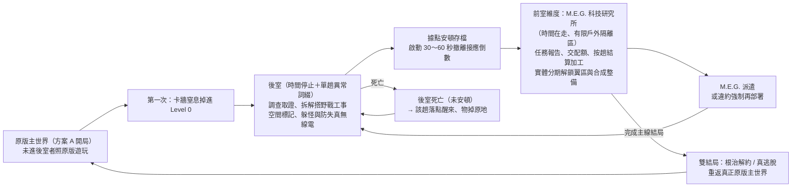

# 遊戲玩法

> 這一章說明這個模組怎麼玩：故事背景、一輪一輪的循環、時間與配額、在後室裡的層數與難度、死亡、安頓與撤離、主世界的前哨、經濟與任務。標示說明見 [企劃書總目錄](../README.md)。
> 2026-11-25 起遊戲方向改成**恐怖、逃離後室**；舊企劃裡「主世界是絕對安全的大本營」「為了變強去後室刷資源」的部分都已照新方向改寫。

## 一句話

**你是不小心掉進後室的 M.E.G. 調查員。** 每一趟的目標是完成現場調查、在接應倒數中活著撤離；但撤離後你並不是回到原本的家，而是被檢疫隔離在跑不出去的「前室」科技研究所裡——身體和雇主都不會讓你待太久。後室裡要命，前室裡要時間。

## 故事背景

### M.E.G. 與你

後室（The Backrooms）是現實的背面。從現實的縫隙「穿」出去（noclip）的人，會掉進一層又一層無盡、空曠、嗡嗡作響的空間。後室的 wiki 裡，**M.E.G.**（Major Explorer Group，主要探險者團體）是在後室裡活動最久的組織之一：他們在各層建據點、畫地圖、記錄實體。

在這個模組裡，你在原版主世界過著原本的生活；某次意外卡進牆裡（窒息切出），醒來時已經躺在潮濕的黃色地毯上，頭頂的日光燈嗡嗡作響——這是 Level 0。當你第一次透過據點或逃生出口撤離出來時，M.E.G. 攔截並接管了你：他們以「你已沾染悲屍化風險」為由，將你收容進一座與世隔絕的科技機構——**前室（The Frontrooms）M.E.G. 檢疫研究所**，強制把你編為外勤調查員。

### 後室沒有時間

後室跟原本的世界是隔開的，裡面沒有時間的概念，不分白天黑夜，也沒有日期。你在裡面待多久都一樣。

但在前室（與地面上）的時間一直在走。從後室出來的人，身上都帶著後室的「痕跡」。

### 悲屍化（Wretch Cycle）

後室 wiki 裡，待在後室太久的人會慢慢失去理智、脫水、變形，最後變成**悲屍**（Wretch）。在這個模組裡，悲屍化反過來發生在後室之外：

- 你的身體已經沾上後室，現實世界開始排斥你。
- 出來的頭兩天一切正常；之後普通食物越來越填不飽、理智一點一點往下掉、晚上開始看到不該存在的東西。
- 能壓住它的藥，原料只在後室裡；真正能根治的配方，藏在更深、更危險的樓層。

### M.E.G. 不是慈善機構

M.E.G. 把你從後室的據點接回前室研究所，但這不是免費的。你是組織的資產，每個週期都要上繳「調查配額」：現場取證照片、空間測繪資料、怪物樣本、失蹤小隊的檔案、從後室帶出來的物資。交得出來，研究所就會逐步開放醫療、軍械、研發與深層傳送權限；交不出來，研究所各翼區會對你關門，並在隔天日出把你「強制再部署」回後室，丟到哪一層隨機。

### M.E.G. 的秘密：地下收容區與用任務養出來的 Boss（2026-11-27 使用者構想）【定：方向】

使用者的構想（原話整理）：

- M.E.G. 其實在做**恐怖的實驗**，研究所的地下室藏著非常多後室的怪物。
- 他們還研究出一隻 **Boss**，而這隻 Boss 能被研究出來，正是因為**玩家一直幫 M.E.G. 做任務**。Boss 可能有後室很多怪物的能力。
- 之後玩家發現內幕，要**反過來擊敗一直給玩家資源的 M.E.G.**。
- 故事內容很重要。

Claude 的建議（待使用者確認）：

1. **每個任務交上去的東西，就是 Boss 的材料**：拍到的照片、怪物樣本、測繪資料，都會變成 Boss 學到的一種能力。例如：
   - 拍到微笑者：在暗處看不到身體，只看得到笑臉；
   - 交獵犬的牙：撲咬、流血；
   - 竊皮者的皮：偽裝成隊友；
   - 肢叢的樣本：抓走手上的武器；
   - 鈍人：撞破封門木板。

   玩家做了哪些任務，就決定最後的 Boss 有哪些能力。這樣作業感會變成「你親手把它養大」，也回答了「為什麼要一直做任務」。
2. **看得到它在長大**：研究所的深色觀察窗（電影裡那種）後面就是地下收容區。每交一次任務，收容艙就多一隻怪物，Boss 的培養槽也跟著變化。理智低時，會有東西貼到玻璃上。
3. **一步一步露出馬腳**：
   - 任務理由越來越對不上；
   - 無線電裡失蹤小隊的話；
   - B2 機密檔案；
   - 前室的夜晚變成 398。
4. **結局改成反轉版**（會改到已做好的雙結局 `core/ending/Endings.java`）：
   - **照 M.E.G. 的意思一路做下去、解約回家**（原本的結局 A）：以為回到家，其實是 398 的惡作劇，即「從來沒有離開過」（壞結局）。
   - **發現內幕、反抗 M.E.G.、在地下收容區打倒 Boss、逃出去**：即「回家了」（真結局，取代原本結局 B 的倒數突破）。
5. **反抗之後 M.E.G. 不再給資源**：
   - 商店與配額關閉，研究所的守衛變成敵人；
   - 最後一段只能靠自己囤的東西，或者後室裡其他組織（殖民者、B.N.T.G.）幫忙；
   - 這樣前面每一趟的累積才有意義。

待討論：Boss 的外型與名字、能力清單、反抗後研究所怎麼變、多人時怎麼算、什麼時候讓玩家發現內幕。

### 主線與雙結局：失蹤的小隊與前室真相【已做】

你不是第一個掉進去的調查員。在你之前，有一整支 M.E.G. 小隊在後室失蹤了。每次任務，你都可能透過無線電、補給箱或深層房間找到他們留下的檔案線索。兩條結局皆已實裝（`core/ending/Endings.java`）：

1. **結局 A：根治解約**：在研究所終端解析紫色空間研究瓶，於 9×9 終極蜘蛛網合成並服用「悲屍化根治藥（`wretch_cure`）」（永久清除悲屍化排斥並把血補滿；生命上限照舊是進過後室的 10，2026-11-28 使用者定），達 5 期權限且無欠款後向指揮官申請解除合約（`/meg ending contract`），正式獲准自由往返原版主世界。
2. **結局 B：違抗與真逃脫（The True Ending）**：以 3～4 階密碼門駭客器撬開研究所 B1 加密艙口進入 B2，讀完**全部 6 份機密檔案**揭露前室真相，再持 3～4 階駭客器蹲下右鍵 B1 異常傳送台覆寫座標，或於深層（第 3 層以上／Level 3）執行 `/meg ending escape` 撐過 45 秒座標覆寫突破倒數，強行突破封鎖回到真正的原版主世界。通關後可用 `/meg ending home` 與 `/meg ending institute` 自由往返。

### 後室裡的其他人

後室裡不是只有 M.E.G.。停車場（Level 1）有 M.E.G. 的據點「第一道光」，也有殖民者的據點「眨眼」、商人之家、診所、餐館；Level 2 有 B.N.T.G. 的辦公區；Level 3 有大型 Gamma 基地與其他勢力據點。這些組織的據點都可以讓你安頓與發起撤離接應【已做】（Level 2 的 B.N.T.G. 辦公區還沒有床）。

## 核心循環

## 流程與前室總部定案（2026-11-26）【已做】

使用者和 Claude、Gemini（Antigravity）討論後定下的完整架構。底下各節若有舊寫法跟這裡衝突，一律以本節為準。

### 已經做好的（2026-11-26，Claude）

- **前室維度** `noclip_backrooms:frontrooms`：
  - 研究所在正中央，外面是原版自然地形（起伏、樹林、水池、牛羊雞豬，沒有怪物、沒有村莊）；
  - 半徑 100 格有一圈檢疫圍牆（高到 y=100、黃黑警示帶、頂上高壓電網和探照燈、內側警告牌），牆外什麼都沒有；跑出去會被帶回研究所大廳。
  - 時間跟著主世界的時鐘（有白天黑夜，可以睡覺）。
- **研究所**（平面圖在 `frontrooms/InstituteLayout`，64×48 格三層）：
  - 1F：檢疫接待大廳（落點在這裡，正對指揮官的桌子）、收購窗口、補給窗口、個人置物櫃室、西側基礎工作區（黃黑邊地板，可以放東西、拆自己放的東西）、北邊檢疫走廊與三間隔離室、南邊大門與前廣場；
  - 醫療隔離翼（交滿 1 期）：醫官、病床、蒸餾設備；
  - 軍械庫與加工車間（交滿 3 期）：軍需官、武器櫃、車間（工作區，有垃圾回收機、蜘蛛網合成台等）；
  - B1 深層異常傳送廳（交滿 5 期，從 1F 北邊樓梯下去）：三座傳送台（站上去就能申請派遣，不用找指揮官）、研究終端、晶體複製機；
  - B2 機密檔案室：B1 角落的加密艙口，只有 3 階以上的密碼門駭客器打得開（打開後所有人都能下去）；裡面六份機密檔案講「前室的真相」，讀滿 6 份即解鎖結局 B 真逃脫路線（`Endings`）。
  - 防爆氣密門上面有燈，鎖著是紅的、開了是綠的；交滿配額時全伺服器會收到「某翼區已開放」。
  - 建築本體打不壞（玩家敲不掉、在上面也放不了方塊），只有工作區可以蓋。
- **人員**：指揮官、收購商、補給商、醫官、軍需官各一位，固定在位置上；不見了會自己補回來。
  - 醫官：賣繃帶、杏仁水、抑制藥等；右鍵時會出現「[治療：40 點]」（補滿血和理智、清掉負面效果，`/meg treat`）。
  - 補給商：多了原版基礎材料（煤、鐵、銅、紅石、玻璃、線、種子、樹苗），之後還會賣無線電、粉筆等。
- **所有回家的路都送到研究所**：撤離、Level 0 綠色 EXIT 門、停車場出口門、歸鄉錨釘；舊存檔裡已經在主世界、進過後室的人，登入時會被 M.E.G. 帶進前室。
- **撤離接應倒數**（取代點一下就回家）：在據點點「[呼叫接應]」、按 EXIT 門、用歸鄉錨釘，就開始倒數。
  - 30 秒起跳，這一趟每多一層多 6 秒，最多 60 秒；畫面上方有倒數條。
  - 要待在原地附近（6～12 格內），離開、換層、死掉就取消。
  - 每 2 秒把 40 格內的怪物都引過來；倒數到三分之一和三分之二時，黑暗裡會再冒出獵犬（越深越多）。
- **死亡**照下面的表做好了；主世界或前室死掉時身上的東西收進置物櫃（放不下的先當「遺物」，下次打開置物櫃時自動放進去）。
- **多人同一片後室**：從外面掉進同一層的人落在同一片；全隊離開後室超過 30 秒，下次掉進去才是新的一片。
- **沒進過後室的人**：照原版（血量 20、沒有倒數與配額畫面、不算進配額人數、主世界死掉照原版）。
- **任務報告畫面**：被送回研究所後跳出，列出這一趟走了幾層、經過哪些 Level、帶回的東西照收購價值多少點、配額還差多少、剩幾天、欠款、研究所權限；關掉後出現黃色「任務開始第 N 天」。
- **研究所升級**：照交滿的期數開門（見上），指揮官會說現在幾期、下一個開放什麼；Level 0、0.1、1 只要隊伍去過就能派遣，Level 2 以後要交滿 5 期。
- **M.E.G. 無線電**：第一次回到研究所時發一台。帶在身上進後室，每 3～6 分鐘收到一則斷斷續續的廣播：失蹤的第七搜索隊的通訊、這一期要交什麼、剩幾天或欠多少。
  - **失真**：這一趟第 4 層以後、理智低於三成、或附近 32 格有竊皮者時，有四成機率是假的：用隊友的名字喊你過去、報假的撤離點。
- **個人置物櫃**：研究所的置物櫃（54 格），每個人打開都是自己的，死了也不會掉。
- **舊的石造公會**：新世界不再生成；舊存檔的在載入時整棟拆掉（地板變回草地、門口小路變回草地、箱子裡的東西掉在原地、商人離開）。

### 補齊完成（2026-11-26，Antigravity）

- **雙結局（結局 A 根治解約＋結局 B 真逃脫）**：`core/ending/Endings.java`、9×9 終極蜘蛛網配方「悲屍化根治藥（`wretch_cure`）」、B2 全部 6 份檔案進度追蹤、B1 傳送台蹲下右鍵覆寫與深層 45 秒突破倒數，通關後解除隔離抓取並自由往返真正原版主世界。
- **場景照偵測**：`Evidence.java` 支援拍攝「停電瞬間（Level 1／0.1 停電中，85 點）」、「紅室祭壇（110 點）」、「異常密室（75 點）」與「異常電氣現場（65 點）」，並納入每期 3 倍目標輪替。
- **偽裝人影竊皮者與生物異常掃描儀（`bio_scanner`）**：`MIMICS` 詞綴期間會在走廊生成偽裝成人類的竊皮者，靠近、右鍵或攻擊即現形；`FieldKit.BIO_SCANNER`（補給商 90 點或 3×3 合成）可掃描 18 格內偽裝箱、偽裝人影與潛行竊皮者，強制逼出原形並施加發光、緩速與虛弱（偽裝箱改為確定性雜湊判定，掃描與開箱 100% 一致）。
- **紅霧動態紅室**：`RED_MIST` 詞綴探索中會在安全區外動態將附近 7×7 普通房間轉化為異常紅室（紅壁紙、紅日光燈、紅室異常結晶叢與異常密室寶箱，絕不碰門／床／既有箱子與工作站），可直接拍攝紅室祭壇場景照。
- **研究瓶解鎖配方**：`core/locker/Research.java`＋`ResearchPayload`＋`ResearchClient` 接通研究所異常研究終端按趟結算：黃研究瓶解鎖 7×7 初級蜘蛛網、灰研究瓶解鎖 9×9 終極蜘蛛網、紫研究瓶解鎖 9×9 悲屍化根治藥（工作站實體合成與配方書同步顯示鎖定與提示）。

### 整條流程（方案 A 開局）

1. **原版主世界開局**：開新世界後先照原版 Minecraft 遊玩，沒有倒數與配額。在主世界被沙子或方塊卡在牆裡窒息，掉進 Level 0。
2. **後室探索（時間停止）**：每趟帶隨機樓層異常現象，進行現場取證、搜刮拆解、搭野戰工事、找據點安頓。
3. **撤離送往獨立維度「前室」**：啟動撤離接應倒數並撐過後，不會回到原本主世界，而是**被送到獨立維度「前室（The Frontrooms）」的 M.E.G. 科技研究所**（檢疫隔離）。
4. **任務報告與週期開始**：回到研究所時跳出**任務報告畫面**，同時結算「按趟加工」成果；第一次回來時開始第 1 期的 5 天倒數與配額。
5. **前室與後室循環**：在有限的前室科技研究所與戶外隔離區整備、交配額、解鎖新翼區、再由 M.E.G. 派遣回後室。違約隔天日出強制再部署；在前室或原版主世界死掉（進過後室者）會直接掉回新 Level 0。
6. **重返原版主世界**：只有完成結局 A（根治解約）或結局 B（揭露真相、從深層真逃脫），才能真正離開被封鎖的前室回到原本的主世界。

### 獨立維度：前室（The Frontrooms）與 M.E.G. 科技研究所

- **維度定位**：新增獨立維度 `noclip_backrooms:frontrooms`（類似《狐霖的後室》跑不出去的前室），取代原本主世界村莊旁的石造公會。
- **原主世界村莊旁石造公會（`guild`）：直接停用／取代**。新世界不再生成；**舊存檔裡已經生成的整個拆掉**【已做】（`core/guild/GuildRemoval`；2026-11-26，連同門口小路與商人，地面補回草地）。原本的 4 位 NPC（收購商、補給商、軍需官、前哨指揮官）、分期開放的醫官、商店、配額與委託，全數遷入前室科技研究所；不再於原版主世界村莊旁生成石造公會。
- **所有回家的路都送到前室研究所**：據點撤離接應、Level 0 的綠色 EXIT 門、停車場的出口門、單向歸鄉錨釘，一律送到前室研究所檢疫接收室。背景設定：所有已知逃生出口皆被 M.E.G. 攔截管制。
- **大型科技感研究所建築（保護區）**：
  - 採用現代／科技研究機構風格（冷白與緊急燈具、混凝土與複合裝甲板、防爆氣密門、門禁讀卡機、觀察窗、檢疫走廊、實驗室與收容槽、深層傳送門廳），格局寬敞分層。
  - **建築本體不可破壞**：防止玩家敲拆科技牆壁／燈具套利或挖穿未解鎖的氣密門；室內規劃**專屬玩家工作區**，允許放置箱子與工作站。
  - **實體分期開門解鎖**（依交滿的配額期數，原本亮紅燈鎖閉的氣密門轉為綠燈開放）：
    - **第 0 期（初始）**：1F 檢疫接待大廳、收購窗口、基礎補給窗口、個人置物櫃室、基礎工作區、大門通往戶外隔離區。
    - **第 1 期達標**：解鎖 **醫療隔離翼**（醫官進駐：治療、賣高階醫療品；開放按趟結算蒸餾研究室）。
    - **第 3 期達標**：解鎖 **軍械庫與加工研發車間**（軍需官進駐＋高階武器測試室；開放按趟結算垃圾回收機、大型工作站區）。
    - **第 5 期達標**：B1 電梯開通，解鎖 **深層異常傳送廳與研究終端**（開放付費派遣至 Level 2、Level 3 與之後深層；開放研究瓶解鎖與異常晶體複製機；高階廣播可提前預告當趟樓層異常現象）。
    - **隱藏區（B2 機密檔案室）**：不靠期數開放，需持高階密碼門駭客器或失蹤小隊鑰匙卡暗中撬開，內藏「前室隔離真相」與結局 B 關鍵線索。
    - 指揮官會說明研究所目前權限等級與下一階段解鎖區域。
- **研究所大門外：有限戶外隔離區（可自由建造）**：
  - 研究所外圍生成一小片外觀近似原版主世界的自然地形（草地、樹林、小水池與可耕地，**半徑約 80～120 格，沒有村莊、沒有其他人煙**；2026-11-27 改版後擴到約 196 格，見下面的「研究所改版」）。
  - 邊界由高聳混凝土檢疫圍牆、高壓電網、探照燈、警示牌與檢疫邊界濃霧／空氣牆封鎖，無法走出去。
  - **此戶外區開放玩家自由建造**：玩家可在此蓋小屋、整理個人倉庫、種樹種田、擺放 7×7／9×9 蜘蛛網合成台與展示收藏，保留 Minecraft 沙盒建造樂趣。

### 研究所改版：照電影結尾的研究機構（2026-11-27）【已做】（第一、二批）

使用者覺得第一版研究所（64×48 的一層樓水泥盒）不像研究所，要求**參考劇照、用 3D 模型、做得寫實壯觀，範圍變大**。

- **參考**：電影《Backrooms》（A24，2026）結尾的研究機構（截圖只在暫存區參考，沒放進專案）。它不是玻璃大樓，而是 90 年代的醫療／研究設施：
  - 白色牆面，下半段刷**芥末黃的腰牆**，門邊有直的黃色色塊；
  - 天花板是吸音板配日光燈盒、通風口；
  - 大片**深色觀察窗**（像單面鏡，看進暗房）；
  - **雙開彈簧門**：門上有小窗，下面是鋼踢板加黃黑警示膠帶；
  - 穿綠色防護衣的小組、藍光的除汙間、X 光；
  - 另一場景是醫院式大廳：薄荷綠牆、腰高的橘色扶手、亮面地板、方柱。
- **做法**：
  - 建築用方塊，貼圖用照片材質做成寫實（白漆牆、黃腰牆、吸音板、塑膠地磚、深色玻璃）；
  - 細節用 Blender 3D 模型（走電影家具那套流程 `tools/film/`）：
    - 擔架床、詢問室桌椅、X 光看片燈箱、除汙淋浴間；
    - 掛著的防護衣、CRT 監視牆、檔案櫃、點滴架、輪椅；
    - 深層傳送裝置（研究所的核心機器）。
- **規模**：
  - 主館加大、做成多層；
  - 圍牆半徑從約 100 擴到約 196，裡面是寫實的 80～90 年代研究園區：
    - 預鑄水泥外牆加帶狀窗、平屋頂上有空調機組；
    - 停車場、鈉燈路燈、鐵絲網；
    - 發電廠與冷卻塔、水塔、儲存槽、通訊塔、圍牆哨塔，以及焊死的大門；
  - 最外圈保留丘陵和樹，給玩家砍木頭、自由建造。
- 一樓的功能、分期開門、B1 與 B2 照舊，只是重新排；外觀與房間照上面的電影風格。
- 前一個提案（玻璃帷幕大樓）看過劇照後不採用；中庭的標本艙留著（裡面吊著一塊 Level 0，呼應 M.E.G. 的秘密實驗）。
- **第一批【已做】（2026-11-27，Claude）**：
  - 主館 96×72，B2、B1 加地上三層；平面圖由 `tools/make_institute_plans.py` 產生（`InstitutePlans.java`），`InstituteLayout` 把平面圖變成方塊；
  - 一樓：
    - 三層挑高中庭，中間是 Level 0 標本艙，玻璃天窗；
    - 指揮官櫃台、收購與補給窗口、回 Level 0 的傳送台；
    - 西翼：工作區、宿舍、置物櫃室，以及電影那種白牆、黃腰牆加單面鏡觀察室的**接收室**（回來的人在這裡醒來）；
    - 東翼：醫療翼（薄荷綠牆、橘色扶手，1 期）、軍械庫與工作坊（3 期）；
    - 北邊：深層區（5 期）往下到 B1；
  - 二、三樓：環繞中庭的走廊，加上兩翼的辦公室與實驗室；
  - B1：傳送廳，以及隔著觀察窗的**地下收容區**格間（每做完一件帶回生物的主線，就多一隻，見「M.E.G. 任務主線」的現況）；B2：檔案室；
  - 外觀：預鑄混凝土加茶色帶狀窗，正門雨遮，上方「M.E.G.」大字，屋頂有直升機坪、雷達罩、空調機組、天線；
  - 園區（`FrontroomsCampus`）：
    - 前廣場與標誌、旗桿，大道、鈉燈、停車場；
    - 發電廠與煙囪、兩座冷卻塔、水塔、三座儲存槽、約 100 格高的通訊塔；
    - 圍牆上 8 座哨塔，以及焊死的南大門；
  - 圍牆半徑 196；150 格內是平的研究園區，外圈是丘陵與樹林；
  - 新方塊 14 個，舊的 5 個換了貼圖（方塊 ID 不變）；貼圖由 `tools/make_frontrooms_institute.py` 用 CC0 照片做（總覽 [images/institute_textures.png](圖片/institute_textures.png)）；
  - 遊戲畫面：
    - [外觀](圖片/institute_outside.jpg)
    - [中庭](圖片/institute_atrium.jpg)、[從三樓看標本艙](圖片/institute_atrium_top.jpg)
    - [接收室](圖片/institute_receiving.jpg)、[醫療翼](圖片/institute_medical_wing.jpg)、[收容區](圖片/institute_cells.jpg)
    - [冷卻塔與發電廠](圖片/institute_towers.jpg)
- **第二批：室內 3D 物件【已做】（2026-11-27，Claude）**：
  - 18 種物件（`tools/film/institute_list.py`）用 Blender 建模、照片材質烘焙（`tools/film/make_institute_props.py`，跟電影家具同一套）：
    - 擔架床、包著塑膠布的器材、詢問室鐵桌、鐵管塑膠椅、候診連排椅、X 光看片燈箱、點滴架、輪椅、壁掛飲水機；
    - 除汙淋浴間、防護衣吊架；
    - CRT 監視台、鐵製辦公桌與電腦、四層檔案櫃、磁帶機櫃、實驗桌、標本槽；
    - B1 的深層傳送裝置（從門裡看得到一段 Level 0）；
  - 總覽 [images/institute_props.jpg](圖片/institute_props.jpg)；
  - 擺放由平面圖工具決定（`make_institute_plans.py` 的 `furnish()`，共 318 件），工具會檢查每件都放在地板上、不互相重疊；
  - 擺放：
    - 一樓：接收室、單面鏡後的觀察室、候診室、置物櫃室、中庭、醫療翼、軍械庫、休息室、深層區的作戰室；
    - B1：傳送裝置、磁帶機，三間收容格裡各有一座標本槽；B2：檔案櫃；
    - 二、三樓：實驗室與辦公室；三樓暗室裡一排排標本槽（M.E.G. 的秘密）；
  - 研究所裡的物件跟建築一樣打不壞；拿到研究所外面放，打掉會拆成廢料；
  - 觀察窗改成半透明：亮的那邊看過去只看得到黑（後面的房間沒開燈），暗的那邊看得到亮的房間，跟真的單面鏡一樣；
  - 遊戲畫面：
    - [接收室](圖片/institute_receiving.jpg)、[觀察室](圖片/institute_observation.jpg)
    - [B1 傳送裝置](圖片/institute_gate.jpg)
    - [二樓實驗室](圖片/institute_labs.jpg)、[三樓標本槽](圖片/institute_tanks.jpg)
- **還沒做**（眷舍小鎮與 398 的夜晚已做，見下一節）：
  - 欄杆還是原版鐵欄杆，之後換成自己的。

### 前室的夜晚：398「慘無人道的惡作劇」（參考狐霖的後室，2026-11-27）【已做】（小女孩由 Gemini 負責）

狐霖的後室裡，前室「地球」白天像回到家的小鎮，晚上變成 Level 398「慘無人道的惡作劇」：原來根本沒回家。兩個結局叫「回家了」與「從來沒有離開過」（資料來自玩家 10/27～31 的日誌，那個遊戲可能已改版）。只借點子，文字與畫面都自己做。

| 點子 | 在我們的前室 |
| --- | --- |
| 白天是家、晚上變 398 | 園區一角蓋「員工眷舍小鎮」（房子、路燈、信箱、公園）。**讀完 B2 機密檔案（結局 B 的線索）後，前室的夜晚開始變成 398**：路燈亮起、居民沒有臉、出現微笑夢魘。 |
| 時鐘「日子變慢了」 | 接 5 天倒數：排斥越重，前室的時鐘走得越慢，最後停住。 |
| 信箱裡的信 | 家人寄來的信（劇情碎片），附少量硬幣。 |
| 公園野餐 | 前室的安全回復點（理智、飢餓）。 |
| 沒有臉的人 | 理智低時研究所的人偶爾沒有臉，接竊皮者的偽裝。 |
| 小女孩事件 | 「受困倖存者支線」的一段放在前室。 |
| 槍店、睡不好的老闆 | 小鎮商店，補給商的另一個版本。 |
| 壞結局：坐在路燈下等天亮／回到房子把門關上 | 398 的夜晚做這兩件事，就是「從來沒有離開過」的壞結局。 |
| 「回家了」 | 結局 B 的名字。 |

**第一批【已做】（2026-11-27，Claude）：眷舍小鎮（白天）**
- 位置：大道西邊一條街（`frontrooms/FrontroomsTown`），兩側各四棟房子、街角一家雜貨店、街對面一座公園；路燈是鈉燈。
- 房子：
  - 外觀是 90 年代美國郊區：木板牆（灰／藍／米三色）、白飾條、瀝青瓦人字屋頂、車庫門、六格窗、樺木前門，門口有信箱、車道與步道；
  - **屋子裡是電影家具店的家具（沙發、躺椅、電視與錄放影機、展示床、五斗櫃、吊燈），鋪著 Level 0 的地毯、貼著 Level 0 的壁紙**：白天看起來像家，細看是後室，算是 398 的伏筆。
- 雜貨店：日光燈、貨架、櫃台，「睡不好的店主」（補給商的貨），後方另設**槍櫃台**（軍需官的貨，軍械庫開放後可買武器），門上有招牌。
- 公園：步道交叉、路邊時鐘、兩張野餐桌、鞦韆、長椅、垃圾桶、樹、消防栓；三個人在野餐。
- 互動（`frontrooms/TownLife`）：
  - 信箱「把整疊信都翻一遍」：一天一次，**照順序**拿到「家裡寄來的信」（12 封從正常到越來越不對勁，集齊後才隨機重複），一半機率多一枚遺失的硬幣；
  - 野餐桌「過去一起吃」：要有野餐的人在，一天一次，回飢餓與 15 點理智；
  - 路邊時鐘：報任務第幾天；排斥開始後，前室的日夜時間真的隨排斥度變慢（最嚴重時只剩原本十分之一速度），時鐘也會提示「日子變慢了」。
- 物件：9 種用 Blender 做（`tools/film/town_list.py`、`make_town_props.py`），房子的方塊與貼圖由 `tools/make_frontrooms_town.py` 產生。
- 遊戲畫面：[街道](圖片/town_street.jpg)、[屋子裡](圖片/town_house.jpg)、[公園](圖片/town_park.jpg)、[雜貨店](圖片/town_store.jpg)。
**第二批【已做】（2026-11-27，Claude）：398 的夜晚**（`frontrooms/Nights398`）
- 條件：前室入夜，而且前室裡有人讀完 B2 的 6 份機密檔案（`Endings.truthKnown`）。
- 入夜時小鎮裡的人看到標題「Level 398「慘無人道的惡作劇」」（一晚一次）。
- 野餐的人和店主不見了；每家草坪上站著一個**沒有臉的人**（用現成的無面靈，中立）。
- **微笑夢魘**：用朋友做的微笑者，血量 2 倍、速度 1.15 倍，小鎮裡每人一隻，從視線邊緣的路燈下走出來。
- 兩個壞選擇，任一個都是壞結局「從來沒有離開過」：
  - 在路燈底下待 60 秒等天亮（20 秒時提醒「路燈底下很暖」）；
  - 晚上進屋子並把門關上，待 10 秒。

  黑畫面、標題「從來沒有離開過／你醒來的時候，頭頂的日光燈正嗡嗡作響」，3 秒後在 Level 0 醒來（身上東西都在）。
- 時鐘：398 的夜晚停在十二點差兩分。
- 天亮後夜晚的東西全部消失，白天的人回來。
- 畫面：398 的夜晚在前室也套用後室那套黑霧，霧拉近到 4～34 格、暗紅色，沒有燈的地方更暗（`Night398Payload` 告訴客戶端，`core/look/Look` 的 `NIGHT_398`；開光影時交給光影）。
- **好結局「回家了」（2026-11-28，Claude）**：讀完 B2 全部 6 份檔案且集齊 12 封家信後，在 398 的夜晚**不攻擊任何一個沒有臉的人**並從每家草坪的沒有臉的人身邊走過，街道西端會亮起一扇發光門（`Nights398.DOOR`）；走進去直接觸發結局 B「回家了」（`Endings.homecoming`），帶著自由之身回到真正的主世界。
- 遊戲畫面：[398 的街道](圖片/town_398.jpg)。
- **還沒做**：
  - 小女孩事件（放在前室的受困倖存者支線，由 Gemini 負責）。

### 原版材料來源配套（因應前室有限範圍）

因前室範圍有限且沒有村莊、地獄與終界，確保原版 3×3 與 7×7／9×9 蜘蛛網外環材料不中斷，採三軌供應：
1. **前室戶外隔離區**：提供可再生的基礎木頭、農作物與動物／農地建造空間。
2. **研究所補給站兌換**：用帳戶點數或後室基礎廢料穩定兌換基礎原版材料（煤炭、鐵、銅、玻璃、紅石等）。
3. **按趟結算回收機＋深層主題樓層**：研究所垃圾回收機把後室拆回的家具與電器穩定轉為鐵錠、銅線、紅石與電池；中後期的礦坑層與異界聯動樓層產出稀有原版核心（黑曜石、終界珍珠、紫水晶、下界素材等）。

### 死亡

| 情況 | 在哪裡醒來 | 東西 |
| --- | --- | --- |
| 在後室死掉、有安頓 | 安頓的地方（據點） | 掉在原地 |
| 在後室死掉、沒安頓 | 這一趟進後室時的落點，層數回到第 1 層 | 掉在原地 |
| 在前室或原版主世界死掉（進過後室的人） | 掉回後室：一片新的 Level 0 | M.E.G. 收進前室研究所的個人置物櫃（遺物），下次回來領 |
| 在原版主世界死掉（沒進過後室的人） | 照原版 | 照原版 |

**2026-11-28 改【定】（還沒做；做好之前照上表）：學狐霖，死了不噴裝，等隊友到下一層復活**

- 在後室死掉**不噴裝**，東西留在身上。
- 死掉期間**變成觀戰**：畫面跟著活著的隊友看（像《致命公司》）。
- **活著的隊員走到下一層時**，死掉的隊員在新的一層**復活**，放煙火。
- 活著的人**撤離回 M.E.G.** 時，死掉的人一起回到研究所。
- **整隊全部陣亡才噴裝**：全滅時東西沒了，照現有規則從新的一趟 Level 0 重來。單人玩時，自己就是整隊，死了就是全滅。
- **安頓不再設重生點**，只用來撤離回 M.E.G.（見「安頓與撤離」）。
- 為什麼這樣改：樓層的維度要改成「用到才建立、整隊離開就刪除」（見 [樓層](../5-樓層/README.md) 的「做到 200 層以上」），死了不噴裝、安頓不當重生點，維度刪掉時才不會弄丟東西或醒在不存在的地方。
- 要跟 Gemini 說：它做的保險箱、單次投保是為「死了會掉東西」設計的，改了之後只在全滅時有用。

- **多人時同一片後室**：有人從前室或主世界掉進去（死掉、派遣、被丟回去、沙子、委託），就開一片新的落點區；之後其他人掉進同一層，就掉進同一片，醒在附近。隊伍裡沒有人在後室了，下次掉進去就是全新的一片。
- 跨層不受影響：Level 0 → Level 2 → 再回到 Level 0，這個 Level 0 是全新的一片（跟層數規則一樣，越深越難）。

### 沒進過後室的人

- 照原版主世界玩：沒有倒數、死掉照原版回家、不會被送進前室或強制再部署。
- 配額人數、在家算時間、強制再部署，都只算進過後室的人。
- 血量砍半（生命上限 10）**只對進過後室的人**【已做】（`PlayerRpg.FRAILTY`；2026-11-26）：沒進過後室的人照原版 20 點，第一次掉進後室後才變成 10。

### 不加回來的

- 「暗處、地底、理智低、身上帶後室物資、在暗房睡覺會慢慢被拉進後室」那一套：**不加**。
- 「主世界地面滲透成黃地毯」與「戶外發光裂縫」：**已移除**。

### 研究所核心新功能（都要做）

1. **任務報告畫面**：撤離回到前室研究所時跳出來，像《致命公司》結算：這一趟走了幾層、去了哪些 Level、拍到／測繪了哪些取證資料、帶回物資收購估值、按趟加工成品通知、配額還差多少、剩幾天、欠款。關掉之後畫面中央出現黃色的「任務開始第 N 天」。
2. **研究所實體分期解鎖**：見上方「獨立維度：前室」分期列表（醫療翼、軍械庫與加工車間、B1 深層傳送廳、隱藏 B2 機密檔案室）。
3. **按趟結算的工業加工與研究**【已做】：研究所內的垃圾回收機、異常蒸餾桶、異常研究終端、異常晶體複製機**不吃前室 5 天倒數的掛機時間**；出門前把原料投進去，下次活著撤離回研究所時，**依本趟探索過的層數直接結算產出與品質**，徹底解決「5 天期限」與「工業加工系統」的衝突。
   - 做法：蹲下右鍵機器開「投料」（每人每台各 27 格）；下次活著回來時結算，成品放進個人置物櫃，任務報告上會列出來。
   - 垃圾回收機：放進去的每 3 件變 1 鐵錠（另外每 2 層多 1）、每 4 件 1 銅錠、每 5 件 1 紅石；第 2 層以後多出電池（每 10 件 1 個，至少 1 個）。
   - 異常蒸餾桶：杏仁水陳化成陳年杏仁露（第 2 層以後 2 瓶換 1，否則 3 瓶換 1）。
   - 異常研究終端：每個研究瓶變成藍圖殘頁（每 3 層多 1 張），**並依瓶色永久解鎖全隊高階蜘蛛網配方**（黃瓶解鎖 7×7 初級蜘蛛網、灰瓶解鎖 9×9 終極蜘蛛網、紫瓶解鎖 9×9 悲屍化根治藥；`core/locker/Research.java`）。
   - 異常晶體複製機：稀有核心與碎片（穿模碎片、火鹽、微笑者眼球、阿爾法獠牙）每 3 層多複製 1 個，最多 2 個。
4. **M.E.G. 無線電**：第一次回到研究所時發一台（補給商也賣）。帶在身上進後室，接收斷斷續續的廣播：失蹤小隊 5 階段線索、這期必交與取證目標、剩餘天數；深層或附近有竊皮者時會出現「失真偽造訊息」（見下方創新玩法）。
5. **個人置物櫃**：前室研究所裡的專屬置物櫃（新方塊），每個人打開看到自己的東西，死了也不會掉；在前室／主世界死亡時的遺物也收在這裡。

## M.E.G. 任務主線（2026-11-27 使用者構想）【部分】（2026-11-28：第一趟、六件主線、收容格已做；Boss 與結局反轉還待討論）

使用者的構想（原話整理）：

1. **第一次進後室就把玩家帶進故事**：第一次掉進 Level 0 時，離落點遠一點的地方有**唯一一個會發光的出口**，其實是通往前室的 M.E.G. 研究所。
2. **進了研究所之後**：M.E.G. 以「你們進過後室」為理由，要玩家回 Level 0 做任務。任務先照搬 Steam 上的後室遊戲（例如拍笑臉、拍一直閃的燈，還要拍其他東西），每一層不只一個任務。
3. **回來之後再派下一層**：M.E.G. 捏造一個理由要你去 Level 1 做任務（任務從 wiki 或 Steam 遊戲搬過來），以此類推，**每一個 Level 都有 M.E.G. 的任務**。
4. **盡頭**：要想一個結局，之後再討論。
5. **使用者擔心**：一直讓玩家做任務，作業感會很重。

Claude 的建議（2026-11-28 使用者說「做吧」，照這份做了第一版，見下面的「現況」）：

- **每層 1 個主線任務＋2～3 個選做任務**：主線做完才派得到下一層、推進劇情；選做的只給報酬和經驗，不做也能往下走。
- **任務種類輪替**，不要每層都是拍照：拍照取證、帶回指定物品、放測繪信標、修電箱讓區域復電、找回失蹤小隊的遺物（錄影帶、名牌）、護送倖存者、撐到撤離。
- **任務和配額合成一件事**：交任務成果就算進配額，不要「做任務」和「刷配額」兩套作業疊在一起。
- **「捏造的理由」本身就是伏筆**：每層 M.E.G. 給的理由越來越對不上，最後接到結局 B（前室的真相，見下面的「前室的夜晚：398」）。也就是說，任務主線的盡頭就是雙結局。
- **第一個發光出口**放在 Level 0 同一個場景裡、離落點約 120～150 格（Level 0 是 300×300 的環面，最遠約 212 格），遠遠就看得到光；只在第一趟出現。
- Gemini 2026-11-27 在本機（尚未提交）做的合約擴充（獵殺、拍微笑者、測繪 Level 0、回收杏仁水、0→1→2 連續跑腿）可以當作選做任務的底。

**現況【已做】（2026-11-28，Claude，`core/story/MainQuest`）**

- 全隊共用一條主線，一次一件，照順序：

| 第幾件 | 樓層 | 要做的事 | M.E.G. 給的理由（越來越對不上） | 做完後收容格多了 |
| --- | --- | --- | --- | --- |
| 1 大廳測繪 | 0 | 離落點 300 格以上放測繪信標、掃完（指揮官會給一個信標） | 畫地圖好派搜救隊找失蹤小隊 | — |
| 2 天頂站的回音 | 0.1 | 到天頂站再回來 | 站裡還在發訊號，去看是誰在回答 | — |
| 3 停車場的笑臉 | 1 | 拍一隻微笑者 | 研究燈光對它的干擾 | 微笑者 |
| 4 管線裡的狗 | 2 | 在 Level 2 打倒 2 隻獵犬 | 獵犬咬斷管線讀數，清出路給維修隊 | 獵犬 |
| 5 發電站的讀數 | 3 | 到 Level 3 再回來 | 發電機的讀數，身上的儀器會記錄 | — |
| 6 辦公室的窗 | 4 | 拍一扇「窗戶」（窗戶怪） | 「最後一件事，做完就能休息」 | 鈍人 |

- 做完要**活著回研究所**才算回報：主線的報酬直接交進配額（交滿之後多出來的進帳戶）、給經驗，指揮官說一句對不上的話（例如「照片歸檔的標籤寫的不是燈光干擾，是收容候選」），再派下一件。
- 派過的樓層 M.E.G. 就能派人去（`Quota.deployable` 多看主線派過的層；淺層 0、0.1、1 直接可派，深層照舊要交滿 5 期）。
- 六件都做完：「M.E.G. 沒有新的指派了。B2 的機密檔案室裡，也許有你該知道的事。」接到結局 B。
- 跟指揮官說話、或打 `/meg story`，會先講目前的主線；選做的是委託（`core/guild/Contracts`），2026-11-28 再加 4 件：Level 0 拍停電那一刻、勘查 Level 0.1、拍一隻鈍人、勘查 Level 4。
- 收容格：B1 觀察窗後面的三間（各有一座標本槽），帶回生物的主線做完一件，就多一隻站著不動、打不死的樣本（`frontrooms/Containment`）。
- 還沒做：Boss 與它的能力、反抗 M.E.G. 的結局反轉（見上面「M.E.G. 的秘密」，待討論）；無線電還不會講主線。
- GM 指令：`/backrooms story next`（目前這件直接算做完並回報）。

### 第一趟：跟著纜線走（2026-11-27 使用者構想）【已做】（2026-11-28，Claude）

現況（`core/story/FirstTrip`、`level0/GuidePlan`、`level0/Level0Guide`）：
- 第一次從外面掉進 Level 0（沙子、死掉、被丟回去）時，在落點鋪一條黑黃纜線，順著走廊中間走到 120～150 格外的一扇**亮著的門**（`guide_door`，自己會發光）。路線在背景執行緒找（不卡伺服器），鋪之前先比對世界有沒有被改過。
- 牆上的字：沿著纜線每約 7 格寫一句（文字顯示實體），照下表的順序：落點先寫「快逃離這裡」「跟著纜線走」「好像有什麼東西生活在這裡」，接著迷失與有東西，再來研究員，再來指路（最後是「快到了」），門旁邊是伏筆。靠近落點的字是乾掉的暗紅色、歪的；越接近門越黑、越正。
- 沿路放三本研究員的「纜線日誌」（寫書，講第四個人凱斯勒沒有回來）、一頂研究員的安全帽、一台無線電；第四個人的東西找不到。每隔約 40 格放一捲纜線盤（沿用 Level 2 的 `cable_reel`）。
- 第一趟其他的出口（EXIT 門、異常出口、閃爍牆）都不開，提示「門的另一邊好像什麼都沒有。地上的纜線一路延伸……」；閃爍牆不會出現。迷宮變形（Edge Shift）不動有纜線的格子。
- 走進亮著的門就到研究所（照一般回家流程：任務報告、配額開始、發無線電），指揮官說歡迎詞、派第一件主線。
- 「去過研究所沒有」每個人分開算；以前就回過研究所的人（領過無線電）不算新人。死掉醒在這一趟的落點，纜線還在；多人時新人掉在別人的纜線附近，就跟著同一條。
- 用指令傳送進 Level 0 的人不鋪纜線、不受限制（測試用）。

原本的構想：

使用者的構想：

- **第一次進後室不會有其他門**，只有通往 M.E.G. 研究所那一扇。
- 引導玩家找到它的方法：
  - **研究員的纜線**：後室的設定裡有 4 個研究員牽著纜線探勘（wiki 原文細節做的時候再查清楚對照）。地上有一條纜線，玩家只要跟著纜線走，就會走到門口。
  - **牆上的塗鴉**：剛進後室就能在牆上看到一些字，例如「快逃離這裡」「跟著纜線走」「好像有什麼東西生活在這裡」。
- **第二次以後進後室，才開始能去其他 Level。**

Claude 的建議（待確認）：

- **纜線**：
  - 從落點附近鋪到發光的門，約 120～150 格（在 Level 0 同一個 300×300 場景裡，複製品照樣同步）。
  - 黑黃相間，平貼在地毯上，轉角順著走廊轉；中間偶爾有一捲纜線盤、接頭貼著膠帶。
- **4 個研究員**：
  - 沿路放他們留下的東西：頭盔、無線電、寫到一半的筆記，接上故事裡「失蹤的小隊」；
  - 第四個人的東西找不到，或出現在不該出現的地方，當作第一個伏筆。
- **塗鴉**：
  - 沿著纜線每隔一段寫在牆上；
  - 一開始字很亂、很絕望，越接近門越清楚、越像在指路；
  - 最後幾句開始讓人懷疑研究所，埋 M.E.G. 秘密的伏筆。
- **第一趟其他的門怎麼處理**：
  - 世界生成的出口門（綠色 EXIT 門、異常出口）照樣在，但第一趟打不開；
  - 碰了會提示「門的另一邊好像什麼都沒有。地上的纜線一路延伸……」；
  - 這樣不用改朋友的 Level 0 生成器。
- **第一趟的門**：只對還沒去過研究所的人發光、打得開；走進去就到研究所的接收室，指揮官做第一次任務簡報。
- **第一趟死掉**：照現有規則，在這一趟的落點醒來，纜線還在。
- **多人**：「去過研究所沒有」每個人分開算；老手帶新人進來時，新人那一趟照樣有纜線。

塗鴉的字（先寫一批，做的時候挑著用，每句附英文）：

| 類別 | 中文 | English |
| --- | --- | --- |
| 指路 | 快逃離這裡 | GET OUT OF HERE |
| 指路 | 跟著纜線走 | FOLLOW THE CABLE |
| 指路 | 纜線會帶你出去 | THE CABLE LEADS OUT |
| 指路 | 不要離開纜線 | DON'T LEAVE THE CABLE |
| 指路 | 只有亮著的那扇門是真的 | ONLY THE LIT DOOR IS REAL |
| 指路 | 別碰其他的門，它們不是門 | THE OTHER DOORS AREN'T DOORS |
| 指路 | 往光的方向走 | WALK TOWARD THE LIGHT |
| 指路 | 不要回頭 | DON'T LOOK BACK |
| 指路 | 纜線斷了就往回走 | IF THE CABLE ENDS, GO BACK |
| 指路 | 快到了 | ALMOST THERE |
| 有東西 | 好像有什麼東西生活在這裡 | SOMETHING LIVES HERE |
| 有東西 | 它在聽 | IT'S LISTENING |
| 有東西 | 燈熄的時候不要動 | WHEN THE LIGHTS GO OUT, DON'T MOVE |
| 有東西 | 牆後面有聲音 | THERE ARE SOUNDS BEHIND THE WALL |
| 有東西 | 它學會了我的聲音 | IT LEARNED MY VOICE |
| 有東西 | 聽到自己的名字，不要回答 | IF YOU HEAR YOUR NAME, DON'T ANSWER |
| 有東西 | 有人在笑 | SOMEONE IS LAUGHING |
| 有東西 | 它不喜歡光 | IT DOESN'T LIKE THE LIGHT |
| 有東西 | 不要相信嗡嗡聲 | DON'T TRUST THE HUM |
| 有東西 | 地毯是濕的。為什麼是濕的？ | THE CARPET IS WET. WHY IS IT WET? |
| 迷失 | 我走了 600 步，又回到這面牆 | 600 STEPS AND I'M BACK AT THIS WALL |
| 迷失 | 這面牆昨天不在這裡 | THIS WALL WASN'T HERE YESTERDAY |
| 迷失 | 第 3 天，還是同一條走廊 | DAY 3. SAME HALLWAY |
| 迷失 | 今天是星期幾？ | WHAT DAY IS IT? |
| 迷失 | 不要睡著 | DON'T FALL ASLEEP |
| 迷失 | 這不是夢 | THIS IS NOT A DREAM |
| 迷失 | 我還記得天空的顏色 | I STILL REMEMBER THE COLOUR OF THE SKY |
| 迷失 | 我把名字寫在這裡，免得忘記：＿＿＿ | MY NAME, SO I DON'T FORGET: ______ |
| 迷失 | 救命 | HELP |
| 迷失 | 媽媽，我想回家 | MOM I WANT TO GO HOME |
| 迷失 | 你不是第一個 | YOU'RE NOT THE FIRST |
| 迷失 | 這裡也有人寫過一樣的字 | SOMEONE WROTE THIS HERE BEFORE |
| 迷失 | 正字記號（數天數） | tally marks |
| 研究員 | M.E.G. 四人小隊經過此處 → | M.E.G. TEAM OF 4 PASSED HERE → |
| 研究員 | 纜線的另一端有人 | SOMEONE IS AT THE OTHER END OF THE CABLE |
| 研究員 | 第四個人沒有回來 | THE FOURTH ONE NEVER CAME BACK |
| 研究員 | 他們說會回來接我們 | THEY SAID THEY'D COME BACK FOR US |
| 研究員 | 我們只剩三個人了 | THERE ARE ONLY THREE OF US NOW |
| 伏筆 | 研究所會救你。研究所不會放你走。 | THE INSTITUTE WILL SAVE YOU. IT WON'T LET YOU GO. |
| 伏筆 | 他們不是在救我們，他們在收集我們 | THEY'RE NOT SAVING US. THEY'RE COLLECTING US |
| 伏筆 | 不要告訴他們你看到了什麼 | DON'T TELL THEM WHAT YOU SAW |
| 伏筆 | 抬頭看 | LOOK UP |

順序（建議）：落點附近多放「迷失」與「有東西」，中段放「研究員」，接近門的地方放「指路」，門旁邊最後一句放「伏筆」。

待討論：結局、Level 5 以後每層的任務（從 wiki 與 Steam 遊戲整理；使用者說的「拍笑臉、拍一直閃的燈」是哪一款遊戲還要確認；現在 Level 1 拍微笑者是主線、Level 0 拍停電是委託）。任務主線由 Claude 做（2026-11-27 定）；受困倖存者支線（含小女孩）由 Gemini 做。

## 後室進階玩法與創新機制（2026-11-26）【定】

> 分工（2026-11-26 使用者決定）：這一章的新玩法、前室維度與研究所，**連研究所的按趟加工結算、武器護甲的數值平衡，全部由 Claude 做**；新道具先用簡單的圖示，之後 Gemini 可以換成 3D 模型。

為了讓後室本身不只是「走路、開箱、躲怪、點床瞬移」，同時發揮 Minecraft 方塊沙盒優勢與 M.E.G. 調查員主題，新增以下 6 項核心玩法：

> **2026-11-26 已做（Claude）**：下面 1～7 都做好了，實際的數字與做法寫在每一節最後的「已做」。程式在 `core/trip/`（接應、異常詞綴）、`core/field/`（取證、工事、標記、空間侵蝕）、`core/radio/`（失真無線電）、`core/locker/Processing.java`（按趟加工）、`core/combat/WeaponBalance.java`（武器平衡）。

### 1. 撤離接應倒數（取代點按鈕瞬移）
- **據點分職**：後室各組織據點的行軍床負責**安頓（存檔重生點）與補給交易**，不再點一下就免費瞬移回家。
- **30～60 秒接應防守**：要撤離回前室研究所，必須在據點撤離電台、出口門充能點或使用「單向歸鄉錨釘」啟動接應程序，進入 **30～60 秒倒數**（依當前層數拉長）。
- 倒數期間發射的訊號與震動會持續吸引周圍實體靠近，玩家與隊友必須運用身上裝備、照明彈與臨時封門工事撐過倒數，接應完成才傳回前室研究所。

### 2. 高風險「現場取證」（拍立得相機＋空間測繪信標）
讓 M.E.G. 配額與必交項目真正貼合「異常調查員」身分，不再只靠撿零件賣錢：
- **M.E.G. 拍立得／錄影機**：每期配額與指定訂單可抽中拍照目標（例如：距離 8 格內拍到微笑者發光笑臉、拍下 Level 1 停電瞬間、拍攝紅室異常祭壇或特定實體）。**按下快門的閃光會激怒微笑者與趨光實體、暴露自身位置**，高風險照片可換取高額配額點數與必交進度。
- **空間測繪信標**：需攜帶至離當層落點 **300 格以上** 的深處架設並啟動掃描 **20 秒**；掃描期間信標會發出高頻嗶聲與閃光吸引怪物。掃描完成收回的「樓層拓撲磁帶」帶回前室可抵大量配額，並**永久折抵該樓層的 M.E.G. 派遣費**。

- **已做**：
  - **M.E.G. 拍立得**（補給商 120 點，或鐵、玻璃片、紅石合成）：拍下畫面中央 16 格內最近的生物（含偽裝人影竊皮者），無生物時自動偵測**異常場景照**（停電瞬間 85 點、紅室祭壇 110 點、異常密室 75 點、異常電氣現場 65 點），得到一張照片並把價值寫在照片上；8 格內拍的再 ×1.5；**這一期的拍照目標**（指揮官會說，每期輪替含生物與場景）再 ×3。閃光會讓 8 格內的怪物、24 格內的微笑者與死亡飛蛾衝過來。底片 24 張，每次間隔 2 秒。
  - **照片影像與相簿**（2026-11-28，Claude，`core/field/Photos`）：快門瞬間收起介面，把玩家看到的畫面做成 144×108 的復古照片（偏黃、雜點、暗角、橘色天數與樓層印記），存在世界存檔的 `noclip_backrooms_photos/`；對照片右鍵觀看。**相簿**（補給商 40 點，最多 24 張）右鍵翻看、蹲下右鍵收進身上的照片、按「取出」拿回。照片賣掉就連影像一起刪除（使用者決定）。舊照片沒有影像。
  - **空間測繪信標**（補給商 150 點或合成）：只能放在離這一趟落點 300 格以外；放下後掃描 20 秒，每秒嗶一聲、閃一下，40 格內的怪物都會被引過來；信標被打掉就失敗。完成後掉出「樓層拓撲磁帶」和信標本身。
  - 照片與磁帶都賣給收購商（算進配額）。磁帶：該層第一次 200 點＋每層 20 點，**賣掉後那一層永久免派遣費**；已經測繪過的層再賣只值 40 點。

### 3. 野戰臨時工事（現場拆解即用）
發揮 Minecraft 動手改造空間的優勢，讓玩家在後室敲家具拆出的木板、膠帶、鐵絲、電線**當場就有戰術價值**，而不必全部背回前室：
- **緊急封門木板**：持釘子＋木板快速釘死走廊門框或窄道，強制獵犬／悲屍等實體花數秒撞破，爭取撤離倒數、吃藥或包紮的喘息時間。
- **鐵絲＋空罐絆線警報器**：在走廊轉角或身後架設，實體經過觸發清脆叮噹聲與方位提示，提前防範偷襲。
- **便攜應急燈與電箱切電**：在暗區插設電池應急燈短暫穩住理智；或主動拉閘切斷某條走道照明以避開趨光型怪物（如死亡飛蛾）。
- 所有野戰工事皆為「撐過當下就得繼續往前／撤離」的臨時手段，不會演變成在後室永久築堡定居。
- **已做**：
  - **緊急封門木板**（木板＋鐵粒，4 片；補給商有賣）：擋在門口，怪物要撞 5 秒才會撞破（有撞擊聲和裂痕）。
  - **絆線警報器**（線＋鐵粒）：怪物走過時叮噹作響，48 格內的玩家都會看到「東北方 12 格的絆線被觸動了」。
  - **便攜應急燈**（鐵、螢石粉、紅石）：亮 3 分鐘，6 格內每秒回 1 點理智，電池用完就熄。
  - 電箱切電：沿用 Level 0、Level 1 已有的電箱（朋友與 Gemini 做的），沒有另外做。

### 4. 會背叛玩家的「空間標記系統」
- 後室裡一般指南針與地圖不可靠；玩家主要仰賴**粉筆塗鴉**（可在牆面／地板畫箭頭、X、出口符號）、**化學螢光棒**與**導引紅線**辨識歸途。
- **空間侵蝕（Noclip Drift）**：當玩家理智低於門檻，或離開標記區超過一定距離後，空間會悄然錯亂——少數粉筆箭頭方向會被偷偷改向、螢光棒熄滅或位移；深處還會出現**失蹤小隊遺留的錯誤／過時標記**，真假難辨。
- **已做**：
  - **粉筆**（骨粉＋黏土）：在地板或牆上畫箭頭（方向是你看的方向），再點一次換成 ✕、再點一次換成「EXIT」；用 64 次。
  - **化學螢光棒**（玻璃片＋螢石粉，4 支）：放在地上，微微的綠光，10 分鐘後熄滅。
  - **導引紅線**（線＋紅色染料）：拿著右鍵開始放線，走過的地上留下一條紅線，再按一次收起；256 格。
  - **空間侵蝕**：每 30 秒檢查一次，理智低於四成、或離自己最近的標記超過 64 格時，160 格內隨機一個地上的粉筆箭頭會被轉向，或一支螢光棒熄掉；這一趟第 4 層以後，附近偶爾會出現前人留下的舊箭頭，指向哪裡都有可能。

### 5. 「失真無線電」＋竊皮者心理戰
- 結合 **M.E.G. 無線電** 與既有的「低理智隊友幻覺」：
  - 深入高層數區域、理智偏低或附近潛伏竊皮者時，無線電會夾雜雜訊，偶爾出現**偽造的隊友求救訊息或假方向提示**（例如假冒隊友播報「找到撤離點，往北側走廊來」），實則引導至埋伏點或死巷。
  - 多人探索時形成雙重猜忌：眼前的隊友可能是低理智幻覺或竊皮者，無線電裡傳來的訊息也未必可信。
- **已做**：這一趟第 4 層以後、理智低於三成、或附近 32 格有竊皮者時，無線電四成是假的（用隊友的名字喊你過去、報假的撤離點）；細節見「流程與前室總部定案」。

### 6. 每趟隨機「樓層異常現象（單趟詞綴）」
- 既然全隊離開後下次進後室會開一片全新落點區，每次開新片區時自動抽取 **1 條當趟異常現象**，打破背板疲乏（研究所升至第 5 期後，出門前可由指揮官廣播提前預告）：
  - **靜電過載**：燈具更頻繁閃爍／爆裂、手電筒耗電加快，但所有電器拆解產出雙倍電路板與電池。
  - **絕對沉寂**：腳步、開門與拆解聲傳播距離加倍（極易引來肢叢與周圍實體），但現場取證與寶箱高階樣本機率提升。
  - **紅霧滲透**：理智流失加快，該片區域紅室與異常密室出現率提高。
  - **偽裝活躍**：部分補給箱與人影實為竊皮者或異常陷阱，須靠近檢驗或用工具識破。
- **已做**：全隊第一個人從外面掉進後室時抽一條，整趟有效（全隊離開後室 30 秒後結束）；聊天欄說明、左上角顯示「異常：…」。
  - 靜電過載：每秒十二分之一的機率讓附近一盞燈爆掉（玩家自己的應急燈、螢光棒、信標不會）；手電筒耗電加倍；拆電器掉的電路板、電池、電容加倍。
  - 絕對沉寂：走動（不蹲）會讓 20 格內、跑步 32 格內的怪物衝過來；敲掉方塊會引來 32 格內的怪物；怪物掉的東西有一半機率多一個。
  - 紅霧滲透：畫面一層紅霧、周圍飄紅色孢子，每秒多扣 1 點理智；探索中會在附近動態凝結出臨時異常紅室（紅壁紙、紅日光燈、紅室異常結晶叢與異常密室寶箱，每趟最多 8 座，不破壞門、床、工作站或既有箱子）。
  - 偽裝活躍：還沒打開的補給箱有四分之一是竊皮者（確定性雜湊判定），走廊亦會出現偽裝成人類流浪者／巡邏隊的竊皮者人影（靠近、右鍵或攻擊即現形）；使用 **生物異常掃描儀（`bio_scanner`）**（補給商 90 點或 3×3 合成）可掃描 18 格內所有偽裝箱、偽裝人影與潛行竊皮者，強制逼出原形並施加發光、緩速與虛弱。
  - **預告**：交滿 5 期後，指揮官會說下一趟會是哪一條。

### 7. 裝備與武器在恐怖玩法下的定位原則
為解開「恐怖無力感」與「5×5／7×7／9×9 龐大合成樹」的矛盾，明確切分裝備用途（細節同步見 [玩家能力值](../2-玩家能力值/README.md) 與 [合成](../3-合成/README.md)）：
- **日常求生與中高階裝備＝反制規則與控場工具**：不靠堆數值秒殺一般怪物，而是提供對抗怪物機制的手段（例如強光／閃光壓制微笑者、發聲誘餌引開肢叢、感測器識破竊皮者、高階工具切開紅室與捷徑、減緩深層理智耗損的護具）。
- **高火力與 Tier 3–4（7×7／9×9 蜘蛛網）裝備的專屬舞台**：專供**樓層 Boss 戰、深層極端區域環境抗性、以及 30～60 秒撤離接應防守戰**。
- **已做**（`core/combat/WeaponBalance`，在 Gemini 的數值上統一打折，不改他的武器檔）：玩家用後室武器打模組的怪物時，實際傷害：
  | 武器階級 | 對一般怪物 | 對 Boss | 撤離倒數中再乘 |
  | --- | --- | --- | --- |
  | 0～1 | 90% | 80% | ×1.1 |
  | 2 | 80% | 100% | ×1.15 |
  | 3 | 65% | 130% | ×1.5 |
  | 4 | 55% | 160% | ×1.5 |

  原版武器、空手、打原版生物都不受影響。數字之後玩過再調。

## 時間：後室裡沒有時間【已做】

- **人在後室時，倒數暫停**，可以慢慢探索，沒有時間壓力，只有危險。
- **人在前室（及尚未遷移前的原版主世界）時，倒數才開始扣**。前室相對安全，但時間一直在燒；待越久，排斥越重、配額期限越近。
- 倒數以「天」計算，一天＝24000 tick（約 20 分鐘）。**每到新的一天，畫面中央會用黃色大字顯示「任務開始第 N 天」**，下面一行是配額進度和剩幾天（最後一天寫「最後一天！」，欠款時寫欠多少）；從後室撤離回來時也會顯示一次。
- 前室左上角一直顯示：第幾天、配額幾點、必交項目交了幾個、欠款。後室裡不顯示（沒有時間）。
- 睡覺跳過黑夜也算過了那段時間（時鐘跳多少就算多少），不然睡覺會變成躲時間的漏洞。就算伺服器關掉日夜循環，在家的每一刻也照樣算。
- 多人時，只要有任何一位進過後室的隊員待在後室之外，隊伍的倒數就在扣（有人拖延，就是在燒大家的時間）；離線的人不算。
- **什麼時候開始**：有人第一次活著從後室撤離到前室的那一刻，第一期開始。在那之前（例如剛開新世界在原版主世界探索），什麼都不會發生。

## 週期：悲屍化倒數＋M.E.G. 配額【已做】（2026-11-26）

上一版靠排斥症狀和發光裂縫逼人回去，但藥可以囤、症狀忍得過去、裂縫只是「可以進去」。改成兩股力量綁在一起：

- **身體**（Gemini 提的《深海迷航》＋後室 wiki 悲屍化）：你帶著倒數計時逃出來，不回去拿藥，在主世界也會爛掉。
- **雇主**（《致命公司》）：M.E.G. 要你每個週期交調查配額。

兩股力量共用**同一個倒數**，玩家只要看一個數字。

### 一個週期（只算在主世界的時間）

- 長度 **5 天**（約 100 分鐘）。
- 第 1～2 天：身體正常。
- 第 3～5 天：悲屍化排斥發作，到期限時最重。症狀照 Gemini 做的四個階段：
  - 理智停止恢復、開始往下掉；
  - 偶爾飢餓，接著虛弱；
  - 晚上有幻覺；
  - 最重時生命上限少一顆心、偶爾眼前一黑。

  進後室就停（時間也停）。
- **交滿配額的那一刻，這個週期就算完成**：
  - M.E.G. 給治療（排斥的症狀清掉、時鐘回到第 1 天）；
  - 在主世界的人各拿一份補給包（杏仁水 2、繃帶 2、麵包 4）；
  - 新的週期從第 1 天開始。

  帶著夠的東西回到地面、馬上交，就有完整的 5 天可以休息、合成、交易，然後再進去。
- 換句話說：每交一次配額，最多只能在家待 5 天。

### 配額：多人一起交

- 整個伺服器是同一隊，一起交。
- **點數**：
  - 第一期 100 點，每交滿一期漲 30%（130、169……）；
  - 人數加成：1 人 ×1，每多 1 人 +60%（2 人 ×1.6、3 人 ×2.2、4 人 ×2.8）；
  - 人數用「這一期上線過的人數」，期中有人加入，配額會跟著往上調。
- **必交項目**：每期指定 1 種（第 3 期起 2 種），每種要交的數量是「人數除以 2 再無條件進位」（1～2 人 1 個、3～4 人 2 個）。從這些裡面抽：
  - 開放樓層怪物的樣本：獵犬獠牙、濕黑長毛、微笑殘光、暗影微粒、糾纏骨節、灰暗殘渣、枯萎心臟、黑絲菌束、強酸囊、蛾翼鱗粉、無面皮膜、偽裝厚皮；
  - 殘破藍圖頁；
  - **M.E.G. 失蹤小隊報告**（新的主線道具：停車場的補給箱、有眼睛的箱子、Level 2 的儲物箱、Level 3 的 M.E.G. 補給箱，大約每 10 個箱子有 1 份）；
  - **現場取證成果【已做】**（`core/field/Evidence`）：高風險拍立得實體／異常照片、離落點 ≥300 格掃描出的樓層拓撲磁帶（同時永久折抵該層派遣費）。
- **怎麼交**：**賣給前哨的收購商就是交**。
  - 賣出的價值先還欠款，再算進配額，**剩下的才付到帳戶**；
  - 必交項目賣出時自動算進去；
  - 收購商收的東西和價格見 `data/noclip_backrooms/shops/buyer.json`（這次補上了上面那些怪物樣本和小隊報告）。
- 原本的三份委託變成 **M.E.G. 指定訂單**：完成時報酬的點數算進配額（放不下的付到帳戶），另外再給報酬的一半當帳戶獎勵。

### 違約（到期交不出來）

- 前哨除了收購商以外都對隊伍關閉：補給商、軍需官不賣，指揮官不接委託。
- 排斥停在最重的那一段，直到欠款還清。
- **強制再部署**：隔天早上（主世界下一次日出），M.E.G. 把當時在主世界的隊員丟進目前開放樓層中隨機的一層，不給補給。違約時人在後室裡的隊員不會被丟，但出來時一樣被前哨拒於門外，直到還清。
- 新的一期照常開始，但配額不漲（只有交滿的期數才會讓配額成長）。
- 這是唯一會把人丟進去的情況。它是期限公布了好幾天、自己沒做到的結果，不是隨機發生的。

### 欠款：複利 20%

- 期限到時還沒交的部分（欠款＋這期沒交滿的點數＋沒交的必交項目，每個算 30 點）**全部再加 20%**，變成新的欠款。之後每過一個期限還沒還清，就再加 20%（例如欠 100 點：下一期 120、再下一期 144）。
- 欠款要先還清，這一期的配額才算得上去。
- 可以用帳戶點數還，但要付兩倍（1 點欠款＝2 點帳戶），當作最後的退路：在指揮官旁邊點「[用帳戶點數還]」或打 `/meg quota paydebt`。

### 藥

- 三種抑制藥（初階穩定劑、高純度血清、現實穩定核心）和杏仁藥水**只能暫時壓住症狀**，不能延長期限、不能代替配額。原料一樣只在後室裡。
- **根治的解藥**【已做】：紫色研究瓶解鎖、9×9 終極蜘蛛網做的「悲屍化根治藥」（`wretch_cure`），見上面的結局 A。就算根治了身體，M.E.G. 的配額還是要交：身體自由了，合約還沒有。

### 拿掉的東西

- **發光裂縫**、**主世界地面變成後室地毯**：都拿掉了。舊存檔裡已經滲成地毯的地面和已經開的裂縫，伺服器開啟時會自動恢復原狀、關掉。

### 為什麼這樣設計（Claude 的看法）

- 時間只在主世界扣：後室裡要命、主世界要時間，兩邊的壓力互補。玩家會自己想快點回去，不需要隨機把人丟進去。
- 有「必須回去」的理由：配額。拖延的下場一定比去更慘：排斥加重、前哨關閉、最後被隨機丟進去。
- 藥囤再多也只能撐症狀，不能交差，囤藥這條路就斷了。
- 多人一起交，大家互相催：有人在家拖，就是在燒全隊的時間，有《致命公司》的味道。
- 要注意越輸越慘的死亡螺旋：違約 → 隨機丟 → 死掉、東西沒了 → 又違約，加上複利，欠款會越滾越大。所以違約後配額不漲，並且可以用帳戶點數還。

## 怎麼進去

- **第一次：意外**【已做】：在主世界被沙子或方塊卡在牆裡窒息，會穿進 Level 0（朋友做的入口）。
- **M.E.G. 派遣**【已做】：右鍵研究所的前哨指揮官（或站在 B1 的傳送台上右鍵），聊天欄會列出可以申請的派遣，點一下就送進去（也可以打 `/meg deploy <樓層>`）。Level 0、0.1、1 只要隊伍去過就能派遣，Level 2 以後要交滿 5 期（`core/quota/Quota.java` 的 `SHALLOW`）。
  - Level 0 免費；
  - 隊伍去過的樓層要付點數：Level 0.1 是 80 點、Level 1 是 50 點、Level 2 是 120 點、Level 3 是 250 點，之後的樓層先訂 400 點。
- **強制再部署**【已做】：違約時，見上面。
- **指定訂單**【已做】：右鍵前哨指揮官接委託，接了就被送進 Level 0。

## 在後室裡：層數與難度

### Level 和「第幾層」不一樣【已做】

層數算法跟《狐霖的後室 RPG》一樣：

- **Level** 是你在哪一個後室（Level 0、Level 1、Level 2……）。
- **第幾層**是這一趟你走過幾次出口。每穿過一次出口加一層，走回去也算。例如 Level 0（第 1 層）→ Level 1（第 2 層）→ Level 2（第 3 層）→ 回到 Level 0（第 4 層）。另外也記「去過幾個不同的 Level」。
- **回到去過的 Level，是一片全新的 Level**：落點在那一層很遠、沒人去過的地方，沒走過的地形、沒被拿過的物資。落點由「你從哪個出口出來」決定，同一個出口過去的隊友會在一起。
- **畫面**：
  - 到達時螢幕中間顯示大字「Level 0」和名稱；
  - 後室裡左上角一直顯示「第 3 層」；
  - 打開背包時上方顯示「Level 0 · 大廳」。
- **一趟什麼時候結束**：
  - 活著回到研究所（或主世界），這一趟就結束、層數歸零；
  - 在後室據點安頓過，死掉在那裡醒來，層數接著算；
  - 死掉又沒安頓過，在這一趟掉進來的地方醒來，層數回到第 1 層；
  - 每個玩家會記住自己走過的最高層數。

### 雙軸難度（原企劃書）【已做】（`core/floors/FloorDifficulty.java`）

1. **垂直難度（層數）**：層數越高，怪物越多、血越厚、打越痛；寶箱與家具掉的東西越多、品質越好、稀有材料越容易出現。
2. **水平難度（離降落點多遠）**：每一層幾乎無限大。**從你這次進入這一層的降落點算**，不是從世界原點 (0, 0) 算（多人和重進時才不會亂）。離降落點越遠，遇怪率、怪物強度、寶箱品質、特殊房間（例如紅室）越高。
   - 分帶（已做）：0～250 格 ×1；250～750 格血 ×1.35、攻擊 ×1.2；750～1600 格血 ×1.85、攻擊 ×1.5；1600 格以上血 ×2.5、攻擊 ×1.9。
   - 層數（已做）：每多一層，怪物血 +18%（最多 ×3）、攻擊 +10%（最多 ×2.2），跟分帶相乘；掉落也跟著變多。
3. **防刷規則**：
   - 層數只放大掉落的數量、品質和該層的深層大獎，不會讓低樓層掉出別的主題樓層才有的材料。例如 Level 0 走到第 50 層，也開不出魔法森林的核心。
   - 短時間內在同兩個 Level 之間來回，不再加層數，還會讓怪物變強、掉落變差。

> 走越遠、越深，帶回去的東西越值錢，但離出口和據點也越遠、理智壓力越大。玩家要自己決定「見好就收」還是「深入搏大獎」。

### 出口

- 每一層有自己的出口；樓層編號越低（越深），出口越難找【已做】。
- Level 0 的綠色 EXIT 門是 M.E.G. 的接應點：右鍵後在門邊撐過接應倒數，就被接回前室研究所【已做】（`level0/ExitDoorBlock` → `core/trip/Extraction`）。2026-11-26 起改成很稀有：每 8 區（一區 600×600 格）才有一扇；一趟的 Level 0 是 300×300 的環面、剛好落在一區裡，所以大約每 8 趟才有一趟的 Level 0 有 EXIT 門。平常要回家，得往下找據點。
- **條件解鎖的樓層與門禁框架**（原企劃書＋Gemini 舊企劃）【已做框架／待各層掛載】：統一由 `core/LevelGates.java` 接入 `LevelExits.use` 與 `Contracts` 防死鎖過濾，支援：
  - 打倒當層 Boss（自動記錄 `boss:<entity>` 旗標）；
  - 鑰匙卡或憑證（M.E.G. 藍卡、C.L.I.P.P. 卡等，可設是否消耗）；
  - 多階密碼門駭客器 1～4 階；
  - 復電／機關旗標（例如發電機或 NPC 任務完成旗標 `quest:<id>`）。
  - 進階戰利品箱分級解封同步實裝（`BackroomsLootChestBlock`）：軍火箱需撬棍／開鎖組、異常密室箱需 2 階以上密碼門駭客器、Boss 戰利品箱需清場附近存活首領，掉落並連動雙軸難度＋`LUCK`。

## 死亡

- **在後室死掉**【已做，2026-11-28 定案要改】：
  - 現在：安頓過在據點醒來；沒安頓過在這一趟掉進來的地方醒來（層數回到第 1 層）；東西都掉在原地，要冒險回去拿。
  - 要改成：不噴裝、死掉期間觀戰、隊友到下一層時復活（放煙火）、撤離時一起回研究所、整隊全滅才噴裝（細節見上面「流程與前室總部定案」的「死亡」）。
- **在研究所或主世界死掉（進過後室的人）**【已做】：掉回 Level 0（隊伍的那一片），身上的東西收進研究所的個人置物櫃。
- **永遠不會掉的**：帳戶裡的點數、等級與能力值。
- **保險箱**（原企劃書）【已做】（`core/locker/Safebox.java`）：隨身保護格，一開始 2 格，在研究所花點數擴充到 6 格（300、600、1000、1600 點）；死在哪裡都不會掉。適合放鑰匙卡、任務信件。

## 安頓與撤離

- **安頓**【已做；2026-11-28 定案要改】：現在是在據點的行軍床或睡袋上躺一下，之後死掉會在這裡醒來。要改成**只用來撤離回 M.E.G.**，不設重生點（死掉改成等隊友到下一層復活，見「死亡」）。
- **撤離接應倒數**【已做】（2026-11-26）：安頓後點「[呼叫接應]」（或 `/meg extract`），撐過倒數就送到研究所；細節見「流程與前室總部定案」。原本的定案：據點改為負責安頓存檔與補給；撤離需在撤離電台、逃生門充能點或使用「單向歸鄉錨釘」啟動 **30～60 秒接應倒數**（越深越久），期間訊號吸引附近實體靠近，撐過倒數即送往**前室 M.E.G. 科技研究所**（見「後室進階玩法與創新機制」）。
- **不是只有 M.E.G.**【已做】：其他組織的據點也能安頓與發起撤離接應（Level 1、3、4 的據點有床；Level 2 的 B.N.T.G. 辦公區還沒有）。
- **中繼站**（原企劃書）【已做】：特定安全樓層與據點（Level 1 第一曙光／商販堡壘、Level 2 EL3A、Level 3 Gamma 基地、Level 4 Base Omega）皆已擺放中繼投遞箱（`relay_dropoff_box`）並接上服務（`RelayService`、`Shops`、`Appraisal`）：
  - **單向寄物箱**【已做】：花每格 15 點把背包裡的東西寄回前室研究所個人置物櫃，人可以不回去、繼續往深處走；
  - **付費服務**【已做】：單趟裝備保險（120 點，死了自動寄回）、付費捷徑（`/meg shortcut <層>`，請嚮導送你到造訪／測繪過的樓層，已測繪享 7 折）、現場簡易修裝（`/meg repair [all]`，依損耗扣點並享工程能力值折扣）；
  - **專業盲盒鑑定與地下黑市**【已做】：收購商與黑市商人提供生鏽保險箱／加密硬碟付費鑑定（套用幸運高階獎池），黑市商人（`ShopRole.BLACK_MARKET`）貨單隨當趟層數解鎖高階武器、彈藥、配件與卷軸。
- **緊急撤離道具**（原企劃書）【已做】：「單向歸鄉錨釘」用蜘蛛網合成台做，使用時同樣走接應倒數並引來附近怪物；成功即帶著全身物品送往**前室研究所**。
- 待討論：
  - 哪些樓層有據點（照 wiki 和狐霖的後室 RPG 查）。

## 前室科技研究所（取代原主世界村莊前哨）【已做】

- **原主世界村莊旁石造公會（`guild`）**：已定案**直接停用／取代**；既有 NPC、商店 JSON、永久帳戶與配額邏輯全部遷入獨立維度「前室（`frontrooms`）」的大型科技感 M.E.G. 研究所（舊公會技術細節與貨單格式暫留於 [舊公會與商店.md](舊公會與商店.md) 作遷移參考）。
- **前室不再是「無限自由且沒有壓力的原版主世界」**：研究所本體為保護區不可破壞，大門外半徑約 196 格的隔離圍牆內開放自由建造、種樹與農作；時間照常在走（見「時間」與「週期」）。
- **研究所核心人員**（隨配額期數分區進駐，見「流程與前室總部定案」）：
  - 收購商（1F 初始開放）：收後室帶回的物資、樣本、現場取證照片與拓撲磁帶，也是交配額的窗口（違約時唯一還開著的）；
  - 補給商（1F 初始開放）：賣藥品、食物、照明、粉筆／螢光棒、無線電，並提供點數／廢料兌換原版基礎材料；
  - 醫官（第 1 期醫療隔離翼解鎖）：提供治療與高階醫療用品；
  - 軍需官（第 3 期軍械庫解鎖）：賣武器、彈藥、護甲與高階反制裝備；
  - 前哨指揮官（1F 接待大廳）：說明研究所權限等級與配額、申請派遣、還欠款、發 M.E.G. 指定訂單、第 5 期起提前廣播當趟樓層異常現象。
- **研究所加工設施（改為按趟結算）**【部分】（前四台已做；檔案修復板只有方塊，功能還沒接）：
  - 垃圾回收機：把後室拆解家具、破布、塑膠、鏡片穩定轉成鐵錠、銅線、紅石、鋼錠與電池；
  - 異常蒸餾桶：把杏仁水、草藥釀成高價的陳年杏仁露；
  - 異常研究終端：用研究瓶解鎖蜘蛛網的高階配方；
  - 異常晶體複製機：後期複製稀有晶核；
  - 異常檔案修復板：繳交各層指定物資組合，永久解鎖便利功能。

  以上設施皆改為**出門前投料、活著撤離回前室時依本趟走過的層數結算產出**，不與 5 天倒數衝突；詳細見 [合成](../3-合成/README.md)。

## 經濟與任務

- **永久帳戶**【已做】：撿到的硬幣（10 點）、錄音帶（40 點）右鍵存入；死掉、進出後室都不會掉。背包下方顯示餘額。
- **賺錢**（原企劃書）：
  - 收集廢料與稀有物資，透過研究所按趟結算加工成高價商品（加工後售價是原料的 3～5 倍）賣給商人；
  - 進行現場拍照取證、空間測繪與完成指定訂單。
- **好裝備的門檻**【已做一部分】：頂級武器要「大量點數＋該層稀有素材」雙門檻，前期刷錢不能直接買到後期。軍需官的好槍已經要錢加材料。
- **越深的中繼站商人賣越好的東西**【已做】：黑市商人（`shops/black_market.json`＋`ShopRole.BLACK_MARKET`）已擺進 Level 1（商販堡壘／速切者招募點）、Level 2（EL3A）、Level 3（Gamma 存儲設施）與 Level 4（Base Omega 東翼），隨當趟第 1／3／5 層逐步解鎖高階槍械、彈藥、戰術配件、藍圖與禁忌卷軸。
- **任務**【部分】：
  - M.E.G. 任務主線（`core/story/MainQuest`）【已做第一版】：6 件主線＋B1 收容格怪物（Boss 與反抗結局待討論）；
  - 選做委託（`Contracts.java`）【已做】：抵達、獵殺、拍照、測繪拓樸、回收與多層連續送信；
  - 受困倖存者支線（`core/quest/Survivors.java`）【已做機制系統】：實作通用三段式狀態機（補給安撫 → 依羅盤提示尋回遺失物 → 護送至安頓床／寄物箱／駐點安全區），結算生存經驗、點數、遺失舊幣、理智與樓層線索並授予 `quest:<id>` 旗標；內建 `little_girl`（可共用至前室／後室）與 `lost_surveyor` 兩組劇本；
  - **防死局（已做）**：指派與承接任務時同時檢查 `LevelExits.openLevels()` 與 `LevelGates.isReachableFor`（含鑰匙卡、駭客器階級與門禁旗標）。

## 待討論（整理）

- 週期長度、配額、漲幅、派遣價格與撤離倒數秒數都是先訂的數字，玩過再調。
- 要不要分隊（現在整個伺服器是一隊）。
- 哪些樓層有據點（照 wiki 和狐霖的後室 RPG 查）。
- 怪物的特殊效果（見 [怪物](../4-怪物/README.md)）。
- 武器與護甲具體數值依「反制規則／控場優先、高火力留給 Boss 與撤離」原則重新平衡（見 [玩家能力值](../2-玩家能力值/README.md)）。

## 程式位置

| 東西 | 位置 |
| --- | --- |
| 層數、Level 名稱、到達標題 | `src/main/java/dev/noclip/backrooms/core/floors/`、客戶端 `core/floors/FloorsClient` |
| 出口、門禁條件與落點 | `core/LevelExits.java`（`anchor`、`fallInto`）、`core/LevelGates.java`（階層／鑰匙卡／旗標鎖定） |
| 黑市商人與盲盒專業鑑定 | `core/trade/Shops.java`（`BLACK_MARKET` 隨層數分階）、`core/trade/Appraisal.java`、`shops/black_market.json` |
| 受困倖存者支線 | `core/quest/Survivors.java`（`STRANDED -> SEEKING_ITEM -> ESCORTING -> RESCUED` 狀態機） |
| 第一趟的纜線、M.E.G. 任務主線、收容格 | `core/story/FirstTrip`、`StoryBlocks`、`MainQuest`；`level0/GuidePlan`（找路線，純函式，`GuidePlanTest`）、`level0/Level0Guide`（鋪纜線、寫字、放東西）；`frontrooms/Containment`；工具 `tools/make_story.py`（貼圖、模型、語言）；實機測試 `gradlew runClientGameTest -Plevels=story` |
| 死亡、安頓、撤離 | `core/trip/Trips.java`、接應倒數 `Extraction`、隊伍落點 `Expedition`、任務報告 `Report`（客戶端 `MissionReportScreen`） |
| 前室與研究所、回家 | `frontrooms/`（`Frontrooms`、`FrontroomsTerrain`、`FrontroomsCampus` 園區、`FrontroomsChunkGenerator`、`InstituteLayout`＋`InstitutePlans` 平面圖、`Institute`、方塊）、`core/Home.java`；工具 `tools/make_institute_plans.py`（平面圖）、`tools/make_frontrooms_institute.py`（貼圖）；舊公會拆除 `core/guild/GuildRemoval.java` |
| 眷舍小鎮與 398 的夜晚 | `frontrooms/FrontroomsTown`（街道與房子）、`TownLife`（信箱、野餐、時鐘）、`Nights398`（夜晚、壞結局）；客戶端 `Night398Client`；工具 `tools/make_frontrooms_town.py`、`tools/film/town_list.py` |
| 眷舍小鎮與 398 的夜晚 | `frontrooms/FrontroomsTown`（街道與房子）、`TownLife`（信箱、野餐、時鐘）、`Nights398`（夜晚、壞結局）；客戶端 `Night398Client`；工具 `tools/make_frontrooms_town.py`、`tools/film/town_list.py` |
| 置物櫃、無線電、醫官治療 | `core/locker/Lockers.java`、`core/radio/Radio.java`、`core/trade/Treatment.java` |
| 異常詞綴、取證、工事、標記、侵蝕、按趟加工、武器平衡 | `core/trip/Anomalies.java`（客戶端 `AnomalyClient`）、`core/field/`（`FieldKit`、`FieldBlocks`、`Evidence`、`Drift`）、`core/locker/Processing.java`、`core/combat/WeaponBalance.java`＋`mixin/LivingEntityWeaponBalance`；圖示工具 `tools/make_field_items.py` |
| 悲屍化排斥（跟著週期的天數走）、藥、預兆 | `core/trip/Pull.java`、`PullState.java`、`SeepageData.java`、`props/BackroomsRiftBlock.java`、客戶端 `core/trip/PullClient.java` |
| 週期、配額、欠款、違約、派遣、「任務開始第 N 天」 | `core/quota/`（`Quota`、`QuotaMath`、`QuotaData`、`QuotaStatusPayload`）、客戶端 `core/quota/QuotaClient`（左上角） |
| 委託（M.E.G. 指定訂單） | `core/guild/Contracts.java` |
| 前哨建築、商人、帳戶 | `core/guild/`、`core/trade/`、`core/economy/`（見 [舊公會與商店.md](舊公會與商店.md)） |
| Level 0 綠色 EXIT 門的稀有度 | `level0/Exits.java`（`RARITY`） |
| 實機測試 | `horror/HorrorClientTest.java`（`-Plevels=horror`：含週期、配額、違約、再部署、還債）、`floors/FloorsClientTest.java`（`-Plevels=floors`）、`guild/GuildClientTest.java`（`-Plevels=guild`）；單元測試 `core/quota/QuotaMathTest`、`frontrooms/InstituteLayoutTest`；`frontrooms/FrontroomsClientTest`（`-Plevels=frontrooms`）、`field/FieldClientTest`（`-Plevels=field`） |
