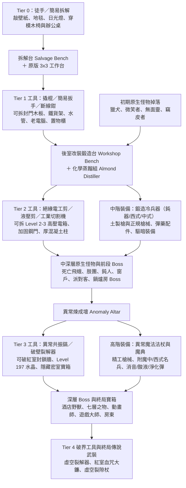

# 合成：資源、工具、武器、裝備與怎麼做

> 這一章說明後室裡能拿到哪些資源、能做出哪些工具、武器、裝備，以及在哪裡、用什麼做。標示說明見 [企劃書總目錄](../README.md)。
> 物品、合成系統、武器與家具主要是 Gemini（Antigravity）做的；這一章合併了他的合成企劃（原 `docs/企劃書/3-合成/`）、各層收集規劃（原 `docs/企劃書/3-合成/各層收集.md`）與原企劃書第 5、6 節。

## 這一章的檔案

| 檔案 | 內容 |
| --- | --- |
| **[配方與物品索引.md](配方與物品索引.md)** | **遊戲裡實際的全部配方**（依工作站分）＋**物品索引**（每樣東西怎麼來、拿去做什麼、哪隻怪物會掉）；由 `tools/make_recipe_docs.py` 從遊戲資料產生，跟遊戲永遠一致 |
| **[合成網狀圖.svg](合成網狀圖.svg)** | **合成網狀圖**：左邊是來源（怪物、原版材料、家具），越往右做得越深，線的顏色是在哪個工作站做的；用瀏覽器打開可以放大、可以 Ctrl+F 找物品 |
| [材料.md](材料.md) | 方塊拆解掉落、穿模家具、基礎與加工材料總表 |
| [各層收集.md](各層收集.md) | 每一層能破壞、收集的東西（Level 0、0.1、1、2、3，與之後的玻璃系列、魔法森林），加上原企劃書的 Level 0 物資表 |
| [工具與工作站.md](工具與工作站.md) | 1～4 階破壞工具、工作站、防具與消耗品 |
| [武器-冷兵器.md](武器-冷兵器.md) | 冷兵器：中世紀鈍器、西式、中式 |
| [武器-槍械.md](武器-槍械.md) | 槍械、彈藥、戰術配件 |
| [武器-魔法與寶箱.md](武器-魔法與寶箱.md) | 魔法與異常武器、樓層寶箱與 Boss 掉落對照 |
| [items/](物品圖/) | 每一件物品、方塊、防具的預覽圖（Gemini 產生，`tools/render_docs_items.java`） |

怪物的掉落與 Boss 見 [怪物](../4-怪物/README.md)。

## 重做方向【定，2026-11-26】

使用者決定合成表**整個重做**，但要等各層物件的建模都定了再開始。思考順序：

1. **每一層的物品敲掉會變成什麼**：先一層一層列出可破壞的物件與它們拆出來的資源（第 0 層的電影版家具已有第一版掉落，見 [Level 0 第八節](../5-樓層/Level0-大廳/README.md#八電影版家具店物件與展示間區定)）。
2. **同時列出要有哪些成品**：醫療物品有哪些、武器有哪些、工具、裝備……
3. **最後才設計怎麼互相組成**：資源怎麼合成成品、跨層的資源怎麼搭配。

另外（2026-11-28 定）：**各層的方塊敲掉掉材料，不掉方塊本身**（壁紙 → 紙、地毯 → 破布、日光燈 → 玻璃碎片與銅線）；只有床、工作台、箱子、家具這類玩家可以擺的照舊能撿回來。原因是方塊貼圖要改成只載入當層的（見 [樓層](../5-樓層/README.md) 的「做到 200 層以上的技術規劃」）。現在 350 種方塊敲掉會掉自己，重做時一起改；拆解台收各層方塊的配方也要跟著改。

在那之前，下面這些現有的工作站與配方照舊，不再加新配方。

## 工作站（現在遊戲裡的樣子）【已做】

| 工作站 | 格子 | 做什麼 |
| --- | --- | --- |
| 原版工作台 | 3×3 | 早期工具、粗糙繃帶、鎮靜草茶、基礎零件、工作站本身（擺得下 3×3 的基礎東西都在這裡做） |
| 後室拆解台 `salvage_bench` | 1 進 4 出 | 把家具、電器、方塊、怪物殘骸拆成材料 |
| 杏仁蒸餾化學組 `almond_distiller` | 3×3 | 杏仁精粹、藥劑、火藥、酸液、血清 |
| 異常煉成壇 `anomaly_altar` | 3×3 星陣 | 異常與魔法類 |
| 後室改裝鍛造台 `workshop_bench` | 5×5 | 冷兵器鍛造、槍械組裝、配件、彈藥、2 階工具、防具 |
| 初級蜘蛛網合成台 `spiderweb_crafting_table` | 7×7 | 高階裝備、終極蜘蛛網合成台本身 |
| 終極蜘蛛網合成台 `ultimate_spiderweb_crafting_table` | 9×9 | 終局 4 階配方 |

- 工作站畫面左邊有分類配方書（全／料／刃／槍／法／甲／具），可以拖曳捲動；點配方會在格子上顯示半透明的擺法，有「自動填入」。
- 裝了 JEI 可以查所有配方，按「+」一鍵填入。
- 實際有哪些配方、各幾條，見 [配方與物品索引.md](配方與物品索引.md)。

### 蜘蛛網合成台的配方邏輯（原企劃書）

- **中心**：後室的稀有核心（Boss 掉落、切出裂片、濃縮杏仁水）。
- **內環**：後室的功能零件與工業中間產物（電路板、計算磚、怪物掉落）。
- **外環**：**Minecraft 原版物資**（鐵錠、紅石、銅錠、黑曜石、終界珍珠、玻璃瓶、紫水晶等）。意思是用現實的物質把異常能量固定住，所以原版資源一直都有價值。
- **前室有限範圍下的原版物資供應【部分】**（補給商的原版材料與垃圾回收機已做；深層樓層的稀有原版核心等那些樓層）：前室戶外區提供基礎木頭與農作空間；鐵、銅、紅石等基礎礦物改由「研究所補給站兌換」與「研究所垃圾回收機（按趟結算拆解後室家具）」穩定供應；黑曜石、終界珍珠等稀有原版核心由中後期礦坑層與異界聯動樓層取得。

## 借鑑其他遊戲的子系統（原企劃書）

| 子系統 | 來自 | 內容 | 狀態 |
| --- | --- | --- | --- |
| 星級品質 | 《星露谷》《異星工廠 2.0》 | 物品有品質：普通 → 銀星 → 金星 → 紫星（異常）。影響消耗品效果、貿易品售價（紫星最多 3 倍）、做裝備時的加成 | 【未來】 |
| 工業零件與三色電路 | 《異星工廠》 | 齒輪、銅線圈、鋼板；綠板（Level 0 基礎電路）→ 紅板（中層塑膠＋綠板）→ 藍板（深層酸液＋紅綠板） | 【已做】物品與配方 |
| 研究瓶 | 《異星工廠》 | 黃瓶（大廳，解鎖 7×7 初級蜘蛛網）、灰瓶（軍事，解鎖 9×9 終極蜘蛛網）、紫瓶（空間，解鎖 9×9 悲屍化根治藥），投入前室研究所的研究終端按趟結算解鎖 | 【已做】 |
| 插件晶片 | 《異星工廠》 | 速度、產能、節能，插在研究所加工機或特定武器上 | 【部分】物品已有，效果還沒接 |
| 科技積木 | 《非生物因素》 | 電源磚、計算磚、控制器，讓大配方不用塞滿零散垃圾 | 【已做】物品與配方 |
| 工具分級拆解 | 《非生物因素》 | 前期徒手或普通工具敲家具只掉基本碎片；中後期用精密拆解螺絲起子，可以完整拆出風扇、電源供應器，甚至把整個檔案櫃打包帶回前室當倉庫 | 【部分】 |
| 密碼門駭客器 | 《非生物因素》 | 1～4 階，永久升級道具，用來開特殊樓層與前室研究所隱藏 B2 機密檔案室 | 【已做】B2 艙口、樓層門禁（`core/LevelGates`）、異常密室箱 |
| 加工致富（按趟結算）【定】 | 《星露谷》 | 異常蒸餾桶釀陳年杏仁露；垃圾回收機把破布、塑膠、鏡片與家具變成鐵／銅／紅石／鋼錠／電池；後期異常晶體複製機。**改為出門前投料、活著撤離回前室時依本趟層數結算產出**，不吃 5 天倒數掛機時間 | 【已做】（`core/locker/Processing.java`） |
| 收集包 | 《星露谷》 | 異常檔案修復板：繳交各層指定物資組合，永久解鎖便利功能（開局補給箱、快捷傳送、探測加成） | 【部分】方塊已有 |
| 封存盲盒 | 《星露谷》晶球 | 敲檔案櫃掉「鏽死辦公保險箱／加密硬碟」，帶回前室付費請商人打開，抽古物、舊幣、卷軸 | 【已做】收購商與黑市商人付費鑑定（`core/trade/Appraisal.java`） |
| 物品標籤 | 原企劃書 | 配方盡量用統一標籤（例如 `#noclip_backrooms:electronics`、`scrap_metal`、`office_junk`），之後加新材料可以直接接進舊配方 | 【已做】9 組標籤 |

## 跟恐怖方向的關係【定／待調數值】

- 武器與護甲定位已定案（見 [遊戲玩法](../1-遊戲玩法/README.md#7-裝備與武器在恐怖玩法下的定位原則) 與 [玩家能力值](../2-玩家能力值/README.md)）：日常求生與中高階裝備主打**反制怪物規則與控場／環境抗性**；高火力與 7×7／9×9 終局裝備專供**樓層 Boss 戰、深層極端區域與 30～60 秒撤離接應防守**，具體數值後續依此原則統一調整。
- 現場玩法道具與消耗品【已做】（2026-11-26，Claude，`core/field/`，圖示是簡單的 32 像素，Gemini 之後可以換成 3D 模型）：M.E.G. 拍立得、空間測繪信標、緊急封門木板、絆線警報器、便攜應急燈、粉筆、化學螢光棒、導引紅線、M.E.G. 無線電、個人置物櫃（方塊）。補給商都有賣；原版工作台配方：
  - 粉筆：2 骨粉＋黏土球；螢光棒 ×4：玻璃片、螢石粉、玻璃片（直排）；導引紅線：8 線圍 1 紅色染料；
  - 封門木板 ×4：木板與鐵粒（PNP／PNP）；絆線警報器 ×2：鐵粒、線；便攜應急燈 ×2：鐵錠、螢石粉、紅石；
  - 拍立得：鐵錠、玻璃片、紅石；測繪信標：銅錠、鐵錠、紅石磚、紫水晶碎片。
  - 照片與拓撲磁帶的價值寫在物品上，賣給收購商時照那個價。
- 配額系統用收購價表算點數（見 [遊戲玩法](../1-遊戲玩法/README.md)）【已做】：收購商已補上開放樓層怪物的樣本和「M.E.G. 失蹤小隊報告」（新道具，在各層補給箱裡）；後續現場取證照片、拓撲磁帶與各層筆記亦需同步納入收購與配額計算。
- 三種抑制藥（穩定劑、血清、穩定核心）只能暫時壓住症狀，不能延長期限、不能代替配額【已做】；**悲屍化根治藥**是 9×9 終極蜘蛛網終局配方（結局 A）【已做】。

## 整體進度科技樹（Tier 0 → Tier 4）

---

## 雙軌破壞與採集原則

為避免破壞後室建築感與建築黨體驗，採取**雙軌掉落規則**：
- **一般破壞（或持對應 Tier 工具）**：依方塊／穿模家具的拆解表掉落細緻素材（例如敲日光燈掉銅線＋燈管碎片＋螢光粉）。
- **精準採集（Silk Touch）**：掉落方塊本體，方便玩家帶回據點裝潢。
- **工具階級不足**：
  - 未持有對應 Tier 工具（由自訂方塊標籤 `noclip_backrooms:requires_tier_1` ～ `requires_tier_4` 控制）時，方塊挖掘速度極慢且**不掉落素材**，並在 ActionBar 提示所需工具類型（例如「需要撬棍或更高階工具拆解」）。
- **絕對不可破壞例外**：跨樓層出口門、EXIT 門、據點置物櫃與世界基岩外殼維持不可破壞。

---

## 遊戲內「獨立合成表」系統規格（《後室合成圖鑑》）

使用者要求合成表需獨立做出來，採用**「資料驅動＋內建獨立 UI＋相容 JEI/REI」**三合一架構：

1. **獨立資料來源（Single Source of Truth）**
   - 所有標準工作台配方照寫標準 Minecraft `data/noclip_backrooms/recipe/*.json`（確保玩家若安裝 JEI / REI / EMI 也能自動讀取）。
   - 進階工作站（拆解台、改裝鍛造台、化學組、異常煉成壇）皆實作為標準 Minecraft `RecipeType` ＋ `RecipeSerializer`，同樣以 JSON 存放在 `data/noclip_backrooms/recipe/`。
   - 額外補一份來源索引（自動從 LootTable / Recipe 掃描生成，不必人工維護兩份）：記錄每個素材來自「哪個方塊（需哪階工具）」、「哪隻怪／Boss」或「哪種樓層寶箱」。
2. **遊戲內獨立查詢 UI：《後室合成圖鑑（`backrooms_compendium`）》**
   - **開啟方式**：隨身書本道具（初次掉進 Level 0 或在據點／馬尼拉房間拾取，也能徒手用壁紙碎紙合成）**或按獨立快捷鍵（預設 `B`）直接開啟**。
   - **左側分類分頁**：
     1. 基礎與拆解素材
     2. 工具與工作站（依 Tier 0–4 排列）
     3. 中世紀鈍器
     4. 西式冷兵器
     5. 中式冷兵器
     6. 熱兵器、彈藥與配件
     7. 魔法與異常武器
     8. 防具、藥劑與求生道具
     9. 怪物圖鑑與掉落（含 Boss 與寶箱）
   - **右側詳情頁功能**：
     - 顯示完整合成格（自動依工作站類型切換 3×3 / 4×4 / 拆解 / 蒸餾 / 煉成版面）。
     - **點擊任一原料可直接跳轉**到該原料的下一層合成表或取得來源頁（支援返回上一頁歷史棧）。
     - 顯示「此素材可用於合成哪些成品（反查用途）」。
     - 支援中文／英文關鍵字搜尋與依樓層篩選（例如只看「Level 0–1 目前做得出的東西」）。

---

## Gemini 原本的分期路線（參考）

| 階段 | 範圍 | 目標 |
|---|---|---|
| **Phase 1（系統骨架）** | 拆解台、改裝台、Tier 1 工具（撬棍/扳手）、《合成圖鑑》UI 框架、Level 0/1 穿模家具 6 種、五大類各 2 把代表武器 | 在既有 Level 0 & 1 完整跑通「敲家具 → 拆素材 → 查圖鑑 → 做工具與武器 → 打獵犬」閉環 |
| **Phase 2（原生怪軍團）** | 第一批 8 種原生怪物（Blender `BoxRig` 統一風格）＋ 專屬掉落 ＋ 蒸餾組 ＋ Tier 2 工具與槍械彈藥鏈 | 補齊 Level 0–5 生態與完整槍械／冷兵器鍛造樹 |
| **Phase 3（異常與 Boss）** | 異常煉成壇 ＋ Tier 3 工具 ＋ 魔法武器全系 ＋ 前 5 隻樓層 Boss 與軍械／異常寶箱 | 銜接 Level 2–5、Level 37、Level 94、Level 188 等新樓層 |
| **Phase 4（深層終局）** | 第二批怪物、深層 Boss、Tier 4 破界工具與全部傳說武裝 | 貫通全 60 層規劃進度 |

---

## Gemini 的企劃書對齊紀錄（2026-11-25，對齊原企劃書與各層收集規劃）

為與最新版最高指導企劃書及各樓層拆解清單保持 100% 同步，系統已完成以下對齊與實裝（全數附帶 3D 模型、64×64 多材質貼圖、JEI 索引與中英文翻譯）：

- **新增第 5 座頂級工作站與 6 座主世界／中繼站設施**：`spiderweb_crafting_table`（超大型蜘蛛網合成台，融合後室核心＋科技積木＋原版物資，支援最高 9 格原料與獨立 JEI 分類）、`scrap_recycler`、`anomaly_distillery_barrel`、`anomaly_research_terminal`、`crystal_replicator`、`anomaly_archive_board`、`relay_dropoff_box`。
- **補齊 20 種 Level 0 與各層收集規劃的可破壞 3D 家具與變體方塊**：桌上型電腦（完好／損壞／穿模）、手機（完好／螢幕裂／穿模）、完好辦公椅、發霉雙人沙發（完好／穿模）、辦公室玻璃隔間（完好／破損）、倒扣折疊椅雜物堆、窗簾布堆、落地全身鏡、塑膠假盆栽、老舊電風扇、泛黃微波爐、落地立燈、生鏽壁掛舊急救箱、紙箱雜物山，均已接入拆解台配方。
- **補齊 73 種企劃書與樓層專屬物品**：
  - Level 0 辦公文具、家電零件與陽春醫療／糧食（破布、斷裂桌腳、一盒螺絲與釘子、絕緣膠帶、強力膠、訂書機、原子筆、橡皮筋球、雜誌、破碎鏡片、機殼風扇、靜電顯像管、閃爍日光燈管、鍵盤、室內電話、空塑膠瓶、無菌紗布、外用酒精、老舊 OK 繃、過期止痛藥、過期罐頭、壓縮餅乾、乾燥泥土與枯萎草藥、土製鎮靜飲品）。
  - 貿易品、盲盒、撤離與深層獎勵（雜訊錄音帶、遺失舊幣、鏽死辦公保險箱、加密硬碟、切出裂片、火鹽、笑魘發光眼珠、生鏽樓梯間鑰匙、樓層通行鑰匙卡、修復的復古終端機、陳年精釀杏仁露、單向歸鄉錨釘、禁忌知識卷軸×3）。
  - 《異星工廠》三色電路（綠／紅／藍板）、三色研究瓶（黃／灰／紫瓶）、三種插件晶片（速度／產能／節能），與《非生物因素》科技積木（電源磚、計算磚、控制器）、精密拆解螺絲起子、密碼門駭客器 Tier 1–4。
  - 早期實戰裝備（粗糙／消毒繃帶、土製燃燒瓶、戰術轉角鏡、辦公室十字弓＋原子筆金屬弩箭、靜電脈衝法杖、3D 穿戴雜誌膠帶護甲與消音地毯潛行靴）及各層收集規劃的汽車輪胎、橡膠輸送帶與六階玻璃系列。
- **統一物品標籤（`data/noclip_backrooms/tags/item/`）**：建立 `electronics`、`scrap_metal`、`office_junk`、`cloth`、`wood_scrap`、`glass_tier`、`circuits`、`science_packs`、`geodes` 共 9 組標籤。
